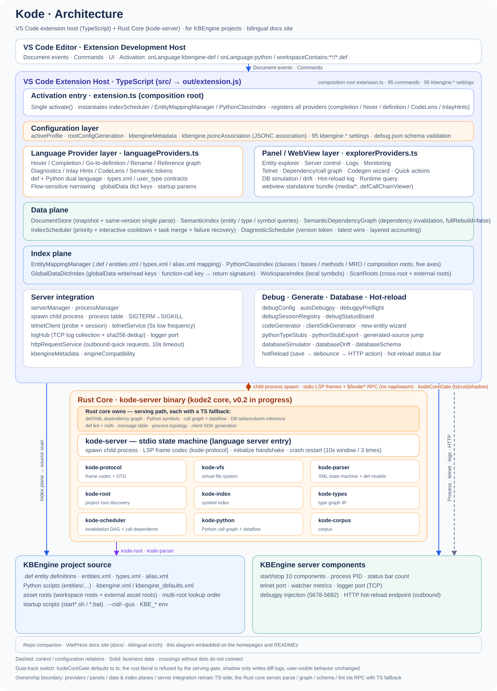
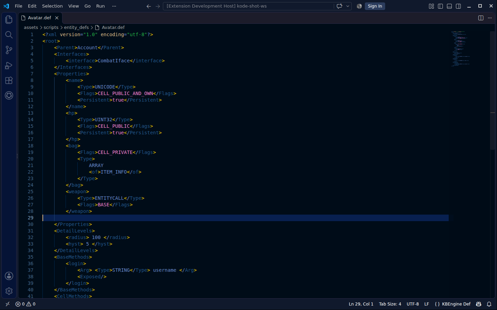
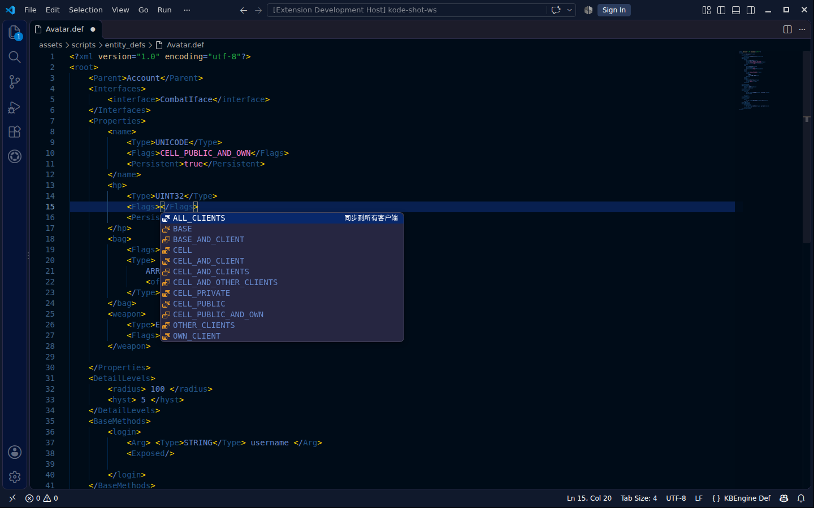
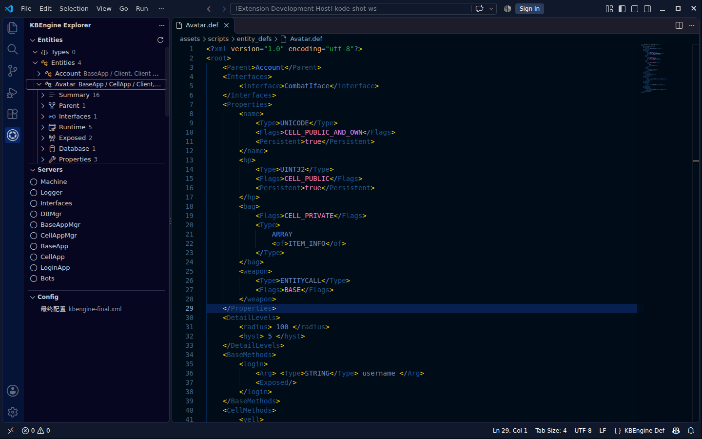
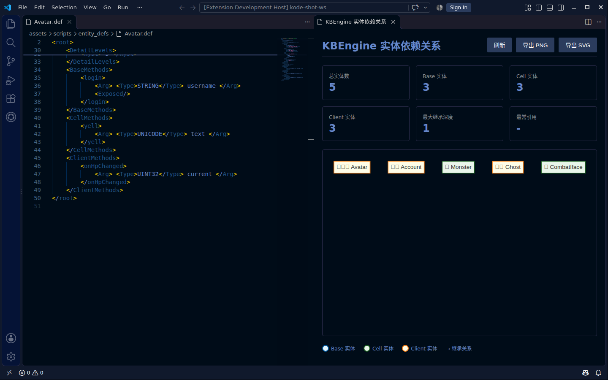
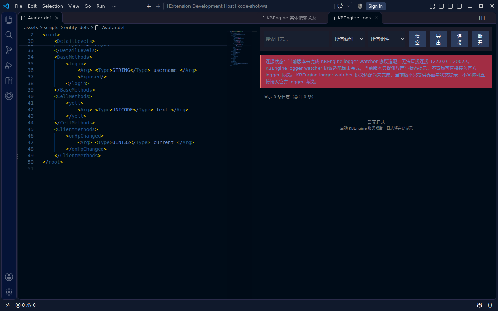
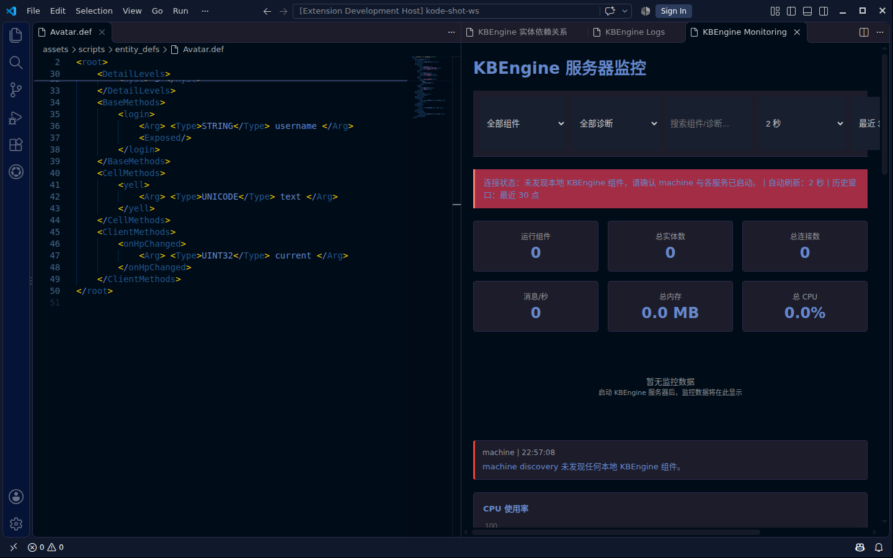

<p align="center"></p>

<h1 align="center">Kode — KBEngine Development Environment</h1>

<p align="center">
<a href="LICENSE"></a> <a href="https://code.visualstudio.com/"></a> <a href="https://www.typescriptlang.org/"></a> <a href="https://github.com/cuihairu/kode/blob/v0.2/docs/kode2/KODE_2_COMPLETE_TODO.md"></a> <a href="https://marketplace.visualstudio.com/items?itemName=cuihairu.kode-kbengine"></a> <a href="https://codecov.io/gh/cuihairu/kode"></a> <a href="https://cuihairu.github.io/kode/"></a>
</p>

[English](README.md) | [中文](README.zh.md)

<p align="center"></p>

> **Kode** (KBEngine Development Environment) - A VS Code development assistant extension for KBEngine

## Introduction

**Kode** is a VS Code extension that provides language support, navigation, and helper panels for the [KBEngine](https://github.com/kbengine/kbengine) game server framework.

KBEngine is an open-source MMO game server framework built on a distributed architecture. Kode targets KBEngine's entity definition (`.def`) files and provides syntax highlighting, completion, hover information, navigation, and diagnostics, along with panels for entity browsing, server control, logs, monitoring, and the dependency graph, plus a code generator.

## Daily Builds

The repository automatically builds from `main` every day and **publishes a rolling release** to [the `nightly` tag on Releases](https://github.com/cuihairu/kode/releases/tag/nightly): each build replaces the previous release's assets and notes (including build time, commit, and an asset table). The tag stays `nightly`; versioned releases (`v0.1.0`–`v0.1.3`) are cut manually from the released `0.1.x` line. The scheduled build skips automatically for that day when the default branch has no new commits within 48 hours. The build pipeline lives in [.github/workflows/daily-build.yml](.github/workflows/daily-build.yml).
| Asset | Platform | Install |
|------|------|------|
| `kode-nightly.vsix` | Windows / macOS / Linux (universal for VS Code ≥1.82) | Download and run `code --install-extension kode-nightly.vsix` |

> **Published on the VS Code Marketplace:** [cuihairu.kode-kbengine](https://marketplace.visualstudio.com/items?itemName=cuihairu.kode-kbengine)
>


## Testing Scope

CI and local development split into three paths by what changed — editing one line of docs should not trigger a full compile.

1. **Docs changes** (`*.md`, `docs/**`, images): no compile. The main CI
   workflow's `paths-ignore` already skips these paths.
2. **Code changes**: run only the touched subset, not the whole suite.
   - `pnpm test -- --testPathPatterns=<changed>`
3. **Full run** (`pnpm test`): triggered only by package.json / pnpm-lock.yaml,
   `.github/**`, Docker/Compose config changes, or before a release.

## Core Features

### Syntax Highlighting
- [Syntax highlighting for `.def` files]
- [Source-backed semantic highlighting for primitives/containers/detail values]
- [Highlighting for container types (ARRAY, FIXED_DICT, TUPLE)]
- [Source-backed Flags / DetailLevel highlighting]

### IntelliSense
- [Type auto-completion]
- [Flags suggestions]
- [DetailLevel suggestions]
- [XML tag suggestions]
- [**Hook method completion (36 hooks, each with its KBEngine source call-site location)**]

### Code Snippets
- [11 common .def templates + 4 Python hot-reload templates (snippets/kbengine-python.json) + 2 types.xml type-alias templates (ARRAY uses the engine's `<of>` syntax; engine-unregistered types such as BOOL/TUPLE have been removed)]
- [One-click insertion of property definitions]
- [Quick generation of method definitions]
- [Snippet generation from the selection (Generate Snippet from Selection, merged into `.vscode/kbengine-custom.code-snippets`)]

### Hover Documentation
- [Detailed type descriptions]
- [Explanations of Flags usage]
- [Usage recommendations]
- [**Hook documentation** (invocation timing, function signatures, usage examples, source locations)]

### Go to Definition
- [Navigate from `entities.xml` to `.def` files]
- [Quick location of entity definitions]
- [Def references (Shift+F12) across defs, including self-property access, receiver RPC calls and unsaved buffers]
- [Go to implementations for def methods]
- [Def outline document symbols and workspace symbol search]
- [Def-chain reveal on hover (`kbengine.hover.defChain`)]

### Refactoring
- [F2 renaming of properties/methods within .def files]
- [Updates every same-name declaration in the file, across all Flags-scope variants]
- [Auto-syncs restatements in descendant defs along the Parent chain and Interfaces mixins]
- [Honest boundary: covers only .def definitions and references; Python-side references and entities.xml/types.xml are not touched]
- [Cross-file def rename: reads dirty `.def` buffers, validates input versions, rejects on name conflicts, syncs resolved Python references and receiver-matched RPC calls]

### Syntax Checking
- [Real-time syntax validation]
- [Source-verifiable Flags / DetailLevel / required-field validation]
- [Type validity checking]
- [Def↔Python method consistency (`kbengine.diagnostics.checkDefMethodMissingInPython` / `checkPythonMethodNotInDef`) with lint and a quick-fix code action]
- [Process topology validation (`kbengine.diagnostics.checkProcessTopology`)]

### Entity Explorer
- [Sidebar listing of all entities]
- [Entity type badges (Cell/Base/Client)]
- [Quick navigation]

### Hooks System
- [36 KBEngine entity script callbacks (verified one by one against the engine source; entries without a source basis were removed)]
- [10 categories: lifecycle, database & archiving, movement, space, teleport, trap, Cell, visibility, control, client]
- [Complete hook documentation and usage examples]
- [Source location annotations]

### Hot-Reload Support
- [Hot-reload code snippets (4, snippets/kbengine-python.json, available in Python files)]
- [KBEngine.reloadScript() suggestions]
- [importlib.reload() hot reload in Python scripts]
- [Reload-related hover documentation and usage examples]
- [Hot-reload status bar: Off → Ready → Sending → Sent(unverified) → Failed; a clean completion is only "sent, unverified" (no receipt check); click the item to open the hot-reload audit log]
- [Hot-reload receipts: accepted ≠ applied — only an engine-confirmed receipt counts as applied; otherwise the outcome stays "sent, unverified" (three-path transport_ok ≠ accepted ≠ applied)]
- [Multi-target hot-reload batch summary (`kbengine.hotReload.showBatchSummary`) and retry-failed-only (`kbengine.hotReload.retryFailed`)]
- [Hot-reload revision evidence with sources (`kbengine.hotReload.showRevisionEvidence`); drift evidence saved per engine version]
- [Structural `.def` changes are blocked from auto-reload and marked restart-required]
- [Temp-edit hot-reload quick action (`kbengine.hotReload.tempEdit.run`): temporary edit → optional auto-restore → reloadScript → result echo; settings `kbengine.hotReload.tempEdit.*`]

### Server Management
- [Start/stop control for 10 components]
- [Live status display (stopped/starting/running)]
- [Process PID display]
- [Per-component log output]
- [Status bar running-component count]
- [Custom paths and environment variables]

### Log Viewer Integration
- [logger connection entry point with status notes]
- [WebView-based visualization]
- [Multi-level filtering (level, component, keyword)]
- [Regular-expression search]
- [Log export (txt/log/json formats)]
- [Color-coded log levels]

The logger protocol adaptation is not finished yet; the extension states clearly that this capability is not yet supported instead of pretending the official protocol is connected.

### Embedded Python Debugging
- [Custom debug configuration (.kbengine/debug.json)]
- [debug.json treated as JSONC: `files.associations` wired automatically (own key only, never overwrites; `kbengine.jsoncAssociation`)]
- [Per-component debug settings]
- [Automatic launch.json generation]
- [Guided debug enablement via telnet prompts]
- [Start-time debugpy injection (`kbengine.debug.autoDebugpy`, default off): telnet `:python` layer, per-component ports 5678-5682; `kbengine.python.debugpySync` places the package in `<assets>/scripts/common/debugpy`]
- [Attach to KBEngine component processes by PID]
- [Path mapping configuration]
- [Per-instance debugpy ports for named targets; debugpy preflight on the selected interpreter]
- [Attach deadline and cancel guard; debug-session end behavior (`kbengine.debug.sessionEndBehavior`)]
- [Remote servers over SSH (`kbengine.remoteServers.*`): remote process picker, remote attach (`kbengine.debug.attachRemote`), path mappings]
- [py-spy profiling (`kbengine.debug.pyspyDump`) and debug status in the workbench]
- [Launch targets in dependency order with cycle detection, a real readiness probe, per-targetId instance separation, and process-tree kill]

### Monitoring Panel
- [Runtime monitoring based on machine + watcher]
- [CPU, memory, entity counts, and verified watcher metrics]
- [System overview cards]
- [Per-component detail cards]
- [Visual charts (bar and line charts)]
- [Data export (JSON format)]

Monitoring data requires both `machine` discovery and `watcher` queries. When the watcher does not respond, the panel keeps only the basic state returned by machine instead of dressing missing watcher metrics up as complete telemetry.

### Python ↔ Def Two-Way Navigation
- [Entity definition mapping manager]
- [Jump from generated Python files back to .def definitions]
- [IntelliSense in Python files (completion of properties and methods)]
- [Automatic scanning and mapping]
- [Multiple Python generation path configurations]

### Entity Dependency Graph
- [Automatic analysis of entity inheritance]
- [Visual entity dependency graph (Mermaid.js)]
- [Shows Base/Cell/Client entity types]
- [Statistics panel (entity count, maximum depth, most-referenced entities)]
- [Jump from the graph to entity definition files]
- [Graph export (PNG/SVG formats)]

### Code Generator
- [Entity creation wizard (step-by-step guidance)]
- [10 predefined templates (account, avatar, NPC, item, monster, scene, guild, team, mail, empty entity)]
- [Automatic .def generation (KBEngine-compliant format)]
- [Automatic Python generation (with hook methods)]
- [Automatic entity registration in entities.xml]
- [Custom property and method definitions]
- [Configurable output paths and options]
- [Preflight all generation targets before writing; plan preview with confirmation; atomic replace; roll back partial generation on failure]
- [Refuse to overwrite existing `.def`/Python files in the wizard; generate an empty implementation for unimplemented def methods]

### Telnet Probe and Session Integration
- [Status bar + server control panel status lamps (connected / open / password rejected / off, etc.)]
- [Three-tier configuration: settings / the kbengine.xml `<telnet_service>` section / the engine's default port table for the seven components]
- [Low-frequency probing (5s by default); probe connections are destroyed immediately, never held]
- [Automatic handshake login when the port is open; the password goes only through the socket and never into logs]
- [Panel command input (whitelist + built-in read-only quick commands) with session output echo]
- [Honest "telnet off" notice with the kbengine.xml enablement snippet when the port is closed]

### HTTP Quick Requests
- [`kbengine.httpRequests` settings list: name / URL template / method / headers / body / enable switch / keybinding hint, with one bundled example (disabled by default) shaped after the default hot-reload endpoint — `curl -X POST 'http://127.0.0.1:8090/hotfix?module_name=entities.fight.FightAI' -d 'module_name=entities.fight.FightAI'` (`module_name` is carried in both the query and the body so either server implementation reads it; the duplicated same value is harmless)]
- [Custom template variables: `${module}` (module path scanned along `__init__.py` package boundaries — `entities/fight/FightAI.py` → `entities.fight.FightAI`; `base`/`cell` role directories have no `__init__.py` and do not count, so the module name falls back to the bare file name), `${moduleBasename}` (last segment only, `FightAI`), `${filename}` (file name), `${line}`, `${sel}`; substituted literally, no URL encoding]
- [Official VS Code variable family also resolves in templates (`${file}`=absolute path, `${workspaceFolder}`, `${fileBasenameNoExtension}`, `${env:NAME}`, ...); placeholders unknown to both tables are kept as-is]
- [Two trigger paths: the command-palette quick pick, or a keybinding on `kbengine.httpRequest.run` with `args.name` via keybindings.json — open a .py file and press the shortcut to fire a hot reload]
- [Execution log goes to the OUTPUT channel "KBEngine HTTP 快捷请求": `▶` request line → `✓` status · duration · response body; failures show a `✗` marker + error notification, with honest reporting and no hanging]

### Rust Core (kode2)

A Rust core runs alongside the TypeScript extension and speaks the same LSP surface over stdio; the backend is selectable and reversible:

- [Dual-track backend (`kbengine.core.backend`: `ts` | `rust` | `shadow`): `ts` = TypeScript serves (default), `rust` = Rust serves, `shadow` = Rust computes and compares but TypeScript still serves; switch back to `ts` at any time]
- [Shadow diff log (`kbengine.core.showShadowDiffLog`) reports Rust-vs-TypeScript divergence per feature surface]
- [Rust-ported def analysis: message table (`message_table.rs`), dependency graph, component semantics, database tables, def MD5 replay, process topology, client SDK generation, and the KBEngine wire-format codec (`wire_codec.rs`)]
- [Cargo workspace crates: `kode-server` (LSP), `kode-parser`, `kode-types`, `kode-index`, `kode-scheduler`, `kode-root`, `kode-vfs`, `kode-python` (ruff AST call graph and dataflow), `kode-corpus`]

### Message Table & Client SDK

- [Entity message-table preview (`kbengine.messagetable.preview`) and JSON export (`kbengine.messagetable.export`)]
- [Client SDK generation (`kbengine.clientSdk.generate`) bound to the active profile (`kbengine.clientSdk.outputDir`), with engine trace in the output and message-number audit against the engine]

### Database Schema & Drift

- [Read-only table preview (`kbengine.database.previewTable`) with query cancel and timeout lifecycle (`kbengine.databaseQueryTimeoutMs`)]
- [Schema impact preview (`kbengine.database.previewSchemaImpact`); result columns are linked back to def sources]
- [Drift check (`kbengine.database.checkDrift` / `checkAllDrift`) with evidence review (`kbengine.database.showDriftEvidence`) and simulation (`kbengine.database.simulate` / `exportSimulation`)]
- [Isolated DB connections per profile (`kbengine.database.open`) and table prefix (`kbengine.db.tablePrefix`)]

### Project Profiles & Remote Servers

- [Project identity store with profiles (`kbengine.project.create` / `import` / `doctor` / `selectActive`; `kbengine.profile.start` / `kbengine.profile.health`); the index follows profile switches]
- [Remote servers over SSH (`kbengine.remoteServers.add` / `select` / `refresh`): remote process picker, remote debug attach, py-spy]

### Python Tooling

- [Per-file Python type stubs (`.pyi`) with alias resolution (`kbengine.python.exportStubs` / `exportTypeStubs`; `kbengine.python.stubDir` / `stubExport` / `stubEngineTypings`)]
- [Def call-chain view (`kbengine.python.showCallChain`) and call-chain inlay hints (`kbengine.python.callChainHints`)]
- [Python test discovery and run (`kbengine.tests.list`) and the build task provider (`kbengine.build.previewTask`)]
- [Python language service status check (`kbengine.python.serviceStatus`)]

### Inlay Hints & Type Inference

- [Def parameter inlay hints (`kbengine.inlayHints.defParams`) and type-data inlay hints (`kbengine.inlayHints.typeData`)]
- [Hover return-type inference (`kbengine.hover.returnTypeInference`) and Python builtin type inlay hints (`kbengine.python.builtinTypeInlayHints`)]
- [Data-dict key access index (`kbengine.python.enableDataDictIndex`) and engine-aware API metadata (`kbengine.python.apiMetadata`)]

### Telemetry, Metrics & Profiling

- [Language-service metrics summary (`kbengine.metrics.showSummary`) and active-task counts (`kbengine.metrics.showActiveTasks`)]
- [Extension host CPU profile capture (`kbengine.metrics.startCpuProfile` / `stopCpuProfile`); host CPU/RSS vitals, event-loop delay, and file-read detail (`kbengine.metrics.fileReadDetail`)]
- [Reproduction config export (`kbengine.diagnostics.exportReproSummary`) and extension identity report (`kbengine.extension.identity`)]

## Def Performance Analysis

Runs a static check over all `.def` files in the workspace and reports optimization suggestions (execute **`Analyze Def Performance`** from the command palette; the report goes to the `KBEngine Def 分析` output panel and also lands in the Problems list as diagnostics):

- Engine-unregistered types (e.g. `BOOL`/`TUPLE`) — entity loading fails
- Properties missing a valid `<Type>`, or redundant definitions with multiple `<Type>` tags on one property
- Sync-cost hints for heavy-payload types (strings/BLOB/containers/PY_*/VECTOR) broadcast to `ALL_CLIENTS`
- Redundant `DetailLevel` fields on properties without client-visible flags
- Property/method names that are Python keywords, or a method colliding with a property name in the same file
- Property/method/component-slot names hitting the engine's limited-name list (`ENTITY_LIMITED_PROPERTYS`) — entity loading fails
- Inheritance-chain name collisions (`Parent` chain and `Interfaces` mix-ins). The engine installs child, parent and interface descriptions into one module, so a property or component-slot name collides on overlapping flag domains, a property and a method collide anywhere, methods collide only inside the same section, and a component slot collides with any same name — entity loading fails in every case

## Installation

> **Published on the VS Code Marketplace:** [cuihairu.kode-kbengine](https://marketplace.visualstudio.com/items?itemName=cuihairu.kode-kbengine)
>
> To skip local builds, grab `kode-nightly.vsix` from the [Daily Builds](#daily-builds) section; otherwise build from source and install locally as follows.

### Build from Source and Install Locally

```bash
# Clone the repository
git clone https://github.com/cuihairu/kode.git

# Install dependencies
cd kode
pnpm install

# Compile
pnpm run compile

# Package (vsce package produces a .vsix)
pnpm run package

# Install locally
code --install-extension kode-kbengine-*.vsix
```

## Documentation

- Configuration and usage documentation lives in [docs/](./docs/)
- The configuration reference is the highlight: [docs/guide/configuration.md](./docs/guide/configuration.md)
- The project ships a VitePress documentation site; preview it locally with `pnpm run docs:dev`

## Versioning

The released line is `0.1.x`, last release `v0.1.3`. `main` currently carries the `0.2.0` WIP line (Rust core); no `v0.2.x` tag exists yet.

## Screenshots

### Syntax Highlighting and IntelliSense




### Entity Explorer


### Dependency Graph


### Log Viewer and Monitoring Panel




## Development

### Requirements

- Node.js `^20.19.0 || >=22.12.0` (the version in `.nvmrc` is recommended)
- Git
- VS Code 1.82.0 or later

### Development Steps

```bash
# 1. Clone the repository
git clone git@github.com:cuihairu/kode.git

# 2. Install dependencies
cd kode
pnpm install

# 3. Open the project in VS Code
code .

# 4. Press F5 to start debugging
# A new VS Code window opens (the Extension Development Host)

# 5. Exercise the features in that window
```

### Project Structure

```
kode/
├── src/
│   ├── extension.ts              # Main entry point
│   ├── languageProviders.ts      # Language features
│   ├── explorerProviders.ts      # Tree views and navigation
│   ├── kbengineMetadata.ts       # KBEngine metadata
│   └── ...
├── syntaxes/
│   ├── kbengine.tmLanguage.json  # Syntax highlighting rules
│   └── kbengine-color-theme.json # Color theme (KBEngine Dark)
├── snippets/
│   ├── kbengine.json             # def snippets (11)
│   ├── kbengine-python.json      # Python hot-reload snippets (4)
│   └── kbengine-types-xml.json   # types.xml type-alias snippets (2)
├── crates/                       # Rust core workspace (kode-server/parser/types/...)
├── tests/                        # vitest functional tests
├── docs/                         # VitePress documentation site
├── resources/
│   └── docs/                     # Project documents
├── .vscode/
│   └── launch.json               # Debug configuration
├── package.json                  # Extension configuration
├── tsconfig.json                 # TypeScript configuration
└── README.md                     # This file
```

### Testing

```bash
# Run the tests
pnpm test

# Compile
pnpm run compile

# Watch-mode compile
pnpm run watch

# Documentation
pnpm run docs:dev
```

## Usage Documentation

For detailed usage documentation and development guides, see:

- [VitePress documentation](./docs/) - the current documentation entry point
- [Design document](./resources/docs/vscode-extension-design.md) - the original project design
- [Quick start](./resources/docs/vscode-extension-summary.md) - developer guide
- [Naming proposal](./resources/docs/plugin-name-suggestions.md) - brand design

## Testing Architecture

A two-runner, layered test setup: vitest carries all functional tests (`tests/`, including a pure-logic layer, a local KBEngine simulator layer, and an assembly/WebView panel layer on top of fake-vscode stubs — all green without a real KBEngine environment); mocha (`src/test/suite/`, 11 cases) only smoke-tests the compiled artifacts, verifying that the packaged `out/extension.js` activates cleanly. With a KBEngine source checkout present, line-by-line "plugin data vs engine source" verification cases are added automatically. See [TESTING.md](./TESTING.md) and the [redesign notes](./docs/redesign.md) for details.

```bash
pnpm test           # Full suite: vitest + compile + mocha smoke tests
pnpm test:unit      # vitest only (green with no engine and no VS Code download)
pnpm test:coverage  # vitest + coverage
```

## Contributing

Contributions are welcome! See [CONTRIBUTING.md](./CONTRIBUTING.md) for details.

### Contributing Guide

1. Fork the repository
2. Create a feature branch (`git checkout -b feature/AmazingFeature`)
3. Commit your changes (`git commit -m 'Add some AmazingFeature'`)
4. Push to the branch (`git push origin feature/AmazingFeature`)
5. Open a Pull Request

## License

This project is licensed under Apache-2.0 - see the [LICENSE](LICENSE) file for details.

## Acknowledgements

- [KBEngine](https://github.com/kbengine/kbengine) - an excellent game server framework
- [VS Code](https://github.com/microsoft/vscode) - the host editor for this extension
- All contributors

## Contact

- GitHub Issues: [https://github.com/cuihairu/kode/issues](https://github.com/cuihairu/kode/issues)
- Email: cuihairu@gmail.com

## Star History

If this project helps you, consider giving it a star.

---

Latest release v0.1.3, published to the Marketplace as `cuihairu.kode-kbengine`. 121 commands and 110 configuration settings are in place; the feature catalog in [COMPLETED_FEATURES.md](./COMPLETED_FEATURES.md) is a 0.1.x snapshot, and [TESTING.md](./TESTING.md) carries the testing record.

### Demo hot reload receiver

The demo includes Base/Cell HTTP receivers using xreload adapted for Python 3.7.3. The official console channel uses KBEngine.reloadScript. Verified receipts can show an applied state; delivery alone stays unconfirmed. See the [implementation and verification guide](docs/design/demo-hot-reload.md) for setup, ports and limitations.
