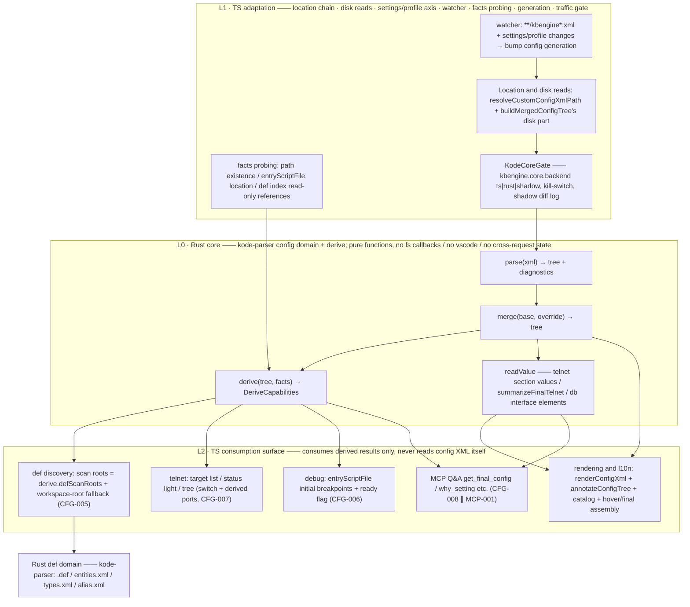

# kode Config-First Architecture and the Rust/TS Layering Boundary (KODE-CFG-001 · Review Draft)

> Status: **review draft**. This document precedes the code; implementation
> starts only after review passes, and the implementation must align with this
> document's wording item by item, reusing the repo's existing vocabulary
> (`$/kode/rpc`, `RpcRegistry`, `KodeCoreGate`, shadow comparison,
> kill-switch, `bumpRootConfigGeneration`, `DeriveCapabilities`, etc.) — no
> new coinage. Unimplemented surfaces are honestly marked "not implemented"
> in the text and never dressed up as implemented.
>
> Task source: `todo.md` KODE-CFG-001 (user directive 2026-11-03, P1); the
> follow-up entries KODE-CFG-002…009 take this document as their yardstick
> for implementation and acceptance.

## 1. Requirements and boundary

1. **Single source of truth**: config XML **parsing / merging / derivation**
   moves into the Rust core (a new config domain + derive in
   `crates/kode-parser`); TS no longer holds a second set of parsing or
   merging semantics.
2. **TS-retained surfaces**: rendering (the `renderConfigXml` family),
   comment injection (`annotateConfigTree`), the l10n copy library
   (`serverConfigCatalog`, 253 entries), VS Code command/tree/hover/virtual
   document assembly, the settings chain, and file watching — all stay in TS.
3. **The config-first pipeline**: parse the configuration first → **derive**
   four capability kinds from configuration features (`DeriveCapabilities`):
   - def discovery scan roots (derived from the `server/kbengine.xml` hit
     segment: truncate at `rfind("res")` and append `scripts/`,
     `resmgr.cpp:489-499`; workspace-root fallback);
   - the telnet section switch + per-component ports;
   - per-process `entryScriptFile` → debug initial breakpoints;
   - the debug ready flag.
4. **Consumption channel**: always through the existing kode-protocol — the
   `$/kode/rpc` registry of `crates/kode-server` (`RpcRegistry`) + LSP stdio
   (`src/kodeCoreClient.ts` / `src/kodeCoreGate.ts`). No new IPC, no second
   chain.
5. **Q&A exit**: the MCP tool (KODE-CFG-008, parallel with MCP-001) consumes
   only the results of this design's channels; it must not carry its own
   second parser.
6. **Non-goals**: no change to the def parser's semantics
   (`.def`/`entities.xml`/`types.xml`/`alias.xml`); no migration of the
   VS Code presentation surface to Rust; no touching the engine start chain
   (debugpy attaches to a process; startup remains the engine launcher —
   `entryScriptFile` only serves **derived breakpoints** and file validation,
   not as a startup command parameter).

## 2. Current-state check (must be re-verified before implementation; line numbers re-measured 2026-11-05)

### 2.1 Config domain (pure TS, `src/`)

| Surface | Location | Current-state fact |
|---|---|---|
| `parseConfigXml` | `src/serverConfigMerge.ts:62` | Regex-tolerant parsing: strips `<!-- -->` and `<? ?>` first, pseudo-root (empty-name nodes), unclosed/extra-closed tags tolerated against seen content without throwing; returns `null` when there are no child nodes |
| `mergeConfigXml` | `src/serverConfigMerge.ts:164` | Children aligned by name: override missing → keep base, present → whole-name replace (repeated-name `<item>` = whole-table replace); one on each side both with children → recurse deeper |
| `renderConfigXml` | `src/serverConfigMerge.ts:211` | Tab indentation; comments always placed **inside the element** (leaves: after the value — the forensics that tinyxml2 `IntText()` only accepts a first child node as text is written in the `serverConfigAnnotations.ts` file header) |
| `sanitizeXmlComment` / `renderConfigXmlSections` | `src/serverConfigCommentText.ts:11` / `src/serverConfigMerge.ts:281` | Comment sanitization (`--` suppression, split into commentText to prevent cycles) / top-level section concatenation |
| `resolveCustomConfigXmlPath` | `src/serverConfigMerge.ts:292` | Location chain: setting `kbengine.assetsRoot` → auto-discovered root → workspace convention path; the profile surface only accepts the profile asset root and never falls back (IDE-REV-015 isolation) |
| `buildMergedConfigTree` | `src/serverConfigMerge.ts:389` | Assembly: defaults + component `kbengine.xml` located and read from disk → parse → merge, supporting `MergedConfigTreeOverrides` (profile-axis overrides) |
| `buildFinalServerConfig` | `src/serverConfigMerge.ts:451` | Assembly: merged tree → `annotateConfigTree` → `renderConfigXmlSections`, with a header comment stating sources and override rules |
| `extractDatabaseInterfaceConfig` | `src/serverConfigMerge.ts:511` | dbmgr `<databaseInterfaces><default>` value reading (pure function), including the engine-default fallback and the encrypt rule |
| `resetDatabaseInterfaceConfigCache` / `resolveDatabaseInterfaceConfig` | `src/serverConfigMerge.ts:547` / `:552` | Cache key = `workspaceRoot + binPath` (**no profile axis**, see §7.3) |
| `summarizeFinalTelnet` | `src/serverConfigMerge.ts:619` | Regex reads the final config's telnet port/password (strips comments from the whole section before `Number()`, preventing `<!-- --> 40000` → NaN) |
| `ConfigXmlNode` | `src/serverConfigMerge.ts:29` | Tree-node DTO: `name/text/children` + render-time-only `comment/docHeader` |
| Copy library | `src/serverConfigCatalog.ts:81` | `SERVER_CONFIG_ITEM_DOCS` **255 entries** (measured grep count), bilingual zh/en + `source` (`kbe/res/server/kbengine_defaults.xml:line` provenance) + `group` |
| Grouping | same file `:34`/`:50` | Top-level section name = process name (serverconfig.cpp forensics); the grouping's primary axis = process |
| Comment injection | `src/serverConfigAnnotations.ts:97` | `annotateConfigTree`: scoped comments (per language) + custom-item categorization + document header note |
| Hover copy | `src/serverConfigHover.ts:20` | A separate `SERVER_CONFIG_FIELD_DOCS` field-description table (overlaps the catalog; reconciliation assigned to CFG-009) |

### 2.2 Telnet surface (`src/telnetService.ts`)

- `ENGINE_DEFAULT_TELNET_PORTS` (`:37`) — the **hard-coded** component default
  port table (an engine-semantics constant living in TS).
- `parseKbengineXmlTelnet` (`:70`) / `parseKbengineDefaultsTelnet` (`:104`) —
  two regex readers of the telnet section, which together with
  `summarizeFinalTelnet` form **three value-reading implementations**.
- `deriveEngineDefaultsXmlPath` (`:139`) — strips `kbe/bin/server` from
  `binPath` and builds the defaults path.
- `buildTelnetTargets` (`:164`) — explicit setting port > component
  `kbengine.xml` section > defaults fill-in > hard-coded table; **telnet not
  enabled in config → empty targets** (batch 111: the defaults'
  `telnet_service` section is always present — it only fills values and never
  acts as the switch).
- `readTelnetTargetsFromSettings` (`:233`) — reads VS Code settings.
- `readTelnetSettings` (`telnetService.ts:233`, extracted in CFG-007) — reads
  `kbengine.telnet.host/port/password/enableCommands`.
- Target list (**delivered in CFG-007**): `readDerivedTelnetTargets` in
  `src/telnetDeriveTargets.ts` is the target-reading entry at the extension
  wiring site — when derivation is available (the `configDerive` state
  includes `derive.telnet`) it takes the derived half (`buildDerivedTelnetTargets`:
  port/component name from derived endpoints, host/password/whitelist from
  settings overrides); when derivation is unavailable, or an explicit port has
  `port>0`, or the target is password-protected and settings don't override
  the password, it falls back to `readTelnetTargetsFromSettings` (the old
  path reads the same config; the port agrees with derivation, the password
  source differs).
- Consumption: `extension.ts:2842-2852` wires TelnetService (getTargets
  swapped to `readDerivedTelnetTargets`) + `setContext('kbengine.telnetConfigured')`.

### 2.3 def domain (pure Rust, `crates/kode-parser`)

- `lib.rs` self-description: byte-level `.def`/`entities.xml`/`types.xml`/
  `alias.xml` parser; iron rules "zero third-party crates except
  cryptography" and "any input never panics" (mutation spot checks in
  `tests/blind.rs`).
- The two domains are currently **zero-dependency and acyclic**: TS does not
  import Rust artifacts for config parsing, and Rust does not read config
  files.

### 2.4 Channel foundations (already exist; this design reuses them)

- `crates/kode-server/src/rpc.rs`: `$/kode/rpc` single-arm dispatch +
  `RpcRegistry` (BTreeMap, panic on duplicate registration, enumerable via
  `methods()`); **handlers are pure functions, params passed straight from
  the TS side (TS already read disk), returning JSON or Err (Err → TS
  fallback, not treated as a Rust assertion failure)**.
- `crates/kode-server/src/server.rs:186`: the top-level match admits only the
  serving surfaces (`textDocument/*`, `$/kode/health|wait|rpc`); new command
  surfaces do not extend it.
- `src/kodeCoreGate.ts`: `kbengine.core.backend` = `ts|rust|shadow` (default
  `ts`; illegal values always fall back to `ts` — the kill-switch can always
  be pulled back); shadow = same-parameter mirror + short-timeout comparison
  + difference logging (`ShadowVerdict`), **always returning the TS result;
  Rust never serves users directly** (ph0-gate gate 3).

### 2.5 def discovery / debug current state (where derivation lands)

- Scan roots `src/scanRoots.ts:115` `getIndexScanRoots` = workspace top level
  ∪ `assetsRoot` ∪ auto-discovered roots ∪ profile-selected root (dedupe by
  path + containment pruning); **currently reads no XML configuration**.
- **The `pyResPath` config key does not exist (engine source actually
  surveyed; the original forensics gap is closed)**:
  - All keys measured in `kbengine.xml` are `account_registration/
    account_resetPassword/account_system/backupPeriod/baseapp/databaseInterfaces/
    databaseName/dbmgr/debug_type/default/enable/host/loginAutoCreate/publish/
    root/script_version/state/trace_packet` — **zero path/directory-type keys**;
    `kbengine_defaults.xml` likewise has none (only `entity_posdir_*` matches
    "dir", meaning entity facing).
  - Paths are **determined entirely by environment variables**:
    `Resmgr::initialize` (`resmgr.cpp:134-141`) reads
    `KBE_ROOT`/`KBE_RES_PATH`/`KBE_BIN_PATH`; when all three are empty,
    `autoSetPaths()` (`resmgr.cpp:66-70`) reverse-derives the root from
    `/kbe/bin/` and hard-codes the four segments
    `kbe/res/; assets/; assets/scripts/; assets/res/`.
  - **Derivation chain (the real source of def scan roots)**:
    `matchRes("server/kbengine.xml")` hits the respaths segment
    (`resmgr.cpp:453-487`) → `getPyUserScriptsPath()` truncates that segment
    at `rfind("res")` and appends `scripts/` (`resmgr.cpp:489-499`) → that is
    the def scan root; inversely, `getPyUserAssetsPath()` removes `/scripts`
    to get the assets root (`:557-567`). **The anchor is the `res` suffix;
    `assets/res` and `assets/scripts` are sibling directories** — the config
    file header note self-certifies: `({assets}/res/server/kbengine.xml)`.
- `entryScriptFile` derivation (**delivered in CFG-006**): TS resolves entry
  facts in `ensureConfigDerivedScanRoot` (`resolveEntryScriptFacts`: config
  `assetsRoot` → `findEngineEntryScript` convention finding `kbengine.py`
  sibling to `scripts/entity_defs`, with `exists` reported honestly, a single
  baseapp/kbengine fact); Rust derives `derive.entryScripts` = facts passed
  straight + `derive.debug.reasons` containing "entry script missing: p/m";
  `src/entryScriptBreakpoint.ts` calls `addBreakpoints` per the derived
  result (line 0 of the entry script) when a port-mode/attach debug target
  starts; a missing entry → no pre-fill + a diagnostic. The existing
  `findEngineEntryScript` (`src/debugpyWaitAtStartup.ts:56`) still finds
  `kbengine.py` sibling to `scripts/entity_defs` by convention, reads no
  config, and guesses no location (thin-shelling assigned to CFG-009).
- `telnet` derivation (**delivered in CFG-007**): in
  `ensureConfigDerivedScanRoot`, TS reads and parses the component
  `kbengine.xml` + engine `kbengine_defaults.xml` into two trees via
  `buildConfigTreePair` and hands them to Rust (core never touches disk);
  `derive.telnet` = section switch (the component `<telnet_service>` section
  present) + per-component derived ports (explicit port → single target
  marked `kbengine.xml`; no port → defaults fill-in > hard-coded table) +
  the `passwordSet` boolean; `readDerivedTelnetTargets` in
  `src/telnetDeriveTargets.ts` is the target-list consumption entry (at the
  extension wiring site): when derivation is available it takes
  `buildDerivedTelnetTargets` (port/component name from derived endpoints,
  host/password/whitelist from settings overrides); when derivation is
  unavailable / explicit port / password-protected and not overridden it
  falls back to `readTelnetTargetsFromSettings` (the old path reads the same
  config; ports agree with derivation). The derived half of the existing
  `buildTelnetTargets` remains as a fallback (thin-shelling assigned to
  CFG-009).
- Debug ready has **no flag**; `debugpyWaitAtStartup` (IDE-DBG-004) is a
  startup-block injection switch, a different thing from this design's
  "config-derived readiness".
- Config change watching: `extension.ts:4303`
  `createFileSystemWatcher('**/kbengine*.xml')` →
  `resetDatabaseInterfaceConfigCache` + synthesized-document refresh; setting
  changes go through `onDidChangeConfiguration` with per-item invalidation +
  `bumpRootConfigGeneration(...)` (`extension.ts:2172/2191`).

### 2.6 Existing test assets (the ledger for no-regression migration; measured `it()` counts)

`tests/serverConfigMerge.test.ts` 29 cases, `tests/serverConfigAnnotations.test.ts`
23 cases, `tests/serverConfigHover.test.ts` 9 cases; additionally
`tests/kbengineDemoAssets.test.ts` runs parse+merge against a real
`kbengine.xml` template.

## 3. Layering and dependency direction

### 3.1 Three-layer definition

- **L0 · Rust core** (`kode-parser` config domain + derive): `parse` / `merge`
  / `derive` / `readValue`. **Pure functions** — inputs passed in one shot
  (text, paths, TS-probed facts), no fs callbacks, no vscode, no cross-request
  state, never panics (the crate's existing iron rules).
- **L1 · TS adaptation**: the location chain (`resolveCustomConfigXmlPath`),
  disk reads, the settings chain and the profile axis, file watching and
  `generation`, facts probing (path existence, entry-file location), and the
  `KodeCoreGate` traffic switch.
- **L2 · TS consumption**: def discovery, telnet targets, debug
  breakpoints/ready, hover/final/db assembly, rendering/comments/l10n, MCP
  Q&A. **Rule: L2 never reads config XML itself; it consumes only L0
  results.**

### 3.2 Dependency direction diagram



14 nodes (3 subgraph clusters not counted); 15 edges.

### 3.3 Acyclicity argument

1. **The call direction is only L1 → L0**. L0 is a callback-free pure
   function whose inputs (config text, facts, profile-axis parameters) are
   passed in one shot; it holds no references to L1/L2, so L0 cannot emit an
   edge pointing upward — the upper layers cannot be "called back" by L0, and
   the back edge of a cycle does not exist even at the type level.
2. **The data direction L0 → L2 is only return values**. L2's discipline is
   "never read config XML itself"; its only contact with configuration is
   handing results to the VS Code API (trees, status lights, breakpoints,
   diagnostics). Recomputation is triggered by L1 events (watcher /
   `onDidChangeConfiguration` / profile switches) bumping the generation →
   another L1 → L0 call — still the same direction.
3. **Between the two domains: one-way and zero-dependency**: the config
   domain (added by this design, inside `kode-parser`) **does not import def
   domain modules**; the def domain's inputs are file texts and **reads no
   configuration** (scan roots are passed in by L1). Thus "config → def" is a
   pure one-way data flow — no reverse dependency exists between modules
   within the crate or across crates, and §2's "two domains zero-dependency
   acyclic" stays true after migration.
4. **The chicken-and-egg cycle is cut by facts**. The only temptation toward
   a cycle is "derive needs def results to know where `entryScriptFile`
   lands / whether a scan root is valid" → this design rules: core **issues no
   requests to the def domain**; def-side facts (path existence, entry-file
   location, def-index read-only references) are statically probed by L1 and
   passed in as `facts` inputs; on absence, L2 falls back (workspace root) +
   degrades diagnostics, **no back edge** (see §7.4).
5. **MCP is an L2 consumer**: it only reads channel results; core does not
   depend on MCP, nor on the process MCP lives in.

## 4. Per-function ownership table

Ownership takes exactly one of three values: **Rust core** (semantics move
into core, produced via the channel) / **TS retained** (stays in TS and does
not relay core semantics through the channel) / **consume via channel**
(implements no semantics; fetches data only via `$/kode/rpc`).

| # | Group | Function/symbol | Location | Current duty (one line) | Ownership | Migration entry / basis |
|---|---|---|---|---|---|---|
| 1 | Parsing | `parseConfigXml` | `serverConfigMerge.ts:62` | Strip comments/PI, pseudo-root, tolerant parse | **Rust core** | CFG-002; semantic alignment list in §7.1 |
| 2 | Merging | `mergeConfigXml` | `:164` | Child-name alignment, whole-name replace, single-container recursion | **Rust core** | CFG-003; byte-level comparison |
| 3 | Rendering | `renderConfigXml` | `:211` | Tab layout, comments inside elements | **TS retained** | Presentation rules; tinyxml2 forensics lives on the TS comment side |
| 4 | Rendering | `sanitizeXmlComment` | `serverConfigCommentText.ts:11` | Comment sanitization (`--` suppression) | **TS retained** | Render-time only |
| 5 | Rendering | `renderConfigXmlSections` | `:281` | Top-level section concatenation | **TS retained** | Same as above |
| 6 | Location | `resolveCustomConfigXmlPath` | `:292` | Settings→discovery→workspace convention location chain | **TS retained** | VS Code settings/profile/discovery exist only in TS |
| 7 | Assembly | `buildMergedConfigTree` | `:389` | Location + disk read + parse + merge assembly | **TS retained** (disk/location) + **consume via channel** (parse/merge half) | Split: text goes through the channel, location stays in TS |
| 8 | Assembly | `buildFinalServerConfig` | `:451` | annotate+render assembly, source header note | **TS retained** | Presentation assembly; data comes from #7's channel result |
| 9 | Read value | `extractDatabaseInterfaceConfig` | `:511` | dbmgr connection element reading (pure function) | **Rust core** | Read-value semantics single source; the `plainPassword` rule migrates with it |
| 10 | Cache | `resetDatabaseInterfaceConfigCache` | `:547` | Cache invalidation | **TS retained** | watcher/settings event wiring is on the VS Code side |
| 11 | Cache | `resolveDatabaseInterfaceConfig` | `:552` | Cache key + assembly of the read | **TS retained** | Cache and settings reading; profile axis added to the key, see §7.3 |
| 12 | Presentation | `KBE_CONFIG_SCHEME` / `KBE_CONFIG_VIRTUAL_PATH` / `FinalConfigContentProvider` / `FinalConfigTreeProvider` | `:569`/`:572` (providers `:578`/`:593`) | Synthesized-config virtual documents and sidebar entries | **TS retained** | Virtual documents are a VS Code surface |
| 13 | Read value | `summarizeFinalTelnet` | `:619` | Regex reads telnet port/password | **Rust core** | CFG-004; the three read implementations (#13/#21/#22) merge into one |
| 14 | DTO | `ConfigXmlNode` | `:29` | Tree-node structure | **Rust core** (produces) | Shape frozen as §5 `ConfigTreeDto`; TS read-only, never rewrites |
| 15 | Comments | `annotateConfigTree` | `serverConfigAnnotations.ts:97` | Scoped comment injection, custom-item categorization | **TS retained** | Comments/l10n are a presentation surface, depending on #17's copy library |
| 16 | Comments | Grouping primary axis/process categorization (file-private) | same file | Top-level section = process name | **TS retained** | Presentation grouping, not in core |
| 17 | Copy | `SERVER_CONFIG_ITEM_DOCS` (255 entries) | `serverConfigCatalog.ts:81` | Bilingual copy + `source` provenance + `group` | **TS retained** | l10n single source; MCP `why_setting` references it |
| 18 | Copy | `SERVER_CONFIG_GROUPS` / `SERVER_CONFIG_GROUP_ORDER` / meta | `:34`/`:50` | Grouping and ordering | **TS retained** | Presentation metadata |
| 19 | Copy | `isZhConfigLanguage` / `configItemDocBody` / `findServerConfigItemDoc` / `SERVER_CONFIG_UNKNOWN_DOC` | `:341`–`:387` | Copy lookup and unknown-item fallback | **TS retained** | Same as above |
| 20 | Copy | `SERVER_CONFIG_FIELD_DOCS` | `serverConfigHover.ts:20` | Hover field descriptions | **TS retained** | Overlap with #17 reconciled under CFG-009 (not mandatory in this design) |
| 21 | telnet | `parseKbengineXmlTelnet` | `telnetService.ts:70` | Component `kbengine.xml` telnet section reading | **Rust core** | CFG-004 |
| 22 | telnet | `parseKbengineDefaultsTelnet` | `:104` | defaults telnet reading | **Rust core** | Dedupe with #13/#21 (three regex implementations exist today) |
| 23 | telnet | `deriveEngineDefaultsXmlPath` | `:139` | `binPath` → defaults path | **TS retained** | Settings derivation; `binPath` is a VS Code setting |
| 24 | telnet | `buildTelnetTargets` | `:164` | Split in two: section switch + port derivation / settings overrides + host + command whitelist | **Rust core** (derived half) + **TS retained** (settings half) | CFG-007 **delivered** (the derived half enters `telnetDeriveTargets.ts` via `derive.telnet`; the settings half and the old-path fallback remain); the "defaults section is never the switch" rule migrates verbatim |
| 25 | telnet | `readTelnetTargetsFromSettings` | `:233` | VS Code settings reading | **TS retained** | Settings surface |
| 26 | telnet | `ENGINE_DEFAULT_TELNET_PORTS` | `:37` | Hard-coded component default port table | **Rust core** | Engine-semantics constants enter core; TS keeps no copy — obtained via #24's derived result |
| 27 | def discovery | `getIndexScanRoots` / `getExternalScanRoots` / `resolveAssetsRootForWorkspace` | `scanRoots.ts:115`/`:162`/`:67` | Root set = workspace ∪ assetsRoot ∪ discovered roots ∪ profile root | Split: config-derived roots take `derive.defScanRoots` (**Rust core**); existence/dedupe/containment pruning stays **TS retained** | CFG-005 |
| 28 | debug | `findEngineEntryScript` | `debugpyWaitAtStartup.ts:56` | Finds `kbengine.py` by convention path (reads no config) | **Rust core** (convention fallback of default derivation) + **TS retained** (existence check) | CFG-006; the default derivation without config shares one source with config derivation |
| 29 | debug | `entryScriptFile` derivation (**delivered in CFG-006**) | `entryScriptBreakpoint.ts` + `configDerive.ts` `resolveEntryScriptFacts` | Entry module location → breakpoint targets (facts probed by TS, `derive.entryScripts` passed straight, `addBreakpoints` line 0) | **Rust core** (derives entryScripts/debug) | CFG-006; breakpoints are derived targets, not startup commands |
| 30 | debug | debug ready flag (**not implemented**) | — | Config parseable + derivation with no fatal gaps → ready | **Rust core** (computes) + **TS retained** (status bar/tree display) | CFG-004 |
| 31 | def domain | `kode-parser` `xml/model/dep/diag/json` | `crates/kode-parser/src/*` | Byte-level def parsing | **Rust core** (untouched) | This design does not change its semantics; the config domain is a **new sibling module** and does not import def modules |
| 32 | Consumption sites | hover / final documents / db read / telnet targets / def discovery / MCP tools | `extension.ts:4059`, `profileDatabaseConnection.ts:69` etc. | Currently call #7/#11 etc. directly | **Consume via channel** | CFG-009 switches to the channel; all fetches via `$/kode/config/*` |

**32 rows** total (#1–#32). Ownership distribution (measured counts): pure
**Rust core** 10, pure **TS retained** 16, pure **consume via channel** 1
(#32), mixed rows split between core+TS 5 (#7, #24, #27, #28, #30 — split
rules written in the notes column).

## 5. kode-protocol message design

### 5.1 Channel choice

- Take the **`$/kode/rpc` registry** (precedent in
  `crates/kode-server/src/rpc.rs`: pure-function handlers, TS already read
  disk, Err → TS fallback), **do not extend `server.rs`'s top-level match**
  (that is the `textDocument/*` serving surface), **do not add LSP methods**
  (configuration is not a textDocument surface).
- Registration follows the existing incremental pattern: each config-domain
  unit has `pub fn register(reg: &mut RpcRegistry)` hung with one line in
  `ServerState::new()` — an increment touches only its own module + one line
  in `server.rs`.
- Method names (registry keys, stable and unchanging):

| method | params | result | Purpose |
|---|---|---|---|
| `$/kode/config/parse` | `{ xml }` | `{ tree, diagnostics }` | Single-text parse; **comparison surface** (CFG-002) |
| `$/kode/config/merge` | `{ base, override }` | `{ tree }` | Two-tree merge; **comparison surface** (CFG-003) |
| `$/kode/config/derive` | `{ tree, facts }` | `{ derive, diagnostics }` | Derivation; **comparison surface** (CFG-004) |
| `$/kode/config/resolve` | see §5.2 | see §5.2 | **One round trip** for parse+merge+derive+readValue, preventing generational mismatch from segmented fetches |
| `$/kode/config/summarizeTelnet` | `{ tree }` | `{ endpoints }` | Standalone telnet quick view (for comparison; the serving surface goes through `resolve`) |

`resolve` is the default fetch entry for hover/final/db/telnet/def/debug/MCP;
the three fine-grained methods serve only comparison and unit tests — no
direct user-facing calls.

### 5.2 The `$/kode/config/resolve` contract

Request params (TS → Rust; TS already read disk, core never touches disk):

```jsonc
{
  "generation": 42,              // TS-side config generation; echoed back as-is so TS can drop stale responses
  "files": {
    "defaults": { "path": "/…/kbe/res/server/kbengine_defaults.xml", "text": "…" },
    "custom":   { "path": "/…/res/server/kbengine.xml", "text": "…" }   // null when absent
  },
  "profile": {                    // an input parameter for path derivation/fallback only, not a VS Code object
    "engineBinPath": "…", "assetsRoot": "…"
  },
  "workspaceRoot": "/…",
  "facts": {                      // TS static-probe results; core issues no queries (§3.3-4)
    "existingScanRoots": ["…"],          // roots probed and actually existing
    "entryScriptFiles": [                // per-process entry location (TS located via conventions/index)
      { "process": "baseapp", "module": "kbengine", "path": "…", "exists": true }
    ]
  }
}
```

Result (Rust → TS):

```jsonc
{
  "generation": 42,               // echoed; TS drops on mismatch
  "sources": { "defaultsPath": "…", "customPath": "…|null",
               "customApplied": true, "defaultsOnly": false },
  "diagnostics": [                // reuses the kode-parser diag::Diagnostic shape
    { "code": "CFG001", "severity": "warning", "message": "…", "span": null }
  ],
  "tree": { "name": "", "text": "", "children": [ /* ConfigTreeDto, shape = ConfigXmlNode */ ] },
  "derive": {
    "defScanRoots": { "roots": ["…"], "fallback": "workspaceRoot", "degraded": false },
    "telnet":       { "enabled": true,
                      "endpoints": [ { "component": "baseapp", "host": "127.0.0.1",
                                       "port": 40000, "passwordSet": true } ] },
    "entryScripts": [ { "process": "baseapp", "module": "kbengine",
                        "path": "…", "exists": true } ],
    "debug":        { "ready": true, "reasons": [] }      // when not ready, reasons carry readable causes
  },
  "telnetSummary": [ { "component": "baseapp", "port": 40000, "passwordSet": true } ],
  "dbInterface":   { "host": "…", "port": 3306, "username": "…", "databaseName": "…",
                     "encrypt": false, "characterSet": "utf8mb4",
                     "plainPassword": "…" }               // always null when encrypt=true (§2.1 #9 rule)
}
```

Conventions:

1. **DTO shape frozen**: `tree` is the JSON-isomorphic form of the current
   `ConfigXmlNode` (`name/text/children`; `comment/docHeader` **never crosses
   the channel** — comment injection is TS render-time behavior, core
   produces no presentation comments).
2. **Pull model, no Rust → TS push**: file watching lives on the VS Code side
   (watcher + settings events); change → `bump` config generation → TS
   re-`resolve`s. Core installs no fs watcher, avoiding lifecycle and
   process-exit races (§7.3).
3. **Sensitive values**: `password` / `plainPassword` are needed by local
   IPC, telnet connections, and drift checks, so results **may carry them**;
   but diff logs, diagnostics copy, and MCP echoes must **never echo
   plaintext** (shadow-diff truncated values must be masked).
4. **Error rules**: handler `Err` → the `$/kode/rpc` standard error codes
   (`-32601` unregistered / `-32602` input or internal error); TS falls back
   to the previous-generation snapshot or an empty result as unavailable,
   **never crashing the command** — consistent with rpc.rs's existing
   conventions.
5. **The config domain hangs off the existing traffic gate**: no new
   `kbengine.config.backend`; reuse `kbengine.core.backend`
   (`ts|rust|shadow`, default `ts`), with shadow diff logs filed under the
   `method` prefix `$/kode/config/*` — avoiding semantic drift between two
   switches (§7.2).

## 6. Old-implementation retirement list and migration steps

### 6.1 Three steps (order is not reversible)

**Step 1 · Comparison first (CFG-002, CFG-003, first half of CFG-004)**
The Rust config domain + derive land with **TS unchanged by a single line**.
Dual-run comparison on the same corpus:

- Corpus: the real `kbengine_defaults.xml` + the real `kbengine.xml` template
  (test cases already exist in `tests/kbengineDemoAssets.test.ts`) + synthetic
  documents with comments (the 406–460 discipline of
  `tests/serverConfigAnnotations.test.ts`) + bad inputs (unclosed, repeated
  `<item>`, `<?xml?>`, JSONC-style comments).
- Comparison: `parse`/`merge` result trees **deep-compared**; `render` does
  not migrate, so the render comparison = feeding the Rust tree to the
  existing TS `renderConfigXmlSections` and comparing output **byte-for-byte**
  with current output.
- Channels: the three fine-grained methods `$/kode/config/parse|merge|derive`
  are exactly the comparison surfaces; diff logs use the existing
  `ShadowDiffEntry` shape of `KodeCoreGate` (distinguished by method prefix).

**Step 2 · Switch the channel (second half of CFG-004, CFG-005/006/007, first half of CFG-009)**
`buildMergedConfigTree` internally switches to fetching via
`$/kode/config/resolve`, gated by `kbengine.core.backend`: `ts` = the old
implementation direct; `shadow` = dual-run recording differences, always
returning the TS result; `rust` = takes effect only after the serving gate
opens (rejections maintained until ph0-gate gate 3 is fully green).
Consumers switch one by one: hover/final → db read → telnet targets → def
discovery → debug breakpoints/ready → MCP. Each switch keeps the old path
behind the gate for rollback.

**Step 3 · Retirement (second half of CFG-009)**
Gate fully green + zero unexplained differences during the coexistence
period: delete the TS parse/merge/read implementations, **downgrade to
compatibility thin shells**, then delete the shells (order in 6.2).
Acceptance: `grep` shows no dual implementations, full test suite green.

### 6.2 Old-implementation retirement list

| Old implementation | Action | Order/condition |
|---|---|---|
| `parseConfigXml` (`serverConfigMerge.ts:62`) | Delete implementation → **compatibility thin shell** (keep the exported signature, internally relay to `$/kode/config/parse`, marked deprecated) → delete the shell after tests migrate | Downgrade to shell at the end of step 2; delete in step 3 |
| `mergeConfigXml` (`:164`) | Same, relay to `$/kode/config/merge` | Same |
| `summarizeFinalTelnet` (`:619`) | Delete → shell relays `resolve.telnetSummary` | Step 3 |
| `parseKbengineXmlTelnet` / `parseKbengineDefaultsTelnet` (`telnetService.ts:70`/`:104`) | Delete; reading merges into core (#21/#22) | Step 3 |
| `ENGINE_DEFAULT_TELNET_PORTS` (`:37`) | Delete the TS copy; the core constant is the sole source | Step 3 |
| `buildTelnetTargets` (`:164`) | Split: delete the derived half, retain the settings half | Step 2 |
| `extractDatabaseInterfaceConfig` (`:511`) | Delete implementation → shell relays `resolve.dbInterface` | Step 3 |
| The config-derived scan-root half of `getIndexScanRoots` | The old workspace/assetsRoot chain remains as fallback, derived results take priority | Step 2 (CFG-005) |
| `findEngineEntryScript` (`debugpyWaitAtStartup.ts:56`) | The convention fallback merges into core's default derivation; the function downgrades to a thin shell | Step 2 (CFG-006) |
| `renderConfigXml` / `renderConfigXmlSections` / `sanitizeXmlComment` | **Not migrated, not deleted** (TS-retained surface) | — |
| `annotateConfigTree` / `serverConfigCatalog` / hover copy | **Not migrated, not deleted** | — |
| `resolveCustomConfigXmlPath` / `buildFinalServerConfig` / `resolveDatabaseInterfaceConfig` / cache and watcher wiring | **Not migrated** (location/cache/watching stay in TS); only internal fetches switch to the channel | Step 2 |

Thin-shell rule: the shell does only "relay to the channel + on Err fall back
to the old semantics' mirror constants (if any)" — it must **never
re-implement any parse/merge/read branch** — otherwise it counts as dual
implementation not retired (acceptance rule).

## 7. Risks

### 7.1 Comparison mismatches (highest probability)

Known difference surfaces between the regex TS implementation and the
byte-level Rust implementation: comment and `<? ?>` strip timing; the two
candidate layers of pseudo-root vs `<root>` wrapping; text concatenation
rules (TS joins with spaces and skips the pseudo-root); repeated-name
`<item>` whole-table replace vs interleaving; where unclosed/extra-closed
tolerance lands; the NaN rules of `trim` and `Number()`; comment placement
relative to leaf values (the engine's `IntText()` reading).
**Mitigation**: §6.1 corpus dual-run + byte-for-byte render comparison; while
both implementations coexist, bug fixes **must be made on both sides with one
test each** (preventing the silent drift of "fixed Rust, forgot TS");
differences are filed per `ShadowVerdict`, and step 3 does not start before
`diff`s are explained.

### 7.2 The dual-implementation coexistence period

Risk: the two implementations evolve separately, retirement recedes
indefinitely, or shadow becomes a formality (the `ts` default leaves the Rust
surface without real load indefinitely).
**Mitigation**: a single switch `kbengine.core.backend` (no second switch);
the coexistence period is time-boxed into CFG-009's acceptance (`grep` dual
implementations = zero); shadow diff logs hook into the existing health
surface (the diff broadcast of `kodeCoreGateWiring`); the `rust` literal
keeps serving rejections until the gate opens, with user-visible behavior
byte-identical to `ts` mode (the iron rule of no traffic switching).

### 7.3 Config change timing / file watching

Three gaps in the current state:
1. The `**/kbengine*.xml` watcher cannot cover the engine's
   `kbengine_defaults.xml` **outside the workspace** (derived from `binPath`,
   usually outside) — defaults changes trigger no refresh;
2. `resolveDatabaseInterfaceConfig`'s cache key = `workspaceRoot + binPath`
   with **no profile axis** (different values when `MergedConfigTreeOverrides`
   are overridden, yet the same key);
3. Invalidation points for setting changes (`binPath`/`configPath`/
   `assetsRoot`) and profile switches are scattered across multiple branches
   of `onDidChangeConfiguration`.

**Mitigation**: each `resolve` has TS `stat` the two input files for mtime
and pass them in params (core judges cache hits by
`(defaultsMtime, customMtime, profileKey, generation)`); unify one config
generation (reusing `bumpRootConfigGeneration` semantics with a new `config`
axis) that watcher, settings events, and profile switches all bump; results
echo `generation`, TS drops stale responses; out-of-workspace defaults cannot
be watched → provide a manual refresh command + an every-call mtime stat
fallback (reading two small files costs far less than re-indexing).

### 7.4 Chicken-and-egg (def discovery ↔ config validation)

Risk: def discovery trusts the config-derived scan roots, while config
validation (e.g. whether `entryScriptFile` lands inside a valid script root)
needs def results — a cycle means the two wait on each other.
**Break (already in §3.3-4)**: workspace-root fallback
(`derive.defScanRoots.fallback`) + static forensics (facts probed by TS `fs`
and passed in; core queries no def); root absent → `degraded: true` +
degrading diagnostics, **not blocking indexing, no retries, no back edge**;
entry file absent → diagnostic + `exists: false`, no breakpoint pre-fill
(CFG-006's two acceptance tests cover this).

### 7.5 Others

- **Performance**: defaults at hundreds of KB parsed fully each time — cache
  by §7.3's mtime+generation; parsing lives in the existing kode-server
  process, no new IPC frames.
- **Sensitive values**: see §5.2-3 (the channel may carry them; logs and MCP
  echoes must not carry plaintext).
- **MCP parallelism (CFG-008 ∥ MCP-001)**: the two tasks share channel
  results; the MCP layer does only Q&A copy and provenance assembly (the copy
  lives in the TS catalog — exactly MCP's l10n surface). If MCP carries its
  own parsing, it violates "single source of truth" — listed as an acceptance
  veto item.
- **Scan-root forensics complete (the original pyResPath gap closed, see §2.5)**:
  that config key does not exist. CFG-005 implements per the surveyed chain —
  `derive.defScanRoots` = locate the `server/kbengine.xml` hit segment →
  truncate at `rfind("res")` → append `scripts/`; on hit failure (no
  kbengine.xml, insufficient respaths segments, path absent) it goes
  `degraded` + workspace-root fallback, inventing no scan roots. **Do not
  look for `pyResPath` in the implementation.**
- **Forensics gap closed**: `entryScriptFile` derivation and the debug ready
  flag are implemented (CFG-004 derived debug readiness + CFG-006 entry
  breakpoints) — the engine entry-module loading-point survey conclusion
  (`entity_app.h:509` `PyImport_Import`, default module name `kbemain`,
  `kbengine_defaults.xml:238/274`) remains as background; `entryScriptFile`
  semantics are defined per §2.5 as the **shared bootstrap module**
  `scripts/kbengine.py` (sibling of entity_defs, resolved by
  `findEngineEntryScript`), a different concept from `entryHooks`' per-component
  `kbemain.py`.

## 8. Acceptance checklist (KODE-CFG-001)

- [x] Dependency direction diagram (config → def/telnet/debug one-way + acyclicity argument) → §3.2 diagram, §3.3's five arguments
- [x] Per-function ownership table for `parseConfigXml`/`mergeConfigXml`/`renderConfigXml` → §4 (32 rows, including `summarizeFinalTelnet`, catalog, annotations)
- [x] Old-implementation retirement list and migration steps (comparison first → switch the channel → retirement, compatibility shells) → §6
- [x] kode-protocol message design (parse request/result/derive capability structures) → §5
- [x] Risks section (comparison mismatches, dual-implementation coexistence, config change timing/file watching) → §7

Related entries: CFG-002/003 (§6.1 step 1), CFG-004 (§5, §3.2),
CFG-005/006/007 (§4 #27–#30, §7.4), CFG-008 (§1-5, §7.5), CFG-009 (§6.2).
