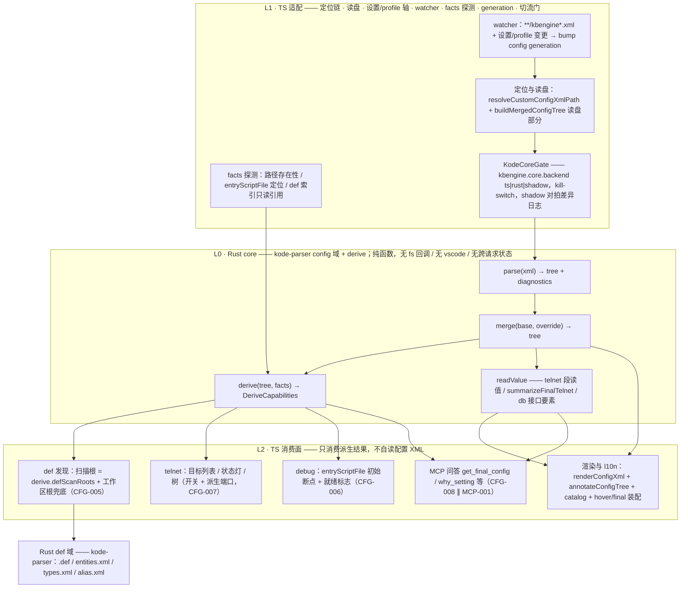

# kode 配置先行架构与 Rust/TS 分层边界（KODE-CFG-001 · 评审稿）

> 状态：**评审稿**。本文档先于代码，评审通过后再动实现；实现必须逐条对齐本文措辞，
> 复用本仓既有词汇（`$/kode/rpc`、`RpcRegistry`、`KodeCoreGate`、shadow 对拍、
> kill-switch、`bumpRootConfigGeneration`、`DeriveCapabilities` 等），不新造术语。
> 未实现的面在文中如实标注「未实现」，绝不写成已实现。
>
> 任务来源：`todo.md` KODE-CFG-001（用户令 2026-11-03，P1）；后续条目
> KODE-CFG-002…009 的实现与验收以本文为准绳。

## 1. 需求与边界

1. **单一真源**：配置 XML 的**解析 / 合并 / 派生**收进 Rust core（`crates/kode-parser`
   新增 config 域 + derive），TS 不再持有第二套解析或合并语义。
2. **TS 留存面**：渲染（`renderConfigXml` 系）、注释注入（`annotateConfigTree`）、
   l10n 文案库（`serverConfigCatalog` 253 条）、VS Code 命令/树/hover/虚拟文档装配、
   设置链与文件监视——全部留 TS。
3. **config-first 管道**：先解析配置 → 按配置特性**派生**四类能力（`DeriveCapabilities`）：
   - def 发现扫描根（由 `server/kbengine.xml` 命中段推导：`rfind("res")` 截断后拼
     `scripts/`，`resmgr.cpp:489-499`；工作区根兜底）；
   - telnet 段开关 + 逐组件端口；
   - 逐进程 `entryScriptFile` → 调试初始断点；
   - debug 就绪标志。
4. **消费通道**：一律走既有 kode-protocol——`crates/kode-server` 的 `$/kode/rpc`
   注册表（`RpcRegistry`）+ LSP stdio（`src/kodeCoreClient.ts` / `src/kodeCoreGate.ts`），
   不新造 IPC，不加第二条链路。
5. **问答出口**：MCP 工具（KODE-CFG-008，与 MCP-001 并行）只消费本设计的通道结果，
   不得自带第二套解析。
6. **非目标**：不改 def 解析器（`.def`/`entities.xml`/`types.xml`/`alias.xml`）语义；
   不迁 VS Code 展示面到 Rust；不动引擎启动链（debugpy 挂进程，启动仍是引擎 launcher，
   `entryScriptFile` 只是**派生断点**与文件校验，不是启动命令参数）。

## 2. 现状核对（实现前必须复核；行号为 2026-11-05 复测）

### 2.1 配置域（纯 TS，`src/`）

| 面 | 位置 | 现状事实 |
|---|---|---|
| `parseConfigXml` | `src/serverConfigMerge.ts:62` | 正则容错解析：先剥 `<!-- -->` 与 `<? ?>`，伪根（空名节点），标签不闭合/多余闭合按已见内容容错、不抛；返回 `null` 当无子节点 |
| `mergeConfigXml` | `src/serverConfigMerge.ts:164` | 子键按名对齐：override 无则留 base、有则整名替换（重复名 `<item>` 整表替换）、两边各一个且都有子节点则递归下钻 |
| `renderConfigXml` | `src/serverConfigMerge.ts:211` | tab 缩进；注释一律放**元素内部**（叶子放值之后——tinyxml2 `IntText()` 只认首子节点为文本的取证写在 `serverConfigAnnotations.ts` 文件头） |
| `sanitizeXmlComment` / `renderConfigXmlSections` | `src/serverConfigCommentText.ts:11` / `src/serverConfigMerge.ts:281` | 注释消毒（`--` 压制，已拆至 commentText 防循环）/ 顶层段拼接 |
| `resolveCustomConfigXmlPath` | `src/serverConfigMerge.ts:292` | 定位链：设置 `kbengine.assetsRoot` → 自动发现根 → 工作区约定路径；profile 面只认 profile 资产根、绝不回落（IDE-REV-015 隔离） |
| `buildMergedConfigTree` | `src/serverConfigMerge.ts:389` | 装配：defaults + 元件 `kbengine.xml` 定位读盘 → parse → merge，支持 `MergedConfigTreeOverrides`（profile 轴覆盖） |
| `buildFinalServerConfig` | `src/serverConfigMerge.ts:451` | 装配：merge 树 → `annotateConfigTree` → `renderConfigXmlSections`，头注写来源与覆盖口径 |
| `extractDatabaseInterfaceConfig` | `src/serverConfigMerge.ts:511` | dbmgr `<databaseInterfaces><default>` 读值（纯函数），含引擎默认兜底与 encrypt 口径 |
| `resetDatabaseInterfaceConfigCache` / `resolveDatabaseInterfaceConfig` | `src/serverConfigMerge.ts:547` / `:552` | 缓存 key = `workspaceRoot + binPath`（**不含 profile 轴**，见 §7.3） |
| `summarizeFinalTelnet` | `src/serverConfigMerge.ts:619` | 正则读最终配置的 telnet 端口/密码（先整段剥注释再 `Number()`，防 `<!-- --> 40000` → NaN） |
| `ConfigXmlNode` | `src/serverConfigMerge.ts:29` | 树节点 DTO：`name/text/children` + 仅渲染期写入的 `comment/docHeader` |
| 文案库 | `src/serverConfigCatalog.ts:81` | `SERVER_CONFIG_ITEM_DOCS` **255 条**（实测 grep 计数），双语 zh/en + `source`（`kbe/res/server/kbengine_defaults.xml:行号` 出处）+ `group` |
| 分组 | 同文件 `:34`/`:50` | 顶层段名 = 进程名（`serverconfig.cpp` 取证），分组主轴 = 进程 |
| 注释注入 | `src/serverConfigAnnotations.ts:97` | `annotateConfigTree`：作用注释（按语言）+ 自定义项归类 + 文档头注 |
| hover 文案 | `src/serverConfigHover.ts:20` | 另有 `SERVER_CONFIG_FIELD_DOCS` 一份字段说明表（与 catalog 有重叠，对账归 CFG-009） |

### 2.2 telnet 面（`src/telnetService.ts`）

- `ENGINE_DEFAULT_TELNET_PORTS`（`:37`）——**写死的**组件默认端口表（引擎语义常量在 TS）。
- `parseKbengineXmlTelnet`（`:70`）/ `parseKbengineDefaultsTelnet`（`:104`）——
  两处正则读 telnet 段，与 `summarizeFinalTelnet` 构成**三套读值实现**。
- `deriveEngineDefaultsXmlPath`（`:139`）——`binPath` 剥 `kbe/bin/server` 拼 defaults 路径。
- `buildTelnetTargets`（`:164`）——设置显式 port > 元件 `kbengine.xml` 段 > defaults 补值 >
  写死表；**配置未开 telnet → 空目标**（批111：defaults 的 `telnet_service` 段恒在，
  只补值不当开关）。
- `readTelnetTargetsFromSettings`（`:233`）——VS Code 设置读取。
- 消费：`extension.ts:2842-2850` 接 `TelnetService` + `setContext('kbengine.telnetConfigured')`。

### 2.3 def 域（纯 Rust，`crates/kode-parser`）

- `lib.rs` 自述：字节级 `.def`/`entities.xml`/`types.xml`/`alias.xml` 解析器；
  铁律「除密码学外零第三方 crate」「任何输入不 panic」（`tests/blind.rs` 变异抽验）。
- 两域**当前零依赖无环**：TS 不 import Rust 产物做配置解析，Rust 不读配置文件。

### 2.4 通道地基（已存在，本设计复用）

- `crates/kode-server/src/rpc.rs`：`$/kode/rpc` 单臂 dispatch + `RpcRegistry`
  （BTreeMap、重复注册 panic、`methods()` 可列举）；**handler 是纯函数，params 由 TS 侧直传
  （TS 已读盘），返回 JSON 或 Err（Err → TS 兜底，不视为 Rust 断言失败）**。
- `crates/kode-server/src/server.rs:186`：顶层 match 只放 serving 面
  （`textDocument/*`、`$/kode/health|wait|rpc`），新增命令面不扩它。
- `src/kodeCoreGate.ts`：`kbengine.core.backend` = `ts|rust|shadow`（默认 `ts`，
  非法值一律回落 `ts`——kill-switch 永远收得回来）；shadow = 同参镜像 + 短超时对比 +
  差异日志（`ShadowVerdict`），**恒返回 TS 结果，Rust 不直接服务用户**（ph0-gate 门 3）。

### 2.5 def 发现 / debug 现状（派生的落点）

- 扫描根 `src/scanRoots.ts:115` `getIndexScanRoots` = workspace 顶层 ∪ `assetsRoot`
  ∪ 自动发现根 ∪ profile 选定根（按路径去重 + 包含剪枝）；**当前不读任何 XML 配置**。
- **不存在 `pyResPath` 配置键（已实勘引擎源码，原取证缺口关闭）**：
  - `kbengine.xml` 全部键位实测为 `account_registration/account_resetPassword/account_system/
    backupPeriod/baseapp/databaseInterfaces/databaseName/dbmgr/debug_type/default/enable/host/
    loginAutoCreate/publish/root/script_version/state/trace_packet` —— **零个路径/目录类键**；
    `kbengine_defaults.xml` 同样无（仅 `entity_posdir_*` 命中"dir"字样，语义为实体朝向）。
  - 路径**完全由环境变量决定**：`Resmgr::initialize`（`resmgr.cpp:134-141`）读
    `KBE_ROOT`/`KBE_RES_PATH`/`KBE_BIN_PATH`；三者为空时 `autoSetPaths()`（`resmgr.cpp:66-70`）
    由 `/kbe/bin/` 反推 root 并硬编码四段
    `kbe/res/; assets/; assets/scripts/; assets/res/`。
  - **推导链（def 扫描根的真实来源）**：`matchRes("server/kbengine.xml")` 命中 respaths 段
    （`resmgr.cpp:453-487`）→ `getPyUserScriptsPath()` 取该段 `rfind("res")` 截断后拼 `scripts/`
    （`resmgr.cpp:489-499`）→ 即 def 扫描根；反向 `getPyUserAssetsPath()` 去掉 `/scripts`
    即 assets 根（`:557-567`）。**锚点是 `res` 后缀，`assets/res` 与 `assets/scripts` 为兄弟目录**——
    配置文件头注自证：`({assets}/res/server/kbengine.xml)`。
- `entryScriptFile` 派生**未实现**；既有 `findEngineEntryScript`
  （`src/debugpyWaitAtStartup.ts:56`）按约定路径找 `scripts/entity_defs` 同级 `kbengine.py`，
  不读配置、不猜落点。
- debug 就绪**无标志**；`debugpyWaitAtStartup`（IDE-DBG-004）是启动块注入开关，
  与本设计的「配置派生就绪」是两件事。
- 配置变更监视：`extension.ts:4303` `createFileSystemWatcher('**/kbengine*.xml')`
  → `resetDatabaseInterfaceConfigCache` + 合成文档刷新；设置变更走
  `onDidChangeConfiguration` 逐项失效 + `bumpRootConfigGeneration(...)`（`extension.ts:2172/2191`）。

### 2.6 既有测试资产（迁移不倒退的底账，实测 `it()` 计数）

`tests/serverConfigMerge.test.ts` 29 例、`tests/serverConfigAnnotations.test.ts` 23 例、
`tests/serverConfigHover.test.ts` 9 例；另有 `tests/kbengineDemoAssets.test.ts` 用真实
`kbengine.xml` 模板跑 parse+merge。

## 3. 分层与依赖方向

### 3.1 三层定义

- **L0 · Rust core**（`kode-parser` config 域 + derive）：`parse` / `merge` / `derive` /
  `readValue`。**纯函数**——入参一次性传入（文本、路径、TS 探测的 facts），无 fs 回调、
  无 vscode、无跨请求状态、不 panic（沿用本 crate 铁律）。
- **L1 · TS 适配**：定位链（`resolveCustomConfigXmlPath`）、读盘、设置链与 profile 轴、
  文件监视与 `generation`、facts 探测（路径存在性、入口文件定位）、`KodeCoreGate` 切流。
- **L2 · TS 消费**：def 发现、telnet 目标、debug 断点/就绪、hover/final/db 装配、
  渲染/注释/l10n、MCP 问答。**规则：L2 不自读配置 XML，只消费 L0 结果。**

### 3.2 依赖方向图



节点 14（另有 3 个 subgraph 簇不计）；边 15。

### 3.3 无环论证

1. **调用方向只有 L1 → L0**。L0 是无回调纯函数，入参（配置文本、facts、profile 轴参数）
   一次性传入，不持有对 L1/L2 的任何引用，因此 L0 发不出指向上层的边——上层无法被
   L0「叫回去」，环的回边在类型层面就不存在。
2. **数据方向 L0 → L2 只是返回值**。L2 的纪律是「不自读配置 XML」；它对配置的唯一接触
   是把结果交给 VS Code API（树、状态灯、断点、诊断）。需要重算时由 L1 的事件
   （watcher / `onDidChangeConfiguration` / profile 切换）触发 bump generation →
   再发一次 L1 → L0 调用，仍是同一方向。
3. **两域之间单向且零依赖**：config 域（本设计新增，落在 `kode-parser` 内）**不 import
   def 域模块**；def 域输入是文件文本，**不读配置**（扫描根由 L1 传入）。
   于是「配置 → def」是纯数据流单向——crate 内模块与 crate 间都没有反向依赖，
   §2 所述「两域零依赖无环」在迁移后保持成立。
4. **鸡生蛋环被 facts 切断**。唯一可能成环的诱惑是「derive 需要 def 结果才知道
   `entryScriptFile` 落在哪 / 扫描根是否有效」→ 本设计规定：core **不向 def 域发起任何
   请求**，def 侧事实（路径存在性、入口文件定位、def 索引只读引用）由 L1 静态探测后
   作为 `facts` 入参传入；缺失时走 L2 兜底（工作区根）+ 降级诊断，**不回边**（详见 §7.4）。
5. **MCP 是 L2 消费者**：只读通道结果，core 不依赖 MCP，也不依赖 MCP 所在进程。

## 4. 逐函数归属表

归属取值三选一：**Rust core**（语义迁入 core，经通道产出）/ **TS 留存**（留在 TS 且
不经通道转述 core 语义）/ **消费通道**（不实现语义，只经 `$/kode/rpc` 取数）。

| # | 分组 | 函数/符号 | 位置 | 现职责（一行） | 归属 | 迁移条目/依据 |
|---|---|---|---|---|---|---|
| 1 | 解析 | `parseConfigXml` | `serverConfigMerge.ts:62` | 剥注释/PI、伪根、容错解析 | **Rust core** | CFG-002；语义对齐清单见 §7.1 |
| 2 | 合并 | `mergeConfigXml` | `:164` | 子名对齐、整名替换、单容器递归 | **Rust core** | CFG-003；字节级对拍 |
| 3 | 渲染 | `renderConfigXml` | `:211` | tab 排版、注释入元素内部 | **TS 留存** | 展示口径；tinyxml2 取证在 TS 注释侧 |
| 4 | 渲染 | `sanitizeXmlComment` | `serverConfigCommentText.ts:11` | 注释消毒（`--` 压制） | **TS 留存** | 渲染期专用 |
| 5 | 渲染 | `renderConfigXmlSections` | `:281` | 顶层段拼接 | **TS 留存** | 同上 |
| 6 | 定位 | `resolveCustomConfigXmlPath` | `:292` | 设置→发现→工作区约定链定位 | **TS 留存** | VS Code 设置/profile/发现链只存在于 TS |
| 7 | 装配 | `buildMergedConfigTree` | `:389` | 定位+读盘+parse+merge 装配 | **TS 留存**（读盘/定位）+ **消费通道**（parse/merge 半） | 拆分：文本经通道，定位留 TS |
| 8 | 装配 | `buildFinalServerConfig` | `:451` | annotate+render 装配、来源头注 | **TS 留存** | 展示装配；数据取自 #7 通道结果 |
| 9 | 读值 | `extractDatabaseInterfaceConfig` | `:511` | dbmgr 连接要素读值（纯函数） | **Rust core** | 读值语义单一真源；`plainPassword` 口径随迁 |
| 10 | 缓存 | `resetDatabaseInterfaceConfigCache` | `:547` | 缓存失效 | **TS 留存** | watcher/设置事件接线在 VS Code 侧 |
| 11 | 缓存 | `resolveDatabaseInterfaceConfig` | `:552` | 缓存 key + 装配读值 | **TS 留存** | 缓存与设置读取；key 补 profile 轴见 §7.3 |
| 12 | 展示 | `KBE_CONFIG_SCHEME` / `KBE_CONFIG_VIRTUAL_PATH` / `FinalConfigContentProvider` / `FinalConfigTreeProvider` | `:569`/`:572`（provider `:578`/`:593`） | 合成配置虚拟文档与侧栏入口 | **TS 留存** | 虚拟文档是 VS Code 面 |
| 13 | 读值 | `summarizeFinalTelnet` | `:619` | 正则读 telnet 端口/密码 | **Rust core** | CFG-004；与 #21/#22 三套读值合并为一处 |
| 14 | DTO | `ConfigXmlNode` | `:29` | 树节点结构 | **Rust core**（产出） | 形状冻结为 §5 `ConfigTreeDto`，TS 只读不改写 |
| 15 | 注释 | `annotateConfigTree` | `serverConfigAnnotations.ts:97` | 作用注释注入、自定义项归类 | **TS 留存** | 注释/l10n 是展示面，依赖 #17 文案库 |
| 16 | 注释 | 分组主轴/进程归类（文件内私有） | 同文件 | 顶层段 = 进程名 | **TS 留存** | 展示分组，不进 core |
| 17 | 文案 | `SERVER_CONFIG_ITEM_DOCS`（255 条） | `serverConfigCatalog.ts:81` | 双语文案 + `source` 出处 + `group` | **TS 留存** | l10n 单一真源；MCP `why_setting` 引用它 |
| 18 | 文案 | `SERVER_CONFIG_GROUPS` / `SERVER_CONFIG_GROUP_ORDER` / meta | `:34`/`:50` | 分组与排序 | **TS 留存** | 展示元数据 |
| 19 | 文案 | `isZhConfigLanguage` / `configItemDocBody` / `findServerConfigItemDoc` / `SERVER_CONFIG_UNKNOWN_DOC` | `:341`–`:387` | 文案查找与未知项兜底 | **TS 留存** | 同上 |
| 20 | 文案 | `SERVER_CONFIG_FIELD_DOCS` | `serverConfigHover.ts:20` | hover 字段说明 | **TS 留存** | 与 #17 重叠对账归 CFG-009（非本设计强制项） |
| 21 | telnet | `parseKbengineXmlTelnet` | `telnetService.ts:70` | 元件 `kbengine.xml` telnet 段读值 | **Rust core** | CFG-004 |
| 22 | telnet | `parseKbengineDefaultsTelnet` | `:104` | defaults telnet 读值 | **Rust core** | 与 #13/#21 同源去重（现存三套正则） |
| 23 | telnet | `deriveEngineDefaultsXmlPath` | `:139` | `binPath` → defaults 路径 | **TS 留存** | 设置推导，`binPath` 是 VS Code 设置 |
| 24 | telnet | `buildTelnetTargets` | `:164` | 拆两半：段开关+端口派生 / settings 覆盖+host+命令白名单 | **Rust core**（派生半）+ **TS 留存**（settings 半） | CFG-007；「defaults 段不当开关」口径原样迁 |
| 25 | telnet | `readTelnetTargetsFromSettings` | `:233` | VS Code 设置读取 | **TS 留存** | 设置面 |
| 26 | telnet | `ENGINE_DEFAULT_TELNET_PORTS` | `:37` | 写死组件默认端口表 | **Rust core** | 引擎语义常量进 core；TS 不留副本，经 #24 派生结果获得 |
| 27 | def 发现 | `getIndexScanRoots` / `getExternalScanRoots` / `resolveAssetsRootForWorkspace` | `scanRoots.ts:115`/`:162`/`:67` | 根集 = workspace ∪ assetsRoot ∪ 发现根 ∪ profile 根 | 拆分：配置派生根接 `derive.defScanRoots`（**Rust core**）；存在性/去重/包含剪枝留 **TS 留存** | CFG-005 |
| 28 | debug | `findEngineEntryScript` | `debugpyWaitAtStartup.ts:56` | 约定路径找 `kbengine.py`（不读配置） | **Rust core**（缺省派生的约定兜底）+ **TS 留存**（存在性校验） | CFG-006；缺配置时的默认派生与配置派生同源 |
| 29 | debug | `entryScriptFile` 派生（**未实现**） | — | 逐进程入口模块 → 定位 → 断点目标 | **Rust core** | CFG-006；断点是派生目标，非启动命令 |
| 30 | debug | debug 就绪标志（**未实现**） | — | 配置可解析 + 派生无致命缺失 → ready | **Rust core**（计算）+ **TS 留存**（状态栏/树展示） | CFG-004 |
| 31 | def 域 | `kode-parser` `xml/model/dep/diag/json` | `crates/kode-parser/src/*` | 字节级 def 解析 | **Rust core**（不动） | 本设计不改其语义；config 域为**新增兄弟模块**，不 import def 模块 |
| 32 | 消费点 | hover / final 文档 / db 读值 / telnet 目标 / def 发现 / MCP 工具 | `extension.ts:4059`、`profileDatabaseConnection.ts:69` 等 | 现直接调 #7/#11 等 | **消费通道** | CFG-009 切通道；取数一律 `$/kode/config/*` |

共 **32 行**（#1–#32）。归属分布（实测计数）：纯 **Rust core** 10、纯 **TS 留存** 16、
纯 **消费通道** 1（#32）、core+TS 拆半的混合行 5（#7、#24、#27、#28、#30，
拆分口径写在备注列）。

## 5. kode-protocol 消息设计

### 5.1 通道选择

- 走 **`$/kode/rpc` 注册表**（`crates/kode-server/src/rpc.rs` 先例：handler 纯函数、
  TS 已读盘、Err → TS 兜底），**不扩 `server.rs` 顶层 match**（那是 `textDocument/*`
  serving 面），**不新增 LSP 方法**（配置不是 textDocument 面）。
- 注册方式与既有增量一致：config 域各自 `pub fn register(reg: &mut RpcRegistry)`，
  在 `ServerState::new()` 里挂一行——增量只碰自己模块 + `server.rs` 一行。
- 方法名（注册表键，稳定不改）：

| method | params | 结果 | 用途 |
|---|---|---|---|
| `$/kode/config/parse` | `{ xml }` | `{ tree, diagnostics }` | 单文本解析；**对拍面**（CFG-002） |
| `$/kode/config/merge` | `{ base, override }` | `{ tree }` | 双树合并；**对拍面**（CFG-003） |
| `$/kode/config/derive` | `{ tree, facts }` | `{ derive, diagnostics }` | 派生；**对拍面**（CFG-004） |
| `$/kode/config/resolve` | 见 §5.2 | 见 §5.2 | **一次往返** parse+merge+derive+readValue，防分段取数的代际错配 |
| `$/kode/config/summarizeTelnet` | `{ tree }` | `{ endpoints }` | telnet 速览独立面（对拍用；服务面走 `resolve`） |

`resolve` 是 hover/final/db/telnet/def/debug/MCP 的默认取数口；细粒度三方法只服务
对拍与单测，不给用户面直调。

### 5.2 `$/kode/config/resolve` 契约

请求 params（TS → Rust；TS 已读盘，core 不碰盘）：

```jsonc
{
  "generation": 42,              // TS 侧配置代际；结果原样回显，TS 据此丢弃过期响应
  "files": {
    "defaults": { "path": "/…/kbe/res/server/kbengine_defaults.xml", "text": "…" },
    "custom":   { "path": "/…/res/server/kbengine.xml", "text": "…" }   // 缺失为 null
  },
  "profile": {                    // 仅作为路径推导/兜底的输入参数，非 VS Code 对象
    "engineBinPath": "…", "assetsRoot": "…"
  },
  "workspaceRoot": "/…",
  "facts": {                      // TS 静态探测结果；core 不发起任何查询（§3.3-4）
    "existingScanRoots": ["…"],          // 探测过的、真实存在的根
    "entryScriptFiles": [                // 逐进程入口定位（TS 已按约定/索引定位）
      { "process": "baseapp", "module": "kbengine", "path": "…", "exists": true }
    ]
  }
}
```

结果（Rust → TS）：

```jsonc
{
  "generation": 42,               // 回显；不等则 TS 丢弃
  "sources": { "defaultsPath": "…", "customPath": "…|null",
               "customApplied": true, "defaultsOnly": false },
  "diagnostics": [                // 复用 kode-parser diag::Diagnostic 形状
    { "code": "CFG001", "severity": "warning", "message": "…", "span": null }
  ],
  "tree": { "name": "", "text": "", "children": [ /* ConfigTreeDto，形状=ConfigXmlNode */ ] },
  "derive": {
    "defScanRoots": { "roots": ["…"], "fallback": "workspaceRoot", "degraded": false },
    "telnet":       { "enabled": true,
                      "endpoints": [ { "component": "baseapp", "host": "127.0.0.1",
                                       "port": 40000, "passwordSet": true } ] },
    "entryScripts": [ { "process": "baseapp", "module": "kbengine",
                        "path": "…", "exists": true } ],
    "debug":        { "ready": true, "reasons": [] }      // 不 ready 时 reasons 给可读原因
  },
  "telnetSummary": [ { "component": "baseapp", "port": 40000, "passwordSet": true } ],
  "dbInterface":   { "host": "…", "port": 3306, "username": "…", "databaseName": "…",
                     "encrypt": false, "characterSet": "utf8mb4",
                     "plainPassword": "…" }               // encrypt=true 时恒 null（§2.1 #9 口径）
}
```

约定：

1. **DTO 形状冻结**：`tree` 即现 `ConfigXmlNode` 的 JSON 同形（`name/text/children`，
   `comment/docHeader` **不跨通道**——注释注入是 TS 渲染期行为，core 不产出展示注释）。
2. **pull 模型，无 Rust → TS 推送**：文件监视在 VS Code 侧（watcher + 设置事件），
   变更 → `bump` config generation → TS 重新 `resolve`。core 不装 fs watcher，
   避免生命周期与进程退出竞态（§7.3）。
3. **敏感值**：`password` / `plainPassword` 为本机 IPC、telnet 连接与漂移校验需要，
   结果**可以带**；但差异日志、诊断文案、MCP 回显一律**不得回显明文**（shadow diff
   截断值需脱敏）。
4. **错误口径**：handler `Err` → `$/kode/rpc` 标准错误码（`-32601` 未注册 /
   `-32602` 输入或内部错误），TS 按不可用回退到上一代快照或空结果，**不崩命令**——
   与 `rpc.rs` 既有约定一致。
5. **配置域挂既有切流门**：不新开 `kbengine.config.backend`，复用
   `kbengine.core.backend`（`ts|rust|shadow`，默认 `ts`），shadow 差异日志按
   `method` 前缀 `$/kode/config/*` 归表——避免两套开关语义漂移（§7.2）。

## 6. 旧实现下线清单与迁移步骤

### 6.1 三步走（顺序不可倒）

**第 1 步 · 对拍先行（CFG-002、CFG-003、CFG-004 前半）**
Rust config 域 + derive 落地，**TS 一行不改**。同语料双跑对拍：

- 语料：真实 `kbengine_defaults.xml` + 真实 `kbengine.xml` 模板
  （`tests/kbengineDemoAssets.test.ts` 已有用例）+ 带注释合成文档
  （`tests/serverConfigAnnotations.test.ts` 406–460 行口径）+ 坏输入（不闭合、
  重复 `<item>`、`<?xml?>`、JSONC 风格注释）。
- 比对：`parse`/`merge` 结果树**深比对**；`render` 不迁，因此渲染对拍 =
  「Rust 树喂现有 TS `renderConfigXmlSections`」产出与现输出**逐字节**比对。
- 通道：`$/kode/config/parse|merge|derive` 三个细粒度方法即对拍面；
  差异日志走 `KodeCoreGate` 既有 `ShadowDiffEntry` 形状（method 前缀区分）。

**第 2 步 · 切通道（CFG-004 后半、CFG-005/006/007、CFG-009 前半）**
`buildMergedConfigTree` 内部改为经 `$/kode/config/resolve` 取数，切流门
`kbengine.core.backend`：`ts` = 旧实现直出；`shadow` = 双跑记差异、恒返回 TS 结果；
`rust` = 服务面门禁放行后才生效（ph0-gate 门 3 未全绿前维持拒绝）。
消费端逐个切：hover/final → db 读值 → telnet 目标 → def 发现 → debug 断点/就绪 → MCP。
每切一个，旧路径保留在门后可回退。

**第 3 步 · 下线（CFG-009 后半）**
门禁全绿 + 共存期零未解释差异后：删 TS 解析/合并/读值实现，**降兼容薄壳**，
再删薄壳（见 6.2 顺序）。验收：`grep` 无双实现、全量测试绿。

### 6.2 旧实现下线清单

| 旧实现 | 动作 | 顺序/条件 |
|---|---|---|
| `parseConfigXml`（`serverConfigMerge.ts:62`） | 删实现 → **兼容薄壳**（保留导出签名，内部转 `$/kode/config/parse`，标注 deprecated）→ 测试迁完后删薄壳 | 第 2 步末降薄壳；第 3 步删 |
| `mergeConfigXml`（`:164`） | 同上，转 `$/kode/config/merge` | 同上 |
| `summarizeFinalTelnet`（`:619`） | 删 → 薄壳转 `resolve.telnetSummary` | 第 3 步 |
| `parseKbengineXmlTelnet` / `parseKbengineDefaultsTelnet`（`telnetService.ts:70`/`:104`） | 删，读值并入 core（#21/#22） | 第 3 步 |
| `ENGINE_DEFAULT_TELNET_PORTS`（`:37`） | 删 TS 副本，core 常量为唯一真源 | 第 3 步 |
| `buildTelnetTargets`（`:164`） | 拆分：派生半删、settings 半留存 | 第 2 步 |
| `extractDatabaseInterfaceConfig`（`:511`） | 删实现 → 薄壳转 `resolve.dbInterface` | 第 3 步 |
| `getIndexScanRoots` 中「按配置派生扫描根」的新增半 | 旧的 workspace/assetsRoot 链保留为兜底，派生结果优先 | 第 2 步（CFG-005） |
| `findEngineEntryScript`（`debugpyWaitAtStartup.ts:56`） | 约定兜底逻辑并入 core 缺省派生；函数降薄壳 | 第 2 步（CFG-006） |
| `renderConfigXml` / `renderConfigXmlSections` / `sanitizeXmlComment` | **不迁不删**（TS 留存面） | — |
| `annotateConfigTree` / `serverConfigCatalog` / hover 文案 | **不迁不删** | — |
| `resolveCustomConfigXmlPath` / `buildFinalServerConfig` / `resolveDatabaseInterfaceConfig` / 缓存与 watcher 接线 | **不迁**（定位/缓存/监视留 TS），仅内部取数改走通道 | 第 2 步 |

薄壳规则：壳体只做「转通道 + Err 回退旧语义的镜像常量（若有）」，**不得重新实现
任何解析/合并/读值分支**——否则视为双实现未下线（验收口径）。

## 7. 风险

### 7.1 对拍不一致（最高概率）

正则 TS 实现与字节级 Rust 实现的已知差异面：注释与 `<? ?>` 剥除时机、伪根与 `<root>`
包裹两层候选、文本拼接规则（TS 用空格 join 且跳过伪根）、重复名 `<item>` 整表替换 vs
交错、不闭合/多余闭合的容错落点、`trim` 与 `Number()` 的 NaN 口径、注释在叶子值前后
的位置（引擎 `IntText()` 取值）。
**缓解**：§6.1 语料双跑 + 渲染逐字节对拍；共存期修 bug **必须双改并各留一个测试**
（防「修了 Rust 忘了 TS」的静默漂移）；差异按 `ShadowVerdict` 归日志，`diff` 未解释
前不进第 3 步。

### 7.2 双实现共存期

风险：两套实现各自演进、下线遥遥无期，或 shadow 形同虚设（默认 `ts` 让 Rust 面长期
无真实负载）。
**缓解**：单一开关 `kbengine.core.backend`（不新开第二个开关）；共存期时间盒写进
CFG-009 验收（`grep` 双实现为零）；shadow 差异日志挂进既有健康面
（`kodeCoreGateWiring` 的差异播报）；`rust` 字面量在门禁放行前维持 serving 拒绝，
用户可见行为与 `ts` 模式逐字节一致（铁律不切流）。

### 7.3 配置变更时机 / 文件监视

现状三个缺口：
1. `**/kbengine*.xml` watcher 盖不到**工作区外**的引擎 `kbengine_defaults.xml`
   （由 `binPath` 推导，常在工作区之外）——defaults 变更不会触发刷新；
2. `resolveDatabaseInterfaceConfig` 缓存 key = `workspaceRoot + binPath`，
   **不含 profile 轴**（`MergedConfigTreeOverrides` 被覆盖时读值不同，key 却相同）；
3. 设置变更（`binPath`/`configPath`/`assetsRoot`）与 profile 切换的失效点分散在
   `onDidChangeConfiguration` 多个分支。

**缓解**：`resolve` 每次由 TS 对两个输入文件 `stat` 取 mtime 随 params 传入（core
按 `(defaultsMtime, customMtime, profileKey, generation)` 判缓存命中）；统一一个
config generation（复用 `bumpRootConfigGeneration` 语义，新增 `config` 轴），watcher、
设置事件、profile 切换都 bump 它；结果按 `generation` 回显，TS 丢弃过期响应；
工作区外 defaults 不可监视 → 提供手动刷新命令 + mtime 每次 stat 兜底（读两个小文件
的成本远低于索引重建）。

### 7.4 鸡生蛋（def 发现 ↔ 配置校验）

风险：def 发现信任配置派生的扫描根，而配置校验（如 `entryScriptFile` 是否落在有效
脚本根内）又要 def 结果——成环则两边互相等。
**破法（已入 §3.3-4）**：工作区根兜底（`derive.defScanRoots.fallback`）+ 静态取证
（facts 由 TS `fs` 探测后传参，core 不查询 def）；根不存在 → `degraded: true` +
降级诊断，**不阻塞索引、不重试、不回边**；入口文件不存在 → 诊断 + `exists: false`，
断点不预填（CFG-006 验收两测试覆盖）。

### 7.5 其余

- **性能**：defaults 数百 KB 每次全量解析——按 §7.3 的 mtime+generation 缓存；
  解析在既有 kode-server 进程内，无新增 IPC 帧。
- **敏感值**：见 §5.2-3（通道可带、日志与 MCP 回显禁带明文）。
- **MCP 并行（CFG-008 ∥ MCP-001）**：两任务共用通道结果；MCP 层只做问答文案与
  出处拼装（文案在 TS catalog，正好是 MCP 的 l10n 面）。若 MCP 自带解析即违反
  「单一真源」——列为验收否决项。
- **扫描根取证已完成（原 pyResPath 缺口关闭，见 §2.5）**：该配置键不存在。CFG-005 按
  实勘链实现——`derive.defScanRoots` = 定位 `server/kbengine.xml` 命中段 → `rfind("res")`
  截断 → 拼 `scripts/`；命中失败（无 kbengine.xml、respaths 段数不足、路径不存在）时
  走 `degraded` + 工作区根兜底，不虚构扫描根。**勿在实现中查找 `pyResPath`。**
- **仍存取证缺口**：`entryScriptFile` 派生与 debug 就绪标志均未实现（§2.5）——
  CFG-006 开工前需实勘引擎入口模块加载点（已知 `entity_app.h:509`
  `PyImport_Import`，默认模块名 `kbemain`，`kbengine_defaults.xml:238/274`）。

## 8. 验收对照（KODE-CFG-001）

- [x] 依赖方向图（配置 → def/telnet/debug 单向 + 无环论证）→ §3.2 图、§3.3 五条论证
- [x] `parseConfigXml`/`mergeConfigXml`/`renderConfigXml` 逐函数归属表 → §4（32 行，含
  `summarizeFinalTelnet`、catalog、annotations）
- [x] 旧实现下线清单与迁移步骤（对拍先行 → 切通道 → 下线，兼容薄壳）→ §6
- [x] kode-protocol 消息设计（解析请求/结果/派生能力结构）→ §5
- [x] 风险节（对拍不一致、双实现共存期、配置变更时机/文件监视）→ §7

关联条目：CFG-002/003（§6.1 第 1 步）、CFG-004（§5、§3.2）、CFG-005/006/007
（§4 #27–#30、§7.4）、CFG-008（§1-5、§7.5）、CFG-009（§6.2）。
