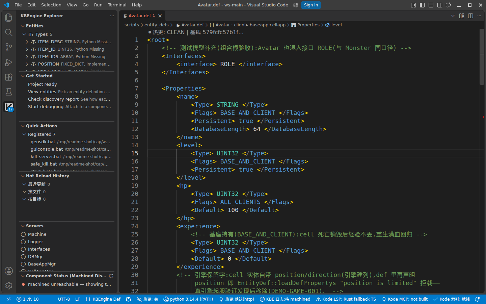
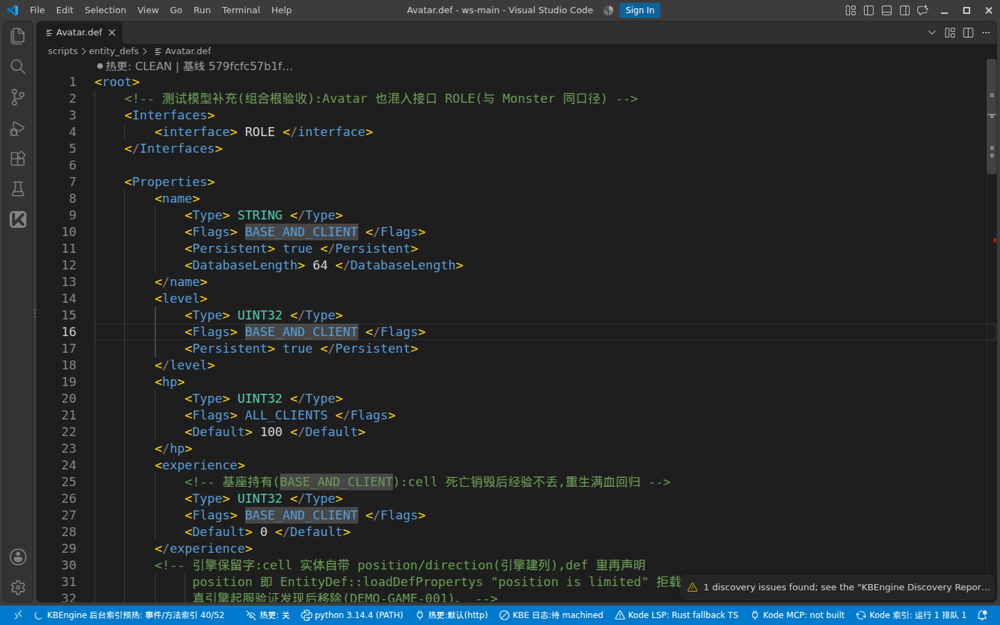
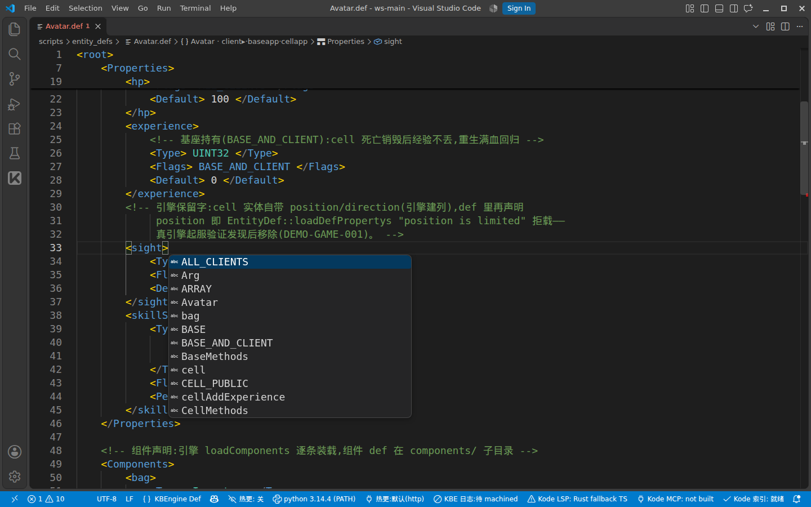
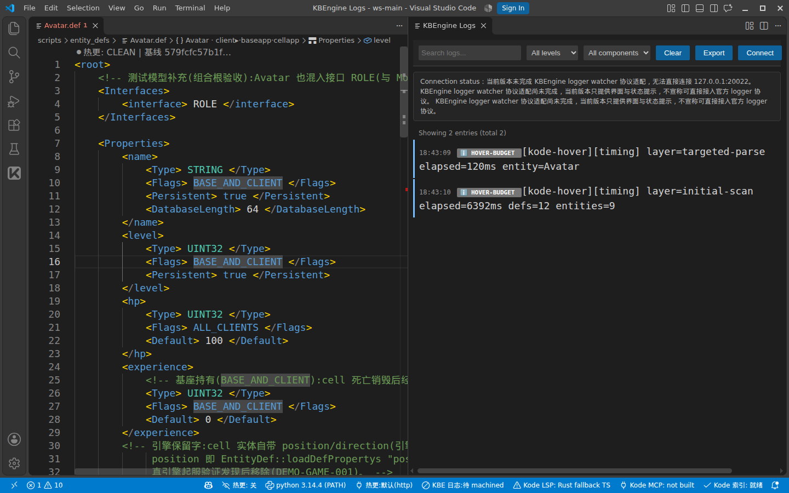

# UI Areas

Where Kode surfaces in the VS Code window — which UI region each piece lives in, how to open it, and the settings that drive it.

The numbered diagram above shows the standard VS Code areas (Activity Bar, Side Bar, Editor, Breadcrumbs, Gutter, Minimap, Panel, Status Bar, Command Palette). The sections below walk them one by one and say what Kode puts in each.

Every entry below corresponds to a declared contribution in `package.json` or a wiring point in the extension source — nothing is invented. Where a capability is not finished (for example the log viewer's logger-protocol adaptation), the page says so instead of describing it as working.

## Activity Bar

Kode adds one activity-bar icon (the Kode logo). Clicking it opens the **KBEngine Explorer** container in the side bar.

- How to open: click the Kode logo in the Activity Bar (right-click the Activity Bar to hide or restore it — standard VS Code behavior).
- What lives here: the container hosts all of Kode's side-bar views — Entity Explorer, Start, Quick Actions, Hot-Reload History, Server Control, Component Status, Telnet Status, Player Data, Remote Servers, Debug Targets, Config, Git History, Git Range History, Type Preview (14 views in total, `kbengine-explorer` container in `package.json`).
- Related settings: none directly — view visibility is VS Code UI state, not extension configuration.

Screenshot: pending (tracked in the todo list; the Side Bar section below shows the opened views).

## Side Bar (KBEngine Explorer views)

- **Entity Explorer** — the entity tree with four fixed groups: `Types`, `Entities`, `Interfaces`, `Components` (live counts in the group headers). Clicking an entity opens its `.def`/script parts; the tree is read-only navigation, not an editor. While folder colors are active (see the next section) the four group headers switch to colored SVG icons; otherwise they use the default theme icons.
- **Start** — the discovery/onboarding view: while a workspace is being recognized it shows the discovery state honestly (recognizing / not found / failed / ready), and stale roots are discarded rather than displayed as current.
- **Quick Actions** — the quick-action tree (run default script, scan scripts, run by name).
- **Component Status / Server Control / Telnet Status** — server lifecycle, per-component status, and telnet session state.
- **Player Data / Remote Servers / Debug Targets** — player-data view, remote-server list, debug targets.
- **Git History / Git Range History** — file-history and selection-history views (same data as the editor context-menu entries below).
- **Type Preview** — preview of a custom type (utype / FIXED_DICT) resolution.
- How to open: Activity Bar → Kode logo; each view collapses/expands independently; drag views out as floating panels if you prefer.
- Related settings: the views reflect the active project profile; see [Configuration](./configuration.md).

## Folder Colors

Semantic coloring of workspace files and Kode's own tree views (FOLDER-COLOR-001, `kbengine.folderColors.*`).

- Where it shows: ① single-letter badges with theme colors on **files** in the native Explorer — assets root `A` orange, `venv`/`.venv` `V` muted gray, `docs/` `D` blue, `configs/` `C` purple, `logs/` `L` red, and process colors under `scripts/<role>/` (baseapp blue `B`, cellapp green `C`, client yellow `U`, bots purple `T` — the same role-directory judgment chain as the process breadcrumbs); ② the entity tree's four group headers get colored SVG icons (`resources/icons/folder-colors/`).
- Dual gate: `kbengine.folderColors.enabled` = true **and** `workbench.colorTheme` in the KBEngine theme family. With any other theme the feature is completely silent, as if not installed; switching themes or toggling the switch takes effect live (badges and icons refresh without a reload).
- Rules: `kbengine.folderColors.rules` (glob + semantic + per-rule toggle), array order = first match wins; unset = the six built-in rules. See the [Folder Colors section](./configuration.md#folder-colors) of the configuration guide for the full table.
- Honest boundary: VS Code has no extension API to tint native Explorer folder backgrounds or replace folder icons — only file decorations (badges on files) and Kode's own tree views can be colored. Folder background colors are never promised.

## Editor Area

For `.def` files:

- Syntax highlighting, completion, and hover for the def XML dialect (utype resolution, `types.xml` aliases, engine-anchored descriptions).
- F12 (Go to Definition) and F2 (Rename) across `.def` ↔ Python entity scripts, with the Rust-first navigation lane.

For Python entity/tool scripts:

- **CodeLens** (above methods/properties): file-top modified-time lens; RPC / receiver-section lenses on entity methods (click runs the source-reveal command `kbengine.source.reveal`, which jumps to the def declaration or the peer face); `types.xml` alias lenses; database storage lenses (`+N 处落库` opens the database view via `kbengine.database.open`). Toggles: `kbengine.codeLens.property`, `kbengine.codeLens.rpc`, `kbengine.codeLens.typesXml`, `kbengine.entity.receiverSections`.
- **Inlay hints**: def-property hints at a whole-line `# kode:props-from-def` anchor (`kbengine.inlayHints.defProps`) and cellData copy-property hints on baseapp entities (`kbengine.inlayHints.propertyShadow`).
- **Formatting**: when ruff is detected, Kode registers Python document/range formatting providers — Shift+Alt+F works without any command. The default formatter is never hijacked: `editor.defaultFormatter` is untouched unless you accept the one-time prompt. The command `kbengine.python.ruffFormat` formats the active file in one shot.
- Diagnostics and quick fixes: see Problems (Panel section below).

How to open: just open a `.def` or `.py` file from a KBEngine project — the providers activate per language.

Screenshots:

## Panel (bottom)

**Output view** — Kode writes to these channels (select in the Output view's dropdown):

- `KBEngine Logs`, `KBEngine Console 日志` (per-component console channels appear as `KBEngine: <component>`), `KBEngine Runtime`
- `KBEngine Ruff` (lint/format pip output), `KBEngine Def 分析`, `KBEngine Dependency`
- `KBEngine Project Doctor`, `KBEngine 数据库预览`, `KBEngine 机器人`, `KBEngine Player Clone`
- `KBEngine Annotations`, `KBEngine Compatibility`, `KBEngine Navigation`, `KBEngine HTTP 快捷请求`, `KBEngine py-spy`, `KBEngine Stub Pyright`, `KBEngine Symbol References`
- Hot-reload log, discovery report, def MD5, JSONC association, debug config, database drift, and the kode-core shadow-diff channel

**Problems view** — Kode's diagnostics arrive grouped by source with `kbengine.*`-family codes, for example: `kbengine.attributeNone` (None-flow member access), RPC argument-count mismatches, role/base misuse, receiver-None, read-only writes, space-navigation misuse, property-direction violations, post-destroy usage, entities.xml duplicate/order checks, and config-value validation (unknown keys, enum/type violations). The behavioral lint rules behind the Python findings are documented in [KBEngine lint rules](./kbengine-lint-rules.md); the full diagnostic inventory is in [Feature overview](./features.md).

**Honesty boundary**: the log viewer WebView (see [Log viewer](./logging.md)) is shipped with its logger-protocol adaptation explicitly unfinished — the extension says so in-product; it never presents the unverified protocol as working.

## Status Bar

Kode owns up to nine items on the right side of the status bar (VS Code sorts by priority; Kode deliberately avoids colliding with the built-in 100–101 slots):

| Priority (desc) | Item | Behavior |
| --- | --- | --- |
| 100 | Server status | Server lifecycle state; click opens server control |
| 99 | Telnet status | Telnet session state |
| 98 | Hot-reload status | Auto hot-reload state |
| 97 | Interpreter | Selected Python interpreter; click → `Select Python Interpreter`. **Yields when `ms-python.python` is installed** (its own selector wins; selection/venv creation still works from the Command Palette) |
| 96 | Hot-reload channel | Which channel (machined/HTTP) hot reload rides |
| 95 | Log tail | Live console log tail state |
| 94 | Kode core | kode-server lane (Rust / Rust-fallback-TS / TS / shadow). Click → shadow-diff log. Tooltip also carries an **engine version** row (source = engine tree version-marker probe chain; explicit "not detected" when absent; never fabricated). Settings: `kbengine.core.backend`, `kbengine.core.serverPath`, `kbengine.engineRoot` (re-probes on change) |
| 93 | Kode MCP | Built-in MCP server state (built / not built / off). Click toggles. Setting: `kbengine.mcp.enabled` (default on) |
| 92 | Kode 索引 | Index lifecycle: `$(check) 就绪` / `$(sync~spin) 运行 n 排队 n` / `$(error) 失败 n` / `$(circle-slash) 未知` (four faces, judged in that fixed order — there is deliberately no "partial" face because the scheduler has no such data). In the ready face the tooltip adds the last build's completion time (local time) and duration; no line before a build has ever completed. Click opens Project Doctor |

Screenshot: pending (tracked in the todo list).

## Command Palette

Every Kode command is registered under the `KBEngine` category — open the palette (Ctrl/Cmd+Shift+P) and type `kbengine` or `KBEngine`. The full table (title, entry point, behavior, bounds, honesty rules) lives in [Commands and panels](./commands.md); the palette is just one of the entry surfaces (views, status-bar items, and context menus are the others).

## Context Menus

- **Editor context menu** (right-click in an editor): *Show File History* and *Show Selection History* (the latter only with a selection), both gated on the git-history feature being enabled for the file.
- **Explorer context menu** (right-click in the file explorer): *New Entity* on folders; *Player Clone* inspect/import on `.kdpclone` archives; *Show File History* on files.
- **View context menus**: the side-bar views add their own title-bar and per-item actions (reveal, refresh, per-view commands) — see the view's own `…` menu.

## Settings Editor

Open Settings (Ctrl/Cmd+,) and search `kbengine` — the extension organizes its configuration into grouped sections (hover, inlay hints, code lens, python, core, mcp, ai, …). Two companion pages keep them documented:

- [Configuration](./configuration.md) — the key list with defaults and meaning
- [Config switch effects](./config-effects.md) — what visually changes when each switch flips

Screenshots for this page (activity bar, status bar, command palette, context menu, settings) are pending; tracked in the todo list.
