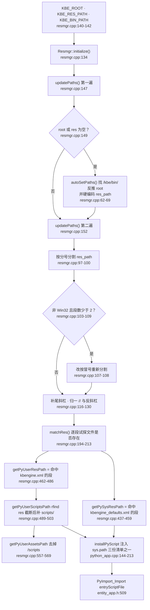

# Fixed directories and the path resolution chain

> KODE-CFG-011 · KB-001 engine mechanics. Every claim below cites `kbe/src`
> `file:line` from the read-only checkout at `/home/cui/workspaces/kbengine`
> (commit `c2a3b8f`). Companion pages: [Entry script SPI methods](entry-script-spi-methods.md),
> [Startup flow and stack](startup-flow-and-stack.md),
> [Entity lifecycle & reference release](entity-lifecycle-reference.md).

The engine has exactly three places where script directories are decided:
the environment variables read by `Resmgr`, the `res_path` string they are
split into, and the hardcoded directory lists that get pushed into `sys.path`.
All three are fixed at compile time — a project cannot add a search directory
without patching the engine.

## Where the paths come from

### The three environment variables

`Resmgr::initialize()` reads `KBE_ROOT`, `KBE_RES_PATH` and `KBE_BIN_PATH`
(`kbe/src/lib/resmgr/resmgr.cpp:134`, `:140-142`), then calls `updatePaths()`
once (`:147`). If `root_path` or `res_path` is still empty it falls back to
`autoSetPaths()` (`:149-150`) and runs `updatePaths()` a second time (`:152`).
Afterwards it checks that all three derived paths resolve, otherwise it prints
`not set environment` (`:154-164`) and sets `isInit_ = true` (`:166`).

`autoSetPaths()` looks for the literal `/kbe/bin/` in the executable path
(`kbe/src/lib/resmgr/resmgr.cpp:62`), truncates everything from there to get
the engine root (`:67-68`), and then hardcodes the resource path:

```
<root>kbe/res/;<root>/assets/;<root>/assets/scripts/;<root>/assets/res/
```

(`kbe/src/lib/resmgr/resmgr.cpp:69`). Note the asymmetry: `kbe/res/` has no
leading slash while the three `assets` entries do — the root always ends with
`/` after `:67-68`.

`Resmgr::initialize()` is invoked from `loadConfig()` before either config
file is read (`kbe/src/lib/server/kbemain.h:68`, config loads at `:71` and
`:74`), so path resolution precedes `kbengine_defaults.xml`.

### Splitting `res_path`

`updatePaths()` (`kbe/src/lib/resmgr/resmgr.cpp:73-131`) normalizes
`root_path` and `bin_path` (trailing slash, `//` → `/`, `\\` → `/`, `:76-94`),
then splits `res_path` on `;` (`:97-100`). On non-Windows builds, if that
yields fewer than 2 segments it clears the vector and re-splits on `:`
(`:103-110`) — the comment above the guard explains why Windows must never take
that branch: it would cut drive letters (`:102`). Each surviving segment gets a
trailing separator (`:116-121`) and the segments are joined back with the same
split flag (`:123-130`).

## Resolving the system and user resource roots

`matchRes(const char*)` walks `respaths_` in order and returns the first
segment for which `segment + res` exists on disk, returning the input path
unchanged when nothing matches (`kbe/src/lib/resmgr/resmgr.cpp:194-213`).

| Accessor | Probe file | Fallback when nothing matches | Lines |
| --- | --- | --- | --- |
| `getPySysResPath()` | `server/kbengine_defaults.xml` | `respaths_[0]` | `kbe/src/lib/resmgr/resmgr.cpp:437-459` (`matchRes` at `:443`, fallback at `:453-454`) |
| `getPyUserResPath()` | `server/kbengine.xml` | `respaths_[1]`, then `respaths_[0]` | `kbe/src/lib/resmgr/resmgr.cpp:462-486` (`matchRes` at `:468`, fallbacks at `:478-481`) |

Both results are cached in function-local `static` strings
(`resmgr.cpp:439`, `:464`), so the resolution happens once per process. In a
stock layout that means: system root = the segment holding `kbe/res/`, user
root = the segment holding `assets/res/`.

## The scripts path is derived, not configured

`getPyUserScriptsPath()` takes `getPyUserResPath()`, finds the **last**
occurrence of the substring `res` with `rfind` (`kbe/src/lib/resmgr/resmgr.cpp:497`),
erases from there to the end (`:498`) and appends `scripts/` (`:499`):

```cpp
path = getPyUserResPath();
std::string::size_type pos = path.rfind("res");
path.erase(pos, path.size() - pos);
path += "scripts/";
```

Consequences worth knowing:

- `assets/res/` and `assets/scripts/` are siblings, and the trailing `res`
  suffix is the only anchor — knowing `assets` is enough to derive `scripts`,
  which is why there is no `KBE_SCRIPTS_PATH` variable.
- The anchor is a substring match, not a path-component match: any user root
  whose last `res` sits elsewhere (a directory literally named `resource`,
  say) silently produces a wrong `scripts/` path.
- If the user root contains no `res` at all, `rfind` returns `npos` and
  `erase(npos, …)` throws `std::out_of_range` (C++ standard behaviour of
  `std::string::erase`), so `KBE_RES_PATH` entries without `res` are not
  merely wrong, they are fatal.

`getPyUserAssetsPath()` is the same path with `/scripts` and `\scripts`
stripped (`kbe/src/lib/resmgr/resmgr.cpp:557-569`, replacements at `:564-565`).

## The fixed directory lists pushed into `sys.path`

There are three separate hardcoded lists, one per app base class. Each ends by
installing the same system-side directory, `getPySysResPath() + "scripts/common"`.

### 1. `PythonApp::installPyScript` — loginapp, dbmgr, interfaces, logger

`kbe/src/lib/server/python_app.cpp:144-213`, called from
`PythonApp::inInitialize()` (`:74`):

| Stage | Directories | Lines |
| --- | --- | --- |
| Precondition | `respaths`, user root, system root, scripts path must all be non-empty | `python_app.cpp:146-151` |
| Common to every component | `common`, `data`, `user_type` | `python_app.cpp:168-170` |
| `BASEAPP_TYPE` | `server_common`, `base`, `base/interfaces`, `base/components` | `python_app.cpp:174-179` |
| `CELLAPP_TYPE` | `server_common`, `cell`, `cell/interfaces`, `cell/components` | `python_app.cpp:180-185` |
| `DBMGR_TYPE` | `server_common`, `db` | `python_app.cpp:186-189` |
| `INTERFACES_TYPE` | `server_common`, `interface` | `python_app.cpp:190-193` |
| `LOGINAPP_TYPE` | `server_common`, `login` | `python_app.cpp:194-197` |
| `LOGGER_TYPE` | `server_common`, `logger` | `python_app.cpp:198-201` |
| default (client) | `client`, `client/interfaces`, `client/components` — **no** `server_common` | `python_app.cpp:202-207` |
| System side | `getPySysResPath() + "scripts/common"` | `python_app.cpp:209-210` |
| Install | `getScript().install(tbuf, pyPaths, "KBEngine", componentType_)` | `python_app.cpp:213` |

### 2. `getComponentPythonPaths` — baseapp, cellapp

`EntityApp::installPyScript()` (`kbe/src/lib/server/entity_app.h:370-389`)
does **not** use the switch above; it calls `getComponentPythonPaths()`
(`entity_app.h:381`) implemented in `kbe/src/lib/entitydef/common.cpp:72-126`.
The list is nearly identical (`common`, `data`, `user_type` at `common.cpp:88-91`,
`BASEAPP`/`CELLAPP`/`DBMGR` branches at `:95-110`, system side at `:118-119`)
with two differences:

- it prepends an extra empty segment `L";"` (`common.cpp:88`), i.e. the scripts
  root itself goes on `sys.path`;
- its `switch` only knows `BASEAPP`, `CELLAPP`, `DBMGR` and `default`
  (`common.cpp:93-116`) — `LOGINAPP`/`INTERFACES`/`LOGGER` would fall into the
  `client` branch if this function were ever called for them.

### 3. `installPyScript` in `client_lib/kbemain.h` — client, bots

`kbe/src/lib/client_lib/kbemain.h:57-110`, called at `:262`. Common set at
`:81-83`, then `CLIENT_TYPE` gets `client`, `client/interfaces`,
`client/components` (`:85-90`) while everything else (i.e. bots) gets `bots`,
`bots/interfaces`, `bots/components` (`:91-96`); system side at `:98-99`,
`script.install(...)` at `:102`.

### Which base class uses which list

| Components | Base class | Directory list |
| --- | --- | --- |
| baseapp, cellapp | `EntityApp<Entity>` (`kbe/src/server/baseapp/baseapp.h:37`, `kbe/src/server/cellapp/cellapp.h:21`) | `entitydef/common.cpp:72-126` |
| loginapp, dbmgr, interfaces, logger | `PythonApp` (`kbe/src/server/loginapp/loginapp.h:22`, `kbe/src/server/dbmgr/dbmgr.h:32`, `kbe/src/server/tools/interfaces/interfaces.h:24`, `kbe/src/server/tools/logger/logger.h:49`) | `python_app.cpp:144-213` |
| bots, client | `ClientApp` (`kbe/src/server/tools/bots/bots.h:40`) | `client_lib/kbemain.h:57-110` |

Entry-module import is likewise split: `EntityApp::installPyModules()` imports
`entryScriptFile` at `kbe/src/lib/server/entity_app.h:509` (baseapp/cellapp
branches at `:495-504`), `PythonApp::installPyModules()` at
`kbe/src/lib/server/python_app.cpp:340` (component branches at `:234-266`),
`Bots::installPyModules()` at `kbe/src/server/tools/bots/bots.cpp:218`, and the
client at `kbe/src/lib/client_lib/clientapp.cpp:272`.

## The trap: `getPyUserComponentScriptsPath` only knows four types

`Resmgr::getPyUserComponentScriptsPath()` (`kbe/src/lib/resmgr/resmgr.cpp:506-555`)
is a second, independent hardcoding of the component→directory mapping. Both
of its branches (`:516-525` when `componentType == UNKNOWN_COMPONENT_TYPE`,
`:538-547` otherwise) only accept `CELLAPP`, `BASEAPP`, `BOTS` and `CLIENT`,
and hit `KBE_ASSERT(false)` for everything else (`:525`, `:547`).

That disagrees with the seven-component world the other two lists live in
(login/dbmgr/interfaces/logger are missing here), and it disagrees with
`getComponentPythonPaths`, which knows base/cell/db but not bots/client.
Its only in-tree caller is `PyEntityDef::loadAllScriptForComponentType()`
(`kbe/src/lib/entitydef/py_entitydef.cpp:1867`), which itself already asserts
for anything but base/cell just above (`py_entitydef.cpp:1849-1865`, `else`
branch at `:1862-1865`).

Practical reading: do not call `getPyUserComponentScriptsPath` for a
non-entity component — the assert is a live code path, not a dead branch.

## `entryScriptFile` defaults to `kbemain`

The default entry module name is `kbemain` (a module name, not a path) in every
component section of `kbe/res/server/kbengine_defaults.xml` — interfaces
`:238`, dbmgr `:274`, cellapp `:451`, baseapp `:592`, loginapp `:746`,
bots `:837`, logger `:908`. It is read into `entryScriptFileName` at
`kbe/src/lib/server/entity_app.h:494-504` / `kbe/src/lib/server/python_app.cpp:233-266`
and imported at `entity_app.h:509` / `python_app.cpp:340`.

## Resolution chain



## Traps in one place

- `updatePaths()` runs twice inside `initialize()` (`resmgr.cpp:147`, `:152`);
  a `KBE_RES_PATH` that is only valid after `autoSetPaths()` is fine, but one
  that is non-empty yet malformed survives into `respaths_` untouched.
- The `:` re-split (`resmgr.cpp:103-110`) never runs on Windows, by design.
- `getPyUserScriptsPath()` is a substring cut, not a path cut
  (`resmgr.cpp:497-499`).
- Three different directory lists exist for the same filesystem layout
  (`python_app.cpp:144-213`, `entitydef/common.cpp:72-126`,
  `client_lib/kbemain.h:57-110`) and they disagree at the edges.
- `getPyUserComponentScriptsPath()` asserts on four of the seven server
  component types (`resmgr.cpp:525`, `:547`).

Next: [Entry script SPI methods](entry-script-spi-methods.md) ·
[Startup flow and stack](startup-flow-and-stack.md)
