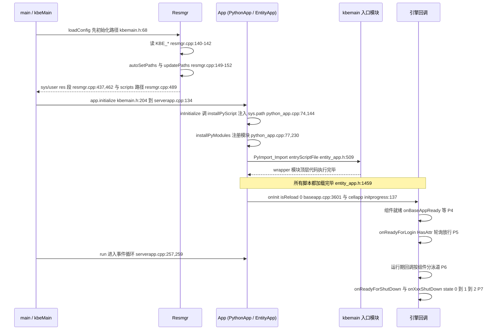

# Startup flow and stack

> KODE-CFG-013 · KB-001 engine mechanics. Phase order and every frame below are
> taken from `kbe/src` at `/home/cui/workspaces/kbengine` (commit `c2a3b8f`).
> Companion pages: [Fixed directories and path resolution](fixed-directories-and-path-resolution.md),
> [Entry script SPI methods](entry-script-spi-methods.md).

## The seven phases

| Phase | What happens | Evidence |
| --- | --- | --- |
| **P0 environment paths** | `Resmgr::initialize()` reads `KBE_ROOT` / `KBE_RES_PATH` / `KBE_BIN_PATH`, runs `updatePaths()`, falls back to `autoSetPaths()` when root or res is empty, runs `updatePaths()` again, then resolves the system root, user root and scripts path | `kbe/src/lib/resmgr/resmgr.cpp:134`, `:140-142`, `:147`, `:149-150`, `:152`; `autoSetPaths` `:62-69`; `updatePaths` `:73-131`; `getPySysResPath` `:437`; `getPyUserResPath` `:462`; `getPyUserScriptsPath` `:489` |
| **P1 module import** | `installPyScript()` injects the fixed directory lists into `sys.path`, `installPyModules()` registers the engine's Python modules, then `PyImport_Import(entryScriptFile)` runs the **wrapper module's top-level code** | `kbe/src/lib/server/python_app.cpp:144`, `:213`, `:230`, `:340`; `kbe/src/lib/server/entity_app.h:281`, `:284`, `:509` |
| **P2 scripts loaded** | The engine's own marker: comment 「所有脚本都加载完毕」 sits immediately before the first callback; `entryScript_` already holds the module object | `kbe/src/lib/server/entity_app.h:1459` / `python_app.cpp:708`（reload path）；cold start: `kbe/src/server/baseapp/initprogress_handler.cpp:184`, `loginapp.cpp:173`, `dbmgr.cpp:308`, `interfaces.cpp:152`, `logger.cpp:128`, `cellapp/initprogress_handler.cpp:136`, `bots.cpp:101`, `clientapp.cpp:130`; module held at `entity_app.h:509` |
| **P3 first engine callback** | `onInit(isReload)` — `0` on the startup path, `1` on the reload path | startup: `kbe/src/server/baseapp/baseapp.cpp:3601`, `kbe/src/server/cellapp/initprogress_handler.cpp:137`, `kbe/src/server/tools/bots/bots.cpp:102`, `kbe/src/lib/client_lib/clientapp.cpp:131`; reload (`isReload=1`): `entity_app.h:1460`, `python_app.cpp:709` |
| **P4 component ready** | each component fires its own Ready callback | `onBaseAppReady` `kbe/src/server/baseapp/initprogress_handler.cpp:185`; `onLoginAppReady` `kbe/src/server/loginapp/loginapp.cpp:174`; `onDBMgrReady` `kbe/src/server/dbmgr/dbmgr.cpp:309`; `onInterfaceAppReady` `kbe/src/server/tools/interfaces/interfaces.cpp:153`; `onLoggerAppReady` `kbe/src/server/tools/logger/logger.cpp:131`; cellapp has no separate ready callback — it uses `onInit(0)` at `cellapp/initprogress_handler.cpp:137` |
| **P5 open for login** | `onReadyForLogin` behind `PyObject_HasAttrString`; the handler polls until the return value reaches ≥ 0.9999, then reports `onBaseappInitProgress` and tears itself down | guard `initprogress_handler.cpp:201`, call `:206`, threshold `:244`, report `:250-254`, teardown `:256-260`; cellapp variant `cellapp/initprogress_handler.cpp:153`, `:156` |
| **P6 runtime** | per-component data / space / account / charge callbacks, all listed in the [SPI method table](entry-script-spi-methods.md) | `entity_app.h:1308`, `baseapp.cpp:3668`, `cellapp.cpp:864`, `spacememory.cpp:609`, `loginapp.cpp:1013`, `dbmgr.cpp:1242`, `interfaces.cpp:637`, `logger.cpp:290` |
| **P7 shutdown** | `onReadyForShutDown` (optional) then `onXxxShutDown(state)` in three stages `0 → 1 → 2` | `baseapp.cpp:275`, `dbmgr.cpp:78`, `logger.cpp:176`; `baseapp.cpp:327` (state 0), `:342` (state 1), `:389` (state 2); `loginapp.cpp:62`, `dbmgr.cpp:156`, `interfaces.cpp:79`, `logger.cpp:218` |

## Sequence

## Stack frames, top to bottom

| # | Frame | Evidence |
| --- | --- | --- |
| 1 | `main(int, char**)` generated by `KBENGINE_MAIN`, which calls `loadConfig()` first | `kbe/src/lib/server/kbemain.h:375-387` (Win32), `:393-399` (POSIX), `loadConfig()` call at `:377` / `:395` |
| 2 | `loadConfig()` → `Resmgr::getSingleton().initialize()`, then `g_kbeSrvConfig.loadConfig("server/kbengine_defaults.xml")` and `("server/kbengine.xml")` | `kbe/src/lib/server/kbemain.h:66-75` (`initialize` at `:68`, config loads at `:71`, `:74`) |
| 3 | `Resmgr::initialize()` → `updatePaths()` → `autoSetPaths()` → `updatePaths()` → `getPySysResPath()` / `getPyUserResPath()` / `getPyUserScriptsPath()` | `kbe/src/lib/resmgr/resmgr.cpp:134-166` (calls at `:147`, `:149`, `:152`, validation `:154`) |
| 4 | `kbeMain(...)` → `SERVER_APP app(...)` → `app.initialize()` | `kbe/src/lib/server/kbemain.h:200`, `:204` |
| 5 | `ServerApp::initialize()` → `loadConfig()` → `initializeBegin()` → `inInitialize()` → `initializeEnd()` → `Network::initialize()` | `kbe/src/lib/server/serverapp.cpp:134-160` (calls at `:142`, `:145`, `:148`, `:151`, `:160`) |
| 6 | `EntityApp<E>::inInitialize()` → `installPyScript()` → `installPyModules()` → `installEntityDef()` | `kbe/src/lib/server/entity_app.h:279-288` |
| 7 | `PythonApp::inInitialize()` → `installPyScript()` → `installPyModules()` | `kbe/src/lib/server/python_app.cpp:72-81` |
| 8 | `installPyScript()` builds `pyPaths` and calls `getScript().install(...)` — the `sys.path` injection | `python_app.cpp:144-213` (install at `:213`); entity variant `entity_app.h:370-388`; client/bots variant `kbe/src/lib/client_lib/kbemain.h:57-102` |
| 9 | `installPyModules()` → `PyImport_Import(entryScriptFile)` — wrapper top-level code runs here | `entity_app.h:509`, `python_app.cpp:340`, `bots.cpp:218`, `clientapp.cpp:272` |
| 10 | `EntityApp<E>::reloadScript()` / `PythonApp::reloadScript()` → `onInit(1)` | `entity_app.h:1452-1463`, `python_app.cpp:702-712`; only reachable through the Python-exposed `KBEngine.reloadScript()` (`cellapp.cpp:1839`, `baseapp.cpp:5104`) |
| 11 | `Baseapp::onDbmgrInitCompleted()` → `onInit(0)` → `InitProgressHandler::start()` | `baseapp.cpp:3581-3614` (`onInit` at `:3601`, handler at `:3611-3614`) |
| 12 | `InitProgressHandler::process()` → `onBaseAppReady` → `onReadyForLogin` loop → `onBaseappInitProgress` | `kbe/src/server/baseapp/initprogress_handler.cpp:132-260` (`:185`, `:201`, `:206`, `:244`, `:250`) |
| 13 | `ServerApp::run()` → `dispatcher_.processUntilBreak()` — the long-lived event loop | `kbe/src/lib/server/serverapp.cpp:257-261`, entered from `kbemain.h:227` |
| 14 | Shutdown: `canShutdown()` → `onShutdownBegin()` → `onShutdown(first)` → `onShutdownEnd()` | `baseapp.cpp:258`, `:321`, `:334`, `:383` with callbacks at `:275`, `:327`, `:342`, `:389` |

## Notes that matter

- **`onInit` has two very different call paths.** The startup path passes
  `isReload = 0` (`baseapp.cpp:3601-3604`, `cellapp/initprogress_handler.cpp:137-140`).
  The `isReload = 1` calls at `entity_app.h:1460` and `python_app.cpp:709` live
  inside `reloadScript()`, which only runs when Python calls
  `KBEngine.reloadScript()` — they are not part of a cold start.
- **loginapp / dbmgr / interfaces / logger never receive `onInit` on a cold
  start.** Their first callback is their own `onXxxReady` (P4); `onInit` for
  them exists only behind `reloadScript()`.
- **The P5 gate is a poll, not an event.** `InitProgressHandler::process()`
  runs every tick, calls `onReadyForLogin` while the attribute exists, converts
  the return value to a float (`initprogress_handler.cpp:217`), and only once
  `v >= 0.9999` (`:244`) marks `completed` and deletes the handler (`:256-260`).
- **Cellapp has no `onCellAppReady`.** Its ready signal is `onInit(0)`
  (`cellapp/initprogress_handler.cpp:137`).
- **Shutdown is three-stage for baseapp only** (`state = 0/1/2`,
  `baseapp.cpp:327`, `:342`, `:389`); the other components fire a single
  `onXxxShutDown` from their `onShutdownBegin` (`loginapp.cpp:62`,
  `dbmgr.cpp:156`, `interfaces.cpp:79`, `logger.cpp:218`).

Related: [Entry script SPI methods](entry-script-spi-methods.md) (36 methods,
32 required / 4 optional) · lifecycle diagram at
`/kbengine-lifecycle.svg` · [Fixed directories and path resolution](fixed-directories-and-path-resolution.md) ·
[Entity lifecycle & reference release](entity-lifecycle-reference.md)
