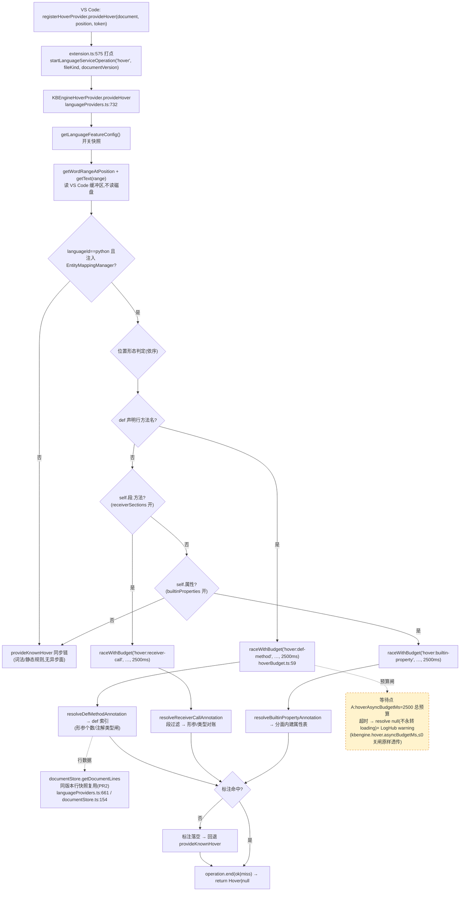
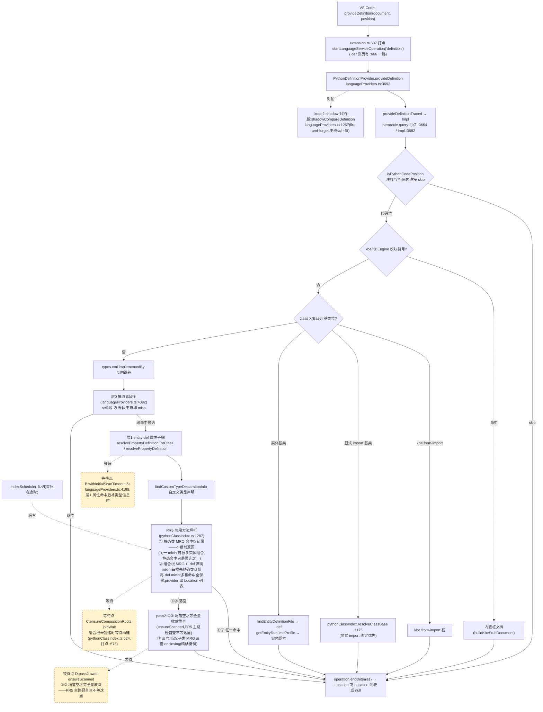
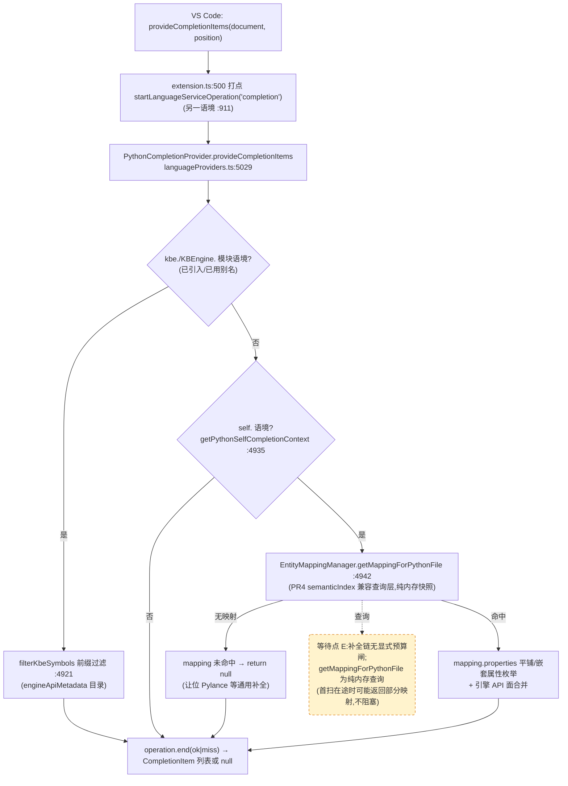
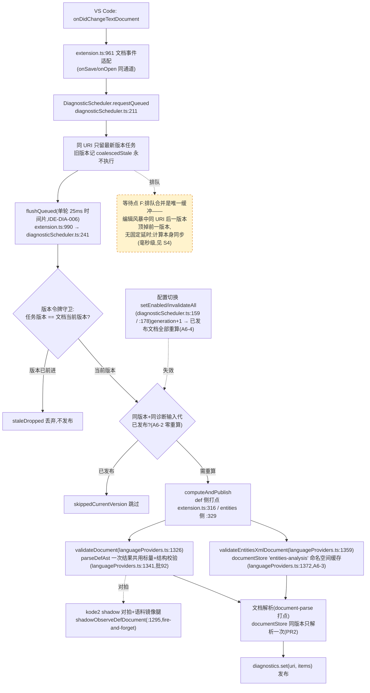

# Kode 语言服务性能基线报告(2026)

- 日期:2026-10-23
- 基线代码:PR1「性能观测与基线」提交(commit hash 见 `docs/review/2026-10-22-unified-semantic-index-refactor.md` 跟踪表;本报告与该提交同树)
- 评审来源:docs/review/2026-10-22-unified-semantic-index-refactor.md §2(性能基线与调用链审计)

## 1. 测试环境

| 项 | 值 |
|---|---|
| OS | Linux(host 内核 7.0.0-38-generic) |
| CPU | Intel(R) Core(TM) i9-10880H @ 2.30GHz,14 逻辑核 |
| 内存 | 45GiB(量测时 buff/cache 33GiB,热缓存口径) |
| 存储 | sda,ROTA=1(机械盘特征;具体介质待确认) |
| Node.js | v24.21.0 |
| 量测框架 | vitest 5.0.3(`vitest.bench.config.ts`)+ fake-vscode 桩,真实索引实现 |
| 观测开销 | PR1 埋点已启用(聚合口径,详细记录关闭);数字含埋点开销 |

## 2. 测试资产集

由 `scripts/generate-perf-assets.mjs` 确定性生成(`--large-files 30000`):

| 场景 | 文件数 | 组成 |
|---|---|---|
| small | 7 | 最小资产树(行为口径) |
| large | 30,005 | 30,000 个生成 .py(1 类 2 方法)+ Avatar 骨架 |
| multi-root | 18 | 3 个独立资产根,同名实体 Avatar、同名类 Inventory |
| big-py | 5 | 单文件 8,000 方法(局部变量推导最坏路径) |
| def-heavy | 1,323 | 1,200 个 .def + 40 组 entities/types/alias.xml 变体 |
| noise | 406 | .git/build/third_party 各 200 个干扰 .py(须被排除) |

## 3. 七场景实测数字(真实代码路径,非桩实现)

复现:`KODE_PERF_LARGE_FILES=30000 npx vitest run --config vitest.bench.config.ts tests/perf/baseline.bench.ts`
原始输出:`docs/perf/baseline-run.txt`

> 时点注意:本表数字为 PR1 时点(提交 89e8783,P0 修复前)。P0 修复系列(492fc40..b9c8acb)后同 bench 复测见 `docs/perf/baseline-run-post-p0.txt`(S1 冷扫 107,737ms→4,880ms),对账与取舍分析见 [docs/review/2026-10-27-r1-migration-data-audit.md](https://github.com/cuihairu/kode/blob/main/docs/review/2026-10-27-r1-migration-data-audit.md)。

| # | 场景 | 指标 | 实测 |
|---|---|---|---|
| 1 | 冷启动首次索引(large,30,001 个 .py) | 首次类名查询总耗时 | **107,737 ms(≈107.7s,≈3.6ms/文件)** |
| 1b | 冷启动 entity-mapping 首扫(def-heavy,1,320 .def) | waitForInitialScan | **652 ms** |
| 5′ | .def 修改后热复扫(mtime 缓存命中) | scanEntityMappings | **17 ms**(对比冷扫 652ms,≈38×) |
| 2 | 索引就绪后重复查询 findClassesByName | P50/P95/P99 | 0.01 / 0.02 / 0.04 ms(n=200) |
| 2 | 索引就绪后 computeMRO | P50/P95/P99 | 0.01 / 0.04 / 1.33 ms(n=40) |
| 3 | 新文件落盘后首次查询(未索引文件) | 索引+查询 | **0.75 ms** |
| 4 | 编辑当前文件后查询(big-py,局部变量) | P50/P95/P99 | 0.04 / 0.14 / 79.93 ms(n=20;P99 来自首轮,含 MRO 缓存清空后重建) |
| 6 | 删除 .py 后失效+旧类不再命中 | 失效耗时/命中数 | **6.7 ms / 0 命中** |
| 7 | 60 路并发查询(multi-root 同名类) | wall / 总命中 | **0.34 ms / 360**(6 定义 × 60 查询,跨根不丢) |
| 7 | rootsContaining(组合根,20 次) | P50/P95/P99 | <0.01 / 0.01 / 4.58 ms |
| 8 | 排除式目录不进索引(noise) | 冷扫 / 泄漏类命中 | **1.6 ms / 0 泄漏** |

## 4. 关键发现(基线事实,非优化结论)

1. **冷启动全量 Python 扫描是唯一的秒级瓶颈**:30,001 文件 ≈107.7s(≈3.6ms/文件),验证评审「首次 Definition 被全仓扫描阻塞」的方向。热路径(场景 2/3/4/6/7)均在亚毫秒~低毫秒级。
2. **mtime 缓存有效**:.def 全量扫描 652ms → 热复扫 17ms;单位文件解析不是当前主要矛盾。
3. **编辑后单次 P99 尖峰 79.9ms**(big-py 8,000 方法文件):源于 `updateFile` 清空 MRO 缓存后的重建,量级可接受但应跟踪。
4. **排除式扫描口径正确**:build/third_party/.git 共 600 个干扰 .py 未进索引。

## 5. 待测项(本报告如实标注,不预设结论)

- [ ] VS Code 真实 UI 端到端延迟(hover/definition/completion 真实激活路径,electron 集成):待测 —— 本报告全部为 fake-vscode + 真实索引实现的服务层耗时,不含 UI 序列化与 provider 调度。
- [ ] VS Code 内冷启动场景(扩展激活 → 首次请求),含 EntityMappingManager 与 PythonClassIndex 竞争:待测。
- [ ] 冷/热磁盘缓存分离量测(本报告为热缓存口径):待测。
- [ ] 多资产根场景在 VS Code 内的同名实体导航正确性走查:待测(服务层跨根命中已验证:360/360)。
- [ ] Windows / macOS 平台与慢盘(网络盘)表现:待测。
- [ ] 诊断(.def/entities.xml)批量校验耗时分布:待测(validateDocument 打点已就位,数据待采集)。

## 6. PR1 观测基建清单

- `src/languageServiceMetrics.ts`:单调时钟(perf_hooks)、请求 ID、11 类事件(hover/definition/completion/diagnostics/python-index-scan/python-composition-roots/entity-mapping-scan/semantic-query/type-registry-query/file-discovery/document-parse)、子阶段计时、文件发现/读取/解析计数、缓存命中率、是否等初始化、状态(ok/miss/cancelled/error);详细样本默认关闭(`kbengine.metrics.detailed` 开启)。
- 埋点接入:hover/definition/completion/诊断(extension.ts 适配层)、provideDefinitionTraced(semantic-query)、resolveEntityAnnotationType(type-registry-query)、ensureScanned/ensureCompositionRoots、scanEntityMappings、findFilesAcrossRoots、updateFile(document-parse)。
- 汇总出口:命令面板 `KBEngine: Show Language Service Metrics Summary`(输出 P50/P95/P99/最大值/命中率/计数)。
- 资产生成:`scripts/generate-perf-assets.mjs`;bench:`tests/perf/baseline.bench.ts`(不进 `pnpm test` 门禁)。

## 7. 主要调用链图(真实路径取证,Mermaid)

> 口径说明:§3 的数字是 PR1 时点(提交 89e8783)实测;本节四条链是 **main 当前代码**的真实调用路径(file:line 以落稿时该分支 HEAD b0732e8 为准,含 PR2 快照/PR3 调度器/PR5 去阻塞/PR6 诊断版本守卫,以及 kode2 phase2-slice-a 双轨 shadow 对拍面)。等待点(可能阻塞请求返回的位置)统一用虚线框标出;shadow 对拍腿均为 fire-and-forget,不阻塞返回,不标等待点。

### 7.1 Hover(Python → 实体标注 → 同步回退)

### 7.2 Definition(Python F12,层序即 provideDefinitionTracedImpl 实际顺序)

### 7.3 Completion(Python self./kbe. 两语境)

### 7.4 Diagnostics(.def / entities.xml,PR6 版本化调度)

