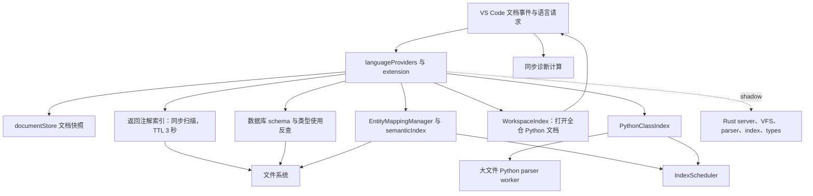

# Kode 架构、性能与 KBEngine IDE 能力审计

- 日期：2026-10-27。
- 源码基线：`cd70e12`，package.json 版本 `0.2.0`。
- 范围：整个模块清单与装配关系；重点追踪 hover、索引、导航、补全、诊断、CodeLens、重命名，以及运行调试、日志、数据库和生成器的边界。
- 方法：源码调用链检查、现有回归测试、直接执行当前源码的独立探针。不是对 5 万行源码逐行证明正确，也不把 fake-vscode 的通过当作真实编辑器验收。
- 本轮没有修改业务实现；另修复了用户指出的 Docs CI 死链，见 §9。

## 1. 判断

**功能方向适合发展为 KBEngine IDE，但当前实现尚不具备大型项目中稳定运行的性能与一致性边界。** 当前问题不仅是个别解析器慢：交互请求仍能启动项目扫描、不同索引重复读取和打开文件、派生计算在扩展宿主同步执行、索引身份与失效关系不完整。这些问题会同时影响 hover、跳转、补全和编辑响应。

本轮在当前源码直接复现了一个严重阻塞：单个约 365 KiB、8,000 个无返回注解方法的 Python 文件，返回类型索引构建耗时 **51.27 秒**；同期设置的 10 ms 定时器直到 **51.27 秒**后才执行。该函数直接在 Python hover 路径上运行，并绕过现有大文件 worker。

真实 provider 探针进一步确认：鼠标放在与方法调用无关的普通变量上，2,200 方法的文件也触发索引构建；连续两次 hover 分别耗时 **3,480.79 ms / 3,287.03 ms**，文件分别被重新读取，返回结果都是空。已有超时设置没有保护这条路径。

**这些实测可以解释长时间卡顿的机制，但尚未在用户正在使用的编辑器中复现完整的“十几分钟”。** 尚缺活动扩展版本、同时启用的扩展清单、目标项目和扩展宿主 CPU profile。不能将所有现场延迟精确归为单一函数。

## 2. 架构现状

审计时 `src/` 顶层有 107 个 TypeScript 模块，合计约 51,735 行；最大模块为 `languageProviders.ts` 5,064 行、`entityMapping.ts` 2,501 行、`extension.ts` 2,480 行、`databaseSchema.ts` 2,032 行。



值得保留的基础包括：文档版本快照、文件级索引更新、依赖图、后台分块、调度优先级、worker revision 校验、Rust shadow 与回退开关、统一日志和性能记录，以及大量导航回归夹具。此前修复索引维护复杂度的工作确有价值。

主要结构问题有四项：

1. **数据事实源不统一。** documentStore、实体语义 loader、Python 类索引、事件索引、返回注解索引、数据库 schema 和 Rust VFS 各有输入与缓存。部分读未保存缓冲区，部分只读磁盘。
2. **交互请求与批处理没有强制隔离。** “后台”通常表示 Promise 或稍后调度，任务体仍可在扩展宿主同步读取、解析和循环。
3. **模块按功能增长，但缺少可约束的查询接口。** Provider 既解释光标，又发现文件、补索引、构建 schema 和生成展示数据。服务的延迟与副作用难以控制。
4. **项目根与符号身份没有贯穿所有索引。** 名字覆盖、大小写归一、单一 owner 和多根 loader 会导致跨项目串线及失效遗漏。

Rust 已有 `kode-server`、parser、VFS、root、index、types、scheduler 等基础实现；`src/kodeCoreGate.ts` 仍阻止 `rust` 正式 serving，默认 TS，shadow 用于比对。当前不能把“Rust 原型已交付”当作“生产请求已经隔离到 Rust”。

## 3. 性能问题与证据

### PERF-01：Python 普通 hover 同步重建返回注解索引，优先级 P0

- 入口：`src/languageProviders.ts:808`，Python 普通变量 hover 调用 `resolveLocalVariableReturnType`。
- `src/pythonReturnTypeInference.ts:236` 在检查是否存在该变量的调用赋值之前，就获取全项目返回注解索引。因此普通无关变量也会付扫描成本。
- `src/pythonReturnTypeInference.ts:196` 使用同步递归目录枚举和 `readFileSync`，最多收集 20,000 个 Python 文件；文件数上限不限制目录数、总字节数或单文件方法数。
- `buildReturnAnnotationIndex` 对每个方法调用 `extractDefReturnAnnotation(source, name)`；后者重新 split 并从文件开头扫描。方法数与文件行数共同放大成本，无返回注解的方法也要执行查找。
- 缓存以构建开始的 `now` 记录 `builtAtMs`。构建超过 3 秒，完成时缓存已经过期；下一次请求立刻重建。本轮真实 provider 的两次连续重读已经复现这一点。
- 索引按方法名全局取首个注解，不绑定 import、接收者类或运行域；这同时是类型正确性限制。扫描根也没有与外部 assetsRoot 的其他索引统一。

当前源码的单文件探针，方法均无返回注解：

| 方法数 | 输入字节 | 耗时 | 返回注解条目 |
| --- | ---: | ---: | ---: |
| 250 | 11,041 | 65.07 ms | 0 |
| 500 | 22,291 | 206.20 ms | 0 |
| 1,000 | 44,791 | 770.65 ms | 0 |
| 2,000 | 91,791 | 2,992.07 ms | 0 |
| 8,000 | 373,791 | 51,271.48 ms | 0 |

同进程 10 ms timer 实际延迟：51,274.34 ms。以上为本机单轮数值，不是用户现场耗时或稳定 P99。

修复目标：一次解析提取返回注解，随文件版本增量更新；先判断当前 hover 是否需要该信息；请求只查内存快照。缓存期限不能让慢构建立即失效。为该能力提供独立开关可以作为临时止血，但不能替代复杂度修复。

### PERF-02：预算没有覆盖所有请求，定时器无法抢占同步工作，优先级 P0

`KBEngineHoverProvider.provideHover` 仅对 def 方法、receiver 调用、内建属性等异步分支设预算；普通 Python 返回类型推导、def schema 提示和部分已知 hover 为同步路径。`src/extension.ts:532` 直接调用 provider，没有覆盖整条 hover 的统一截止时间。

即使增加 Promise.race，参数求值中的同步工作也会先执行；同进程定时器在宿主阻塞期间无法运行。取消一个等待者也不等于取消底层扫描。`hover.asyncBudgetMs` 调小不能解决 PERF-01；调大只会扩大等待窗口。

修复目标：交互路径消除全仓同步计算；请求级 deadline/cancellation 贯穿调用链；请求独占任务可取消，共享索引按受控队列推进。

### PERF-03：事件 CodeLens 启动独立全仓文档索引，优先级 P0/P1

`src/eventApi.ts:121` 即使当前文件没有事件，也调用 `WorkspaceIndex.allEventCalls()`。`src/workspaceIndex.ts:31` 只排除 `.git/node_modules`，然后对全部 Python 文件执行无界 `Promise.all(openTextDocument)`。

本轮探针：100 个无事件 Python 文件，请求一次事件 CodeLens，实际打开 **100 个文档**，返回 **0 个 CodeLens**。

真实编辑器中，首次打开文档还会触发 `src/extension.ts:870` 的诊断和预热。`prewarmKbengineIndex` 又调用 `resolveMethodDefinition(..., '__prewarm__')`；当文件无 def 归属时，`ensureIndexForPythonFile` 仍可能等待全量实体扫描（`src/entityMapping.ts:2168`）。因此存在“全仓打开 → 文档事件 → 诊断/定向发现/全扫”的放大链。

此外，这份事件索引不复用 PythonClassIndex 的扫描排除和外部根策略，也没有首扫取消与全局并发上限。

修复目标：无相关语法时立即返回；事件信息并入共享文件索引；后台读取文件不应通过打开编辑器文档完成；统一排除、根、并发和生命周期。

### PERF-04：数据库计算进入 hover、CodeLens 和导航，优先级 P1

`src/languageProviders.ts:1880` 的属性 hover 调用 `describePropertyDatabaseStorage → getDatabaseSchemaSnapshot`。后者重新读取 def、types、父链/组件，推导完整表结构，检查脚本存在性并读取数据库配置（`src/databaseSchema.ts:203`）。传入 TextDocument 仅用于选根，实际 `readTextDocument` 仍是 `readFileSync`（同文件 :1789）。

types.xml CodeLens 的使用反查会遍历实体并构建 schema（同文件 :1966）；schema 虚拟文档与反向跳转也消费这些结果。它们不都是用户主动执行的低频批命令。

修复目标：按 root、文档/依赖版本和相关配置 generation 缓存纯 schema 数据；重建异步化；hover 查询当前可用结果，不在光标路径重算全实体结构。含 IPC 的新实现需独立量测。

### PERF-05：Python 同步诊断绕过大文件 worker，优先级 P1

`src/receiverNoneDiagnostics.ts:192` 在扩展宿主直接调用 `parsePythonFile`。每个 receiver 使用点又在 `enclosingMethodSpan` 内重新收集、排序该类的方法位置。`DiagnosticScheduler.flushQueued` 合并版本，但实际 `compute` 仍同步串行执行。

本轮构造每个方法一处 `self.cell.send()`：250 方法 15.15 ms，1,000 方法 63.84 ms，2,000 方法 145.54 ms，8,000 方法 **2,453.66 ms**。这条路径默认开启，随打开/编辑 Python 文档触发。

修复目标：复用同版本解析结果；一次建立方法区间索引；诊断按有限时间片或 worker 执行；只分析相关工作区文件。

### PERF-06：worker 与指标仍有长会话风险，优先级 P2

- `pythonParserWorkerHost.ts` 的 pending 和串行 worker 消息没有按文件合并旧版本任务。revision 校验防旧结果落地，但不减少已经排队的旧解析工作；需用编辑风暴量测队列收敛。
- `languageServiceMetrics.ts:229` 将所有耗时样本永久追加到数组，查看汇总时复制排序。详细记录虽有 500 条上限，聚合样本数组没有同样的上限。
- `LogHub` 有条数与批大小限制，方向合理；文件 tail 路径仍同步分配并读取本轮全部增量（`logHub.ts:200`），大日志突增需做有界读取和背压验证。

上述为源码风险，不冒充本轮已复现的分钟级根因。

## 4. 索引与基础导航审核

| 编号 | 判断 | 证据及影响 |
| --- | --- | --- |
| IDX-01 | **跨根同名实体可装错语义，P1，已复现** | `EntityMappingManager.buildIndex` 接收精确 defPath，却用多根 loader 按 entityName 重新查找（:436）；loader 先根命中（`definitionSemantics.ts:440`）。本轮请求 B/scripts/entity_defs/Hero.def，返回 index.rootDefFile 为 B，但 semantics.owner.filePath 为 A 的 Hero.def。跳转、签名和诊断可能串项目。 |
| IDX-02 | **共享脚本失效只更新一个实体，P1，已复现基础数据结构** | `SemanticIndex` 的 Python owner 映射只有单一值，`findEntitiesByPythonOwner` 返回最多一条（:230），事件处理还 break（`entityMapping.ts:1044`）。A、B 共用 Shared.py 的探针只返回 A。B 的实现位置和方法绑定会滞留。 |
| IDX-03 | **替换注册后删除仍残留旧 owner，P1，已复现** | `registerEntity` 创建新 record，但对已有 owner 不替换；remove 只删除与新 record 引用相等的记录。Old.py → New.py 替换并删除实体后，Old.py 仍查到 A。违反删除后旧导航不可达的要求。 |
| IDX-04 | **Linux 路径大小写被折叠，P1，已复现** | `definitionSemantics.ts:911` 无条件 lowerCase；SemanticIndex 使用该函数建 root 与 def 键。`/project/A` 与 `/project/a` 注册后 root 数量为 1。documentStore 则保留 POSIX 大小写，两个核心层的身份规则不一致。 |
| IDX-05 | **事件索引并发首查提前返回部分结果，P1，已复现** | `WorkspaceIndex.ensureStarted` 在首扫前设置 started=true，没有共享进行中的 Promise。首个 discovery 被扣住时，第二个 allEventCalls 已返回空表。首次读取失败也不能正常重新启动。 |
| IDX-06 | **当前文件成员查询仍等待全仓，P1，源码确认** | `languageProviders.ts:3943` 为同文件类方法调用 `findClassesByName`，后者 await ensureScanned。外层 Definition race 只限制等待，不消除该分支的全仓依赖。该查询应使用当前文件快照。 |
| IDX-07 | **未保存编辑的事实源不一致，P1，源码确认** | PythonClassIndex 用缓冲区和 revision；DefinitionSemanticsLoader、数据库 schema 的读取仍来自磁盘。相同编辑版本的诊断、hover、schema 与反向跳转可能看到不同声明。 |
| IDX-08 | **根配置改变未覆盖所有索引生命周期，P1，源码确认** | extension 的 assetsRoot/工作区变化路径重置 PythonClassIndex 和其 watcher；EntityMappingManager 的 watcher 在启动时建立，缺少对应的统一重建入口。返回注解与事件索引又有独立根缓存。需覆盖移除根与切换外部资产根。 |
| IDX-09 | **实体 def/类型 watcher 漏掉第二个工作区根，P1，源码确认** | `entityMapping.ts:948/:987` 仅从 workspaceFolders[0] 建 types/alias/def watcher；getExternalScanRoots 又排除全部工作区内的根。因此第二个工作区文件夹不会由这两组 watcher 维护，初扫可见而修改后语义仍旧。Python watcher 使用全部工作区根，更新覆盖范围与 def/类型面不一致。 |

Python MRO、mixin、多实现、import 别名、同名角色、文件增删和未保存 Python 编辑已有实质回归测试，是现有代码的优点。但这不能证明所有根、索引和落点身份都正确：本轮两批现有测试共 380 例通过，IDX-01..05 的新增状态仍能复现。

基础能力的实际边界：

- **定义跳转**：已支持多条 def/Python/类型路径；需先修 root 身份、依赖失效和同文件全仓等待。超时只返回部分候选时，应避免把结果宣称为完整多实现集合。
- **补全**：有 def/type、KBEngine API 和实体成员补全。Python 成员补全依赖当前映射快照，首扫中可落空；部分注册入口忽略 CancellationToken，需覆盖输入风暴与过时结果。
- **签名帮助/inlay**：已实现 RPC 段和参数校验，独立开关较清楚；仍共享 manager 的根与缓冲区问题。
- **引用**：目前是 `kbengine.symbolReferences.show` 自定义图命令，`src/` 没有原生 ReferenceProvider 注册，Shift+F12 不能据此视为完整 KBEngine 语义引用。
- **重命名**：`defRenamer.ts` 明确只覆盖 def 声明及后代复述；不更新 Python 调用、entities.xml、types.xml。不能当作跨语言安全重构；其他脏文档也需要统一快照与版本保护。
- **Call Hierarchy**：有 provider 和 def/Python 调用模型，但不是完整 Python 动态调用图；RPC 段、继承及多目标身份必须与 Definition 共用同一符号模型。
- **文档/工作区符号、实现跳转、代码操作**：本轮未见对应原生 provider 注册。Python/XML 的通用能力可由现有语言扩展承担，Kode 应补齐 KBEngine 语义部分及明确协作边界。

## 5. 安装版本与现场问题

本环境 `/home/cui/.vscode/extensions/extensions.json` 登记了两个不同 ID：

| ID | 版本 | 文件侧可确认事实 |
| --- | --- | --- |
| cuihairu.kode | 0.1.0 | 存在编译产物，注册 hover，能由 def 触发激活。 |
| cuihairu.kode-kbengine | 0.1.2 | 存在编译产物，注册 hover，能由 Python/def 触发激活；未发现独立 pythonParserWorker.js。 |

这只能证明本环境安装目录与登记状态，**不能证明用户当前窗口同时启用了它们**，也不能证明用户反馈来自这个 Linux 环境。源码 0.2.0 的修复是否进入当前 VSIX、是否实际加载，必须与运行中的扩展 ID、版本和构建提交对账。

建议现场取证顺序：先记录活动扩展 ID/版本与启用位置；做 Kode 启用/禁用及单一 ID 的对照；在扩展宿主进程采 CPU profile 和事件循环延迟；同时记录请求开始前的排队时间、请求内部耗时、扫描量、RSS 和后台队列。仅查看 provider 内部热缓存分位数不能覆盖这些时间。

## 6. 距离 KBEngine IDE 还缺什么

| 能力 | 当前已有 | 仍需完成 | 优先级 |
| --- | --- | --- | --- |
| 可靠语言服务 | def/Python 导航、补全、hover、诊断、RPC/inlay、部分重构和调用图 | 本报告性能与索引一致性问题；取消、部分结果和冷启动状态；原生引用/符号/KBEngine 语义重构与 quick fix | P0/P1 |
| 项目模型 | 根发现、配置合成、实体树、extraPaths、存根 | 统一 workspace/root/runtime-role/engine-version 身份；项目健康与依赖状态；完整项目初始化/导入流程 | P1 |
| Python 协作 | Pylance extraPaths 与 KBEngine.pyi/types stubs | 明确 Python 扩展、解释器与语言服务依赖；base/cell 同名模块隔离；避免启发式类型结果误导；Python 跨语言重构 | P1 |
| 运行编排 | 启停、重启、日志、quick actions、工作台 | 服务就绪检测、依赖顺序和失败恢复；多实例/多目标 profile。当前主要按组件名管理单个进程，且 running 以固定 1 秒 timer 判定（serverManager :431 / processManager :128） | P1 |
| 调试闭环 | 本地/远程 attach、launch.json、telnet 阶段注入 debugpy | 启动早期断点；远程 pathMappings 配置；多进程关联与会话状态。复用现有 debugpy 适配器即可，不必自建调试器 | P1 |
| 构建与测试 | quick actions 可调用脚本，仓库自身有测试 | KBEngine 项目的结构化 build/run/test 任务、测试发现与结果导航、引擎/依赖检查 | P2 |
| 热更新 | watch/HTTP/状态栏、临时编辑和 def hash 检查 | 真实 target 下 accepted/applied/restart_required 可验证闭环、失败重试和多目标部分成功；不能以请求发出等同代码应用 | P1/P2 |
| 运行观测 | 日志、Telnet、watcher 查询、profile、空间查询 | 稳定真实引擎端到端 fixture、版本兼容矩阵；空间/实体持续观察与源码定位。mock 通过与真实运行能力应分别标识 | P2 |
| 数据库工具 | schema 推导、模拟、只读 drift | 可靠的只读数据查询与源码联动、结构变更影响预览；先解决交互重算和未保存状态 | P2 |
| 客户端与协议 | TS/C# SDK 生成、messageTable 纯计算模块 | messageTable 当前缺产品入口；协议/SDK 与目标引擎版本和实际装载顺序联验 | P2 |
| 生成与重构可靠性 | 实体/组件/类型向导、部分 no-overwrite | codeGenerator.ts :211/:376 仍直接覆盖已有 def/Python 文件；需预览、冲突保护和变更原子性，保持与 generatorForms 的一致契约 | P1 |
| 发布与支持 | VSIX、文档、CI、版本元数据 | 扩展 ID 迁移/旧版共存处理、可识别构建提交、兼容性矩阵与现场诊断导出 | P1 |

已有功能量足以构成 KBEngine 专用开发工具集合；当前最明显的差距是“统一且可靠的 IDE 工作流”，不是缺少更多面板。建议把可编辑、可导航、可运行、可调试、可验证五条基本闭环作为验收单位。

## 7. 建议架构与执行顺序

统一的数据层应提供按根与版本的不可变快照：文档内容优先于磁盘；符号使用 rootId + URI + 限定名 + 运行域身份；依赖是多对多关系；schema、事件和返回注解都是同份文件索引的派生物。

交互接口只消费快照，携带 cancellation/deadline 和所需 freshness，不拥有扫描或 watcher。后台索引负责发现、读取、解析、增量失效与有界队列；解析和重计算进入 worker 或 Core 进程。运行调试、日志和管理协议作为独立服务域，通过明确的 target/profile 模型与编辑器结合。

建议执行次序：

1. **止住宿主长阻塞**：优先修 PERF-01 的平方级构建和过期循环，再处理事件 CodeLens 无界文档打开；为所有交互路径建立实际工作量上限。
2. **修基础正确性**：IDX-01..05 以最小反例先锁行为；统一跨根身份、owner 多对多、替换/删除反向索引和启动中的 Promise。
3. **收敛重复数据管线**：统一文本快照、根发现、文件索引与失效；schema 和诊断复用解析结果；清理仍在前台补全扫描的分支。
4. **在真实编辑器验收**：冷启动/未知符号/连续编辑/外部根/取消/多扩展并存，记录端到端 P50/P95/P99、最长同步段、RSS 与队列收敛。既定热态目标 Hover P95 ≤30 ms、Definition P95 ≤50 ms；冷启动与未命中单独记录。
5. **按实测接入 Rust**：XML parser/index 的 R2 数据价值仍成立；切流必须保证完整语义、脏缓冲区、根与位置对拍，并计入 IPC。Python 热路径本次出现新证据，应更新 R1 的泛化结论；先修算法，再决定迁移哪些解析与派生能力。
6. **补 IDE 闭环**：原生引用和跨语言重构、项目/target profile、可靠运行调试、构建测试，再扩空间/实体观测等能力。

## 8. 验证记录与限制

环境：Node v24.21.0，Linux x64，14 logical CPUs，Intel Core i9-10880H。所有探针均执行当前源码的临时转译结果，临时资产放 `/tmp`，未改业务实现。

现有回归测试命令：

```sh
pnpm exec vitest run tests/semanticIndex.test.ts tests/pythonMixinNavigation.test.ts tests/navigationRegression.test.ts tests/pythonIndexMaintenance.test.ts tests/pythonIndexPr5.test.ts tests/definitionSemantics.test.ts tests/pythonReturnTypeInference.test.ts tests/hoverBudget.test.ts tests/indexScheduler.test.ts tests/relativePathAnchoring.test.ts tests/receiverNoneDiagnostics.test.ts

pnpm exec vitest run tests/defRenamer.test.ts tests/defRenamerBranches.test.ts tests/eventApi.test.ts tests/memberAccessNavigation.test.ts tests/pythonSignatureGateSurfaces.test.ts tests/batch159RevealSignature.test.ts tests/rpcCodeLens.test.ts tests/defParamInlayHints.test.ts tests/typeInlayHints.test.ts tests/languageProviders.test.ts tests/languageProvidersGaps.test.ts tests/batch129TypesXmlSymbolNavigation.test.ts
```

结果：首批 **11 files / 169 tests passed**，补充基础能力测试 **12 files / 211 tests passed**，合计 **23 files / 380 tests passed**。这说明所选既有场景仍通过，不构成新增反例不存在的证明。

独立探针结果：

| 探针 | 结果 | 证据层级 |
| --- | --- | --- |
| 返回注解 250/500/1,000/2,000/8,000 方法 | 65.07/206.20/770.65/2,992.07/51,271.48 ms | 当前纯函数实跑 |
| 8,000 方法下 10 ms timer | 51,274.34 ms 才执行 | 同进程事件循环实跑 |
| 普通变量真实 hover provider，2,200 方法 | 3,480.79/3,287.03 ms，连续两次各读一次文件，均返回空 | 真实 provider + fake-vscode |
| 事件 CodeLens，无事件，100 文件 | 打开 100 文档，返回 0 lens | 真实 provider/index + fake-vscode |
| 并发事件索引首查 | 第二次在首次 discovery 完成前返回空表 | 真实 WorkspaceIndex + discovery gate |
| receiver 诊断，8,000 方法/调用 | 2,453.66 ms，8,000 findings | 当前纯函数实跑 |
| 双根 Hero.def，精确请求 B | semantics owner 实际为 A | 真实 manager + 临时双根 + fake-vscode |
| 两实体共享 owner | 只反查到 A | 当前 SemanticIndex 实跑 |
| owner 替换并删除 | 旧 Old.py 仍可查到 A | 当前 SemanticIndex 实跑 |
| Linux 大小写不同根 | root 数量 1，期望 2 | 当前 SemanticIndex 实跑 |

尚未测量：用户现场十几分钟的完整复现、真实扩展宿主 CPU/RSS、现场已安装版本、其他 Python 语言服务的开销、真实运行引擎的远程调试与观测端到端。以上均不能标为通过。

此前的 coldHover bench 主要悬停在 def 已声明方法，providerHotspots 使用少量小 Python 文件；它们没有覆盖“普通变量 + 大量无注解方法 + TTL 过期”组合。R1 的亚毫秒热路径结论不能推广到本轮实测路径。

## 9. 本轮附带修复：Docs CI

用户给出的 GitHub Actions run `40512196508` / job `122216704179`，失败步骤为 `pnpm run docs:build`。VitePress 报 `docs/perf/2026-baseline.md` 指向 `../review/2026-10-27-r1-migration-data-audit.md` 的死链；站点配置明确通过 srcExclude 排除了 review 目录。

已将该链接改为 GitHub 中的源文件链接。没有放宽死链检查或扩大站点收录范围。

验证命令：`GITHUB_ACTIONS=true GITHUB_PAGES=true pnpm run docs:build`；结果成功，159.96 秒，仅保留已有 bundle 大小提示。提交与推送状态以 Git 历史为准；远端验收状态以推送后对应的 GitHub Actions 记录为准，本地构建成功不表示远端 CI 已通过。
