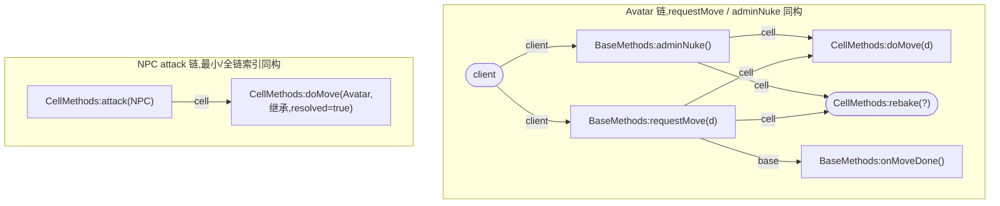

# FLOW-001(KFLOW-CORE-01)现有图失败样本 — 审计纪实

日期:2026-11-14。todo.md FLOW-001(旧 KFLOW-CORE-01):记录现有图失败样本。验收:选真实入口收集缺失本地帧、错误跨进程落点、合成 client 和同名混边;保留原图与预期路径做回归依据。

## 交付面

**`tests/flowFailureSamples.test.ts`**(6 例审计钉,零生产码改动)——现任本地调用树面 `buildDefCallChain`(src/backend/defCallChain.ts)上的四个失败族,样本全部按真实 KBEngine 工程形态构造(Avatar base/cell/client 三脚本 + NPC extends Avatar 继承 + 客户端只调 requestMove 的真实入口);每例注释先写「预期路径」再钉「当前真值」。

## 样本域与图面盘点(现有图 = 三条链)

| 图面 | 实现 | 本批处置 |
|---|---|---|
| 本地调用树 | `buildDefCallChain`(defCallChain.ts,def 方法 BFS) | **钉 6 例**(四失败族全在此面) |
| 进程流转图 | `entityFlowGraph`(def 旗标驱动:Exposed/Flags/Persistent,client→base→cell→aoi→db) | 不钉:边方向由 def 旗标构造性决定,四失败族不适用;跨进程「落点」语义缺陷归 FLOW-007 重做面 |
| 工作区调用图 | Rust `$/kode/python/callgraph`(callgraph.rs) | 不钉(移动面,并发会话在改):分类按接收者形态(kbe-xxx/Local/Unknown),同名 callee 节点消歧在面板消费点——同名混边风险记入 FLOW-004 重做清单 |

## 四失败族(每例:真实入口 → 原图 → 预期路径 → 根因)

### S1 缺失本地帧:模块函数调用不可见

- **真实入口**:客户端 → Exposed `requestMove`(base)→ `self.cell.doMove(d)`(cell)→ `clamp_pos(d)`(自 `nav_helpers` 导入的模块函数,移动钳制,经典 helper)。
- **原图**:doMove 进入图,`clamp_pos` 无帧无边。
- **预期路径**:doMove → 本地帧 `nav_helpers.clamp_pos`(带调用点 file:line)。
- **根因**:`findPlainSelfCalls`(defCallChain.ts:138-171)只认 `self.<name>(`;裸名调用不在扫描面。

### S2 缺失本地帧:跨实体接收者调用不可见

- **真实入口**:cell 脚本拉怪/互打形态——`found = KBEngine.entities.get(101)` 后 `found.cell.halt()`。
- **原图**:整段不可见(无节点无边)。
- **预期路径**:跨实体边 `Avatar.doMove → Monster.halt`(带调用点证据);引擎 KBEngine.entities 检索→cell 角色方法调用是Monster AI 交互的标准形态。
- **根因**:同 :138/:134 扫描面只认 `self.` 前缀;`PYTHON_RECEIVER_CALL_PATTERN`(pythonLanguageUtils.ts:134)字面注释「entity.cell.X 等局部接收者不识别(用户令)」——这是 F12 引用面的既定口径,调用树重做时须另行建模跨实体边。

### S3 错误跨进程落点:非法接收者组合仍画边

- **真实入口**:base 脚本 `requestMove` 内 `self.base.onMoveDone()`——baseapp 实体没有 `.base` 属性(引擎九面表 `PYTHON_RECEIVER_FACES` base.base=null,baseapp/entity.cpp 构造点逐个核实,Rust refs.rs bind_self_role 同源语义),运行期必 AttributeError。
- **原图**:`Avatar:BaseMethods:requestMove>Avatar:BaseMethods:onMoveDone:base` **已解析边**。
- **预期路径**:无边(或 AttributeError 形态的诊断/未解析标记)。
- **根因**:defCallChain.ts:193 `findPythonReceiverCalls(bodyText)` 未传 `callerFace` → `pythonReceiverSectionFor` 落到无条件段映射(:128-131),面合法性闸被绕过。F12/Hover/诊断面都已带面(逐面语义表已收口),唯独调用树链没带。

### S4 错误跨进程落点(潜伏面,当前不可达):未解析调用恒标根实体名

- **形态**:defCallChain.ts:276 `unresolvedNode(index.rootName, …)`——未解析节点一律挂链根实体名。
- **现状**:不可达。frontier 里非根实体 def(继承体)全被 S5 截断挡住,永远走不到「继承体内产生未解析调用」这一步;自身体的未解析调用标 rootName 是正确的(C1 对照钉)。
- **预期路径**(FLOW-004 修复继承绑定后必须一并修):未解析节点标**调用点所属实体**的方法段,不是链根。
- **风险**:只修绑定不修归属会把潜伏缺陷翻成活性缺陷——两个修必须同一批。

### S5 缺失本地帧:继承 def 入图但实现体静默截断(双因)

- **真实入口**:NPC(extends Avatar)cell 攻击逻辑 `self.cell.doMove()`(实现在 Avatar)。
- **原图**:`Avatar:CellMethods:doMove` 节点入图且 **resolved=true**,零出边——图呈现「已解析的叶子」,比未解析框更误导。
- **预期路径**:解析到 Avatar.py 的 doMove 实现并继续展开(其体内调用面全部可见)。
- **根因(双因,探针实证)**:
  1. **文件臂**:实现文件不在本实体索引(owner 文件发现不全)→ `findBoundMethod`(defCallChain.ts:125-135)第一臂 filePath==defFile 永假(pythonMethods 存 .py 路径,defFile 是 .def 路径,该臂**结构性永假**——注意:这意味着第一臂从未生效过,绑定实际全靠第二臂身份匹配);
  2. **身份臂**:即使实现文件已绑定(生产常态,P4 钉),`sameIdentity`(entityMappingHelpers.ts:59-68)逐字段比较含 **sourceKind**——继承 def identity.sourceKind='base',python 绑定恒为 'local',永不相等 → 两臂全落空。
- **推论**:现任调用树实际只能展开「链根实体本地方法」,继承链实现体在任何索引形态下都不可见。KFLOW 重做的本地解析必须按「def 声明 → 实现文件(全 owner 链)→ 方法体」三段解析,身份比较用 (ownerName, section, symbolName) 三元组,sourceKind/sourceChain 不参与实现绑定。

### S6 合成 client:Exposed 方法无客户端证据仍获 client 入边

- **真实入口**:客户端源码(scripts/client/Avatar.py `chooseRole`)只调 `self.base.requestMove(3)`;`adminNuke` 虽 `<Exposed>` 但无任何客户端调用证据。
- **原图**:`adminNuke` 链仍含合成 `client` 源节点 + `client>Avatar:BaseMethods:adminNuke:client` 入边(defCallChain.ts Part A :293-311,对链内全部 Exposed 方法无条件加边);client 源节点不带证据字段(methodName 空、signature 恒 'client')。
- **预期路径**(FLOW-006 验收原文):有客户端源码→绑定实际调用点到 Exposed RPC;无客户端源码→只显示外部入口和证据(`<Exposed>` 旗标),不能伪造 Client 函数栈。
- **根因**:Part A 把「Exposed=可能被客户端调」直接画成「client 调用边」,证据(调用点)与推断(旗标)两种来源不区分。现状的合成节点是纯来源标记(不伪造函数帧),但边语义仍是无证据的调用主张。

### C1 对照钉:自身体未解析调用按 rootName 标注是正确的

NPC.stalk(本地)调 `self.cell.despawn()`(处处未定义)→ `NPC:CellMethods:despawn:unresolved`——归属正确。与 P4 对照锁死缺陷面边界:在「未解析归属」维度上自身体无缺陷。

### P6 回归基准:继承重名入口的 defFile 同文件臂

NPC.def 本地 attack(line 5)与 Avatar.def 继承 attack(line 12)并存时,入口按 start.filePath 同文件臂命中正确声明(双向验证:NPC.def→NPC 本地 / Avatar.def→Avatar 声明)。记录为回归基准:FLOW 重做入口解析不得让继承重名吞掉本地声明。

## 原图存档(经 P1-P6 断言锁死的节点/边集渲染)

S1/S2 的帧(clamp_pos、found.cell.halt)在两图中均不存在——缺失本身就是样本。

## 修复合计(归属,不实施)

| 样本 | 修复归属 | 修法要点 |
|---|---|---|
| S1 | FLOW-004 | 本地解析加裸名/导入函数帧(命名空间感知:模块函数 vs 内建) |
| S2 | FLOW-004/FLOW-007 | 跨实体接收者建模(`entities.get(...).cell.X` 形态识别,接收实体候选解析) |
| S3 | FLOW-007 | 链扫描传 callerFace(逐面语义表已存在,一行接线)+ 非法组合降级为诊断/未解析标记 |
| S4 | FLOW-004(与 S5 同批) | 未解析归属改调用点所属实体 |
| S5 | FLOW-004 | 实现绑定三段解析;sameIdentity 去 sourceKind;第一臂结构性永假须重写 |
| S6 | FLOW-006 | client 边分证据/推断两态;无证据态降级为「外部入口+<Exposed> 证据」标记 |

## prove-red 说明

本批零生产码改动(审计钉批,DATA-01 同款):prove-red 不适用——断言即当前真值,接线破坏/语义漂移即红。P1-P6 全部先经探针实证(fixtures 按 parsePythonMethodBlocks 真值派生行号)再钉,未凭猜测写断言。

## 坑账

1. **buildDefCallChain 的 readPythonFile 默认读真盘**:不传时 `readPythonFileWithMtimeCache` 按绑定 filePath 读磁盘,虚拟路径全落 null → 整链退化为「零调用面」;测试必须显式传 readPythonFile(首轮 5/6 红即此因);
2. **findBoundMethod 第一臂结构性永假**:pythonMethods.filePath 恒 .py、defFile 恒 .def,filePath 相等臂不可能命中——读代码时勿被「先按文件后按身份」的顺序误导,实际绑定只靠身份臂;
3. **sameIdentity 含 sourceKind/sourceChain**:构造继承身份夹具时 identity.sourceKind 必须 'base',否则钉的不是生产真值(本批 P3→P4 的探针迭代即此坑);
4. **vitest 静默 console.log**:探针输出勿走 console,直接写成断言(测试即探针)。

## 门禁

compile 0 / eslint 0 / vitest 全量(本批 +6 例审计钉)/ xvfb demo 25 RC=0(全量门禁数以跑批时点为准,见 todo.md 勾行)。
