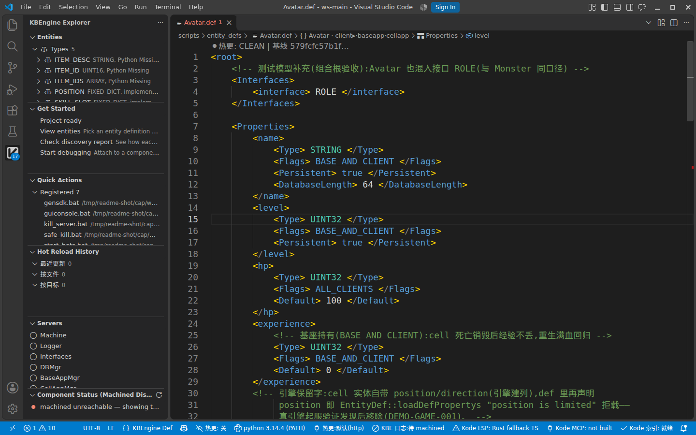
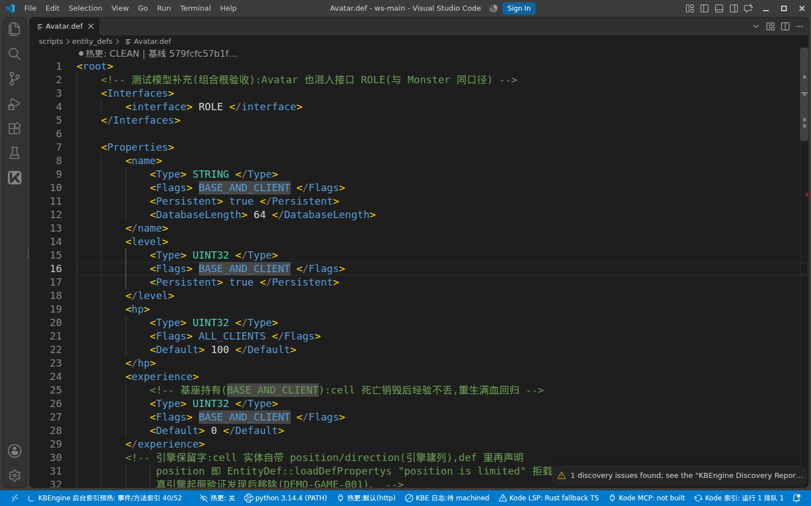
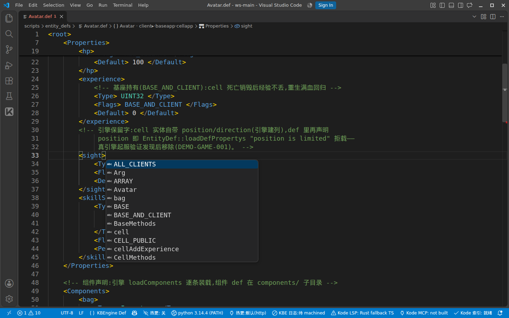
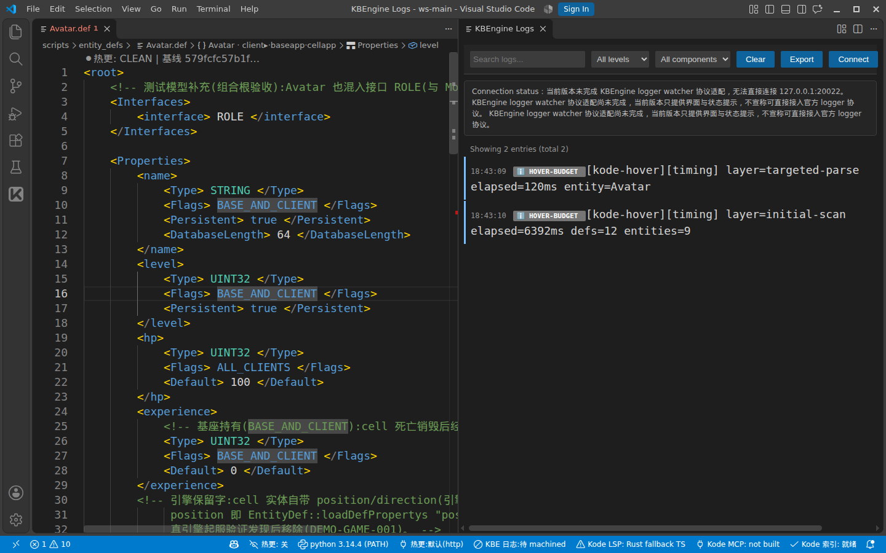

# 界面区域

Kode 在 VS Code 窗口里的落位——每块 UI 在哪个区域、怎么打开、背后的配置开关。

上图标注了 VS Code 窗口的标准区域（活动栏、侧边栏、编辑器区、面包屑、装订线、缩略图、底部面板、状态栏、命令面板）。下面逐块说明 Kode 在每个区域放了什么。

本页每个条目都对应 `package.json` 里声明的贡献点或扩展源码里的装配点——不发明不存在的 UI。能力未完成的（例如日志查看器的 logger 协议适配）如实注明，不当作可用能力来描述。

## 活动栏（Activity Bar）

Kode 在活动栏加一个图标（Kode logo）。点击即在侧边栏打开 **KBEngine 资源管理器** 容器。

- 怎么打开：点击活动栏的 Kode logo（右键活动栏可隐藏/恢复容器——VS Code 标准行为）。
- 放了什么：容器承载 Kode 全部侧边栏视图——实体浏览器、开始、快捷操作、热更历史、服务器控制、组件状态、Telnet 状态、玩家数据、远程服务器、调试目标、配置、Git 历史、Git 区间历史、类型预览（共 14 个视图，`package.json` 中的 `kbengine-explorer` 容器）。
- 相关配置：无直接开关——视图可见性是 VS Code 界面状态，不是扩展配置。

截图：待补（已登记 todo；侧边栏一节展示了打开后的视图）。

## 侧边栏（KBEngine 资源管理器视图）

- **实体浏览器** —— 实体树固定四分组：`Types`、`Entities`、`Interfaces`、`Components`（组头带实时计数）。点击实体打开其 `.def`/脚本分部；树是只读导航，不是编辑器。目录着色生效期间（见下一节）四个组头换彩色 SVG 图标,否则用默认主题图标。
- **开始** —— 发现/引导视图：工作区识别中如实显示状态（识别中 / 未找到 / 失败 / 就绪），陈旧根一律弃置不冒充当前态。
- **快捷操作** —— 快捷操作树（跑默认脚本、扫描脚本、按名运行）。
- **组件状态 / 服务器控制 / Telnet 状态** —— 服务器生命周期、组件状态、telnet 会话状态。
- **玩家数据 / 远程服务器 / 调试目标** —— 玩家数据视图、远程服务器清单、调试目标。
- **Git 历史 / Git 区间历史** —— 文件历史与选区历史视图（与下方编辑器右键菜单同一份数据）。
- **类型预览** —— 自定义类型（utype / FIXED_DICT）解析预览。
- 怎么打开：活动栏 → Kode logo；各视图独立折叠/展开；也可拖出为浮动面板。
- 相关配置：视图反映活动项目 profile，见[配置说明](./configuration.md)。

## 目录着色

按路径语义给工作区文件与 Kode 自有树视图着色（FOLDER-COLOR-001，`kbengine.folderColors.*`）。

- 出现在哪：①原生 Explorer 里给**文件**挂单字母角标+主题色——资产根 `A` 橙、`venv`/`.venv` `V` 弱化灰、`docs/` `D` 蓝、`configs/` `C` 紫、`logs/` `L` 红,`scripts/<角色>/` 下按进程色(baseapp 蓝 `B`、cellapp 绿 `C`、client 黄 `U`、bots 紫 `T`——与进程面包屑同源的角色目录判定链);②实体树四分组组头换彩色 SVG 图标(`resources/icons/folder-colors/`)。
- 双条件门：`kbengine.folderColors.enabled` = true **且** `workbench.colorTheme` 属 KBEngine 主题族。其他主题下功能完全静默,与未安装无异;切主题/拨开关即时生效(角标与图标无重载刷新)。
- 规则：`kbengine.folderColors.rules`(glob+语义+单条开关),数组序第一条命中即用;未设置 = 内置六条。完整规则表见配置指南的[目录着色节](./configuration.md#目录着色)。
- 边界如实：VS Code 无扩展 API 给原生 Explorer 文件夹上底色/换文件夹图标——能着色的只有文件装饰(文件角标)与 Kode 自有树视图。文件夹底色永不承诺。

## 编辑器区（Editor）

`.def` 文件：

- def XML 方言的语法高亮、补全、悬停（utype 解析、`types.xml` 别名、引擎锚定说明）。
- F12（转到定义）与 F2（重命名）贯通 `.def` ↔ Python 实体脚本，导航走 Rust-first 车道。

Python 实体/工具脚本：

- **CodeLens**（方法/属性上方）：文件顶部修改时间透镜；实体方法上的 RPC / 接收端分段透镜（点击执行 `kbengine.source.reveal` 源码揭示，跳到 def 声明或对端面）；`types.xml` 别名透镜；数据库落库透镜（`+N 处落库` 经 `kbengine.database.open` 打开数据库视图）。开关：`kbengine.codeLens.property`、`kbengine.codeLens.rpc`、`kbengine.codeLens.typesXml`、`kbengine.entity.receiverSections`。
- **Inlay 提示**：整行锚 `# kode:props-from-def` 处的 def 属性提示（`kbengine.inlayHints.defProps`）；baseapp 实体上的 cellData 复制属性提示（`kbengine.inlayHints.propertyShadow`）。
- **格式化**：探测到 ruff 时注册 Python document/range 格式化 Provider——Shift+Alt+F 不走命令即可用。**绝不抢默认**：`editor.defaultFormatter` 原样不动，除非你接受一次性提示。命令 `kbengine.python.ruffFormat` 一键格式化当前文件。
- 诊断与快速修复：见下方面板区的问题面板。

怎么打开：打开 KBEngine 工程里的 `.def` 或 `.py` 文件即可——Provider 按语言自动生效。

截图：

## 面板区（Panel，底部）

**输出视图** —— Kode 写这些通道（输出视图下拉里选择）：

- `KBEngine Logs`、`KBEngine Console 日志`（组件控制台通道按 `KBEngine: <组件>` 出现）、`KBEngine Runtime`
- `KBEngine Ruff`（lint/format 的 pip 输出）、`KBEngine Def 分析`、`KBEngine Dependency`
- `KBEngine Project Doctor`、`KBEngine 数据库预览`、`KBEngine 机器人`、`KBEngine Player Clone`
- `KBEngine Annotations`、`KBEngine Compatibility`、`KBEngine Navigation`、`KBEngine HTTP 快捷请求`、`KBEngine py-spy`、`KBEngine Stub Pyright`、`KBEngine Symbol References`
- 热更日志、发现报告、def MD5、JSONC 关联、调试配置、数据库漂移、kode-core 对拍差异通道

**问题视图** —— Kode 诊断按来源分组、带 `kbengine.*` 族诊断码，例如：`kbengine.attributeNone`（None 流成员访问）、RPC 实参个数错配、角色/base 误用、接收端 None、只读面写入、空间导航误用、属性方向违规、销毁后使用、entities.xml 重复/顺序检查、配置值校验（未知键、枚举/类型违规）。Python 侧行为规则背后的依据见 [KBEngine lint 规范](./kbengine-lint-rules.md)；完整诊断清单见[功能概览](./features.md)。

**诚实边界**：日志查看器 WebView（见[日志查看](./logging.md)）随扩展提供但 logger 协议适配明确未完成——扩展在产品内如实提示，绝不把未核实的协议实现当作可用能力。

## 状态栏（Status Bar）

Kode 在状态栏右侧最多占十项（VS Code 按优先级排序；Kode 有意避开内置的 100–101 位）：

| 优先级（降序） | 项目 | 行为 |
| --- | --- | --- |
| 100 | 服务器状态 | 服务器生命周期状态；点击打开服务器控制 |
| 99 | Telnet 状态 | telnet 会话状态 |
| 98 | 热更状态 | 自动热更状态 |
| 97 | 解释器 | 选定的 Python 解释器；点击 → `Select Python Interpreter`。**装了 `ms-python.python` 即让位**（对方自己的选择器出镜；选择/创建 venv 仍可走命令面板） |
| 96 | 热更通道 | 热更换乘哪条通道（machined/HTTP） |
| 95 | 日志 tail | 控制台日志尾随状态 |
| 94 | Kode 核心 | kode-server 车道（Rust / Rust 降级 TS / TS / 对拍）。点击看对拍差异日志。tooltip 另含**引擎版本**行（数据源=引擎树版本标记探测链，未检出显式「未检测到」，绝不编造）。配置：`kbengine.core.backend`、`kbengine.core.serverPath`、`kbengine.engineRoot`（引擎版本行随其变化重探） |
| 93 | Kode MCP | 内建 MCP 服务器状态（已关闭 / 未构建 / 已构建 / 正常 / 无应答——末两态是活性探针脸：激活后与配置变化时各跑一轮 `kode-mcp --probe` 握手探活，不做轮询；「已构建」只说明二进制在位，「正常」=真能拉起并应答 MCP 握手）。点击启停。配置：`kbengine.mcp.enabled`（默认开） |
| 92 | Kode 索引 | 索引生命周期：`$(check) 就绪` / `$(sync~spin) 运行 n 排队 n` / `$(error) 失败 n` / `$(circle-slash) 未知`（四态，固定判定顺序——刻意没有「部分索引」态，因为调度器没有这个数据面）。就绪态 tooltip 附最近一轮建立完成时刻（本地时间）与耗时；从未建完不加该行。点击打开 Project Doctor |
| 91 | Core 健康 | kode-server 活性灯，六态：关（backend=ts，整灯隐藏）/ 未接入（配了 rust/shadow 但二进制落空）/ 无响应 / 降级 / 正常 / 待探活；无响应与未接入带错误底色。10s 自续探针（`$/kode/health`，2s 预算竞速——探针自身永不悬挂）驱动脸面；只观测，不驱动回落。点击 = 详情（探针结果 + 失败原因词 + 命令腿熔断连超次数）+ QuickPick，选「重启核心服务」才真重启 |

截图：待补（已登记 todo）。

## 命令面板（Command Palette）

Kode 的全部命令注册在 `KBEngine` 分类下——打开命令面板（Ctrl/Cmd+Shift+P）输入 `kbengine` 或 `KBEngine` 即可。完整表（标题、入口、行为、边界、诚实口径）在[命令与面板](./commands.md)；命令面板只是入口之一（视图、状态栏项、右键菜单是其他入口）。

## 右键菜单

- **编辑器右键**（编辑器内右键）：*显示文件历史* 与 *显示选区历史*（后者仅在有选区时出现），都以 git 历史功能对该文件启用为前提。
- **资源管理器右键**（文件树内右键）：文件夹上的 *新建实体*；`.kdpclone` 归档上的 *Player Clone* 检查/导入；文件上的 *显示文件历史*。
- **视图右键**：侧边栏视图自带标题栏与逐项操作（揭示、刷新、各视图命令）——见视图右上 `…` 菜单。

## 设置编辑器

打开设置（Ctrl/Cmd+,）搜索 `kbengine`——扩展配置按分组组织（hover、inlay 提示、code lens、python、core、mcp、ai 等）。两份伴生文档：

- [配置说明](./configuration.md) —— 配置键清单与默认值
- [配置开关效果](./config-effects.md) —— 每个开关翻转后看得见的变化

本页缺的截图（活动栏、状态栏、命令面板、右键菜单、设置）待补；已登记 todo。
