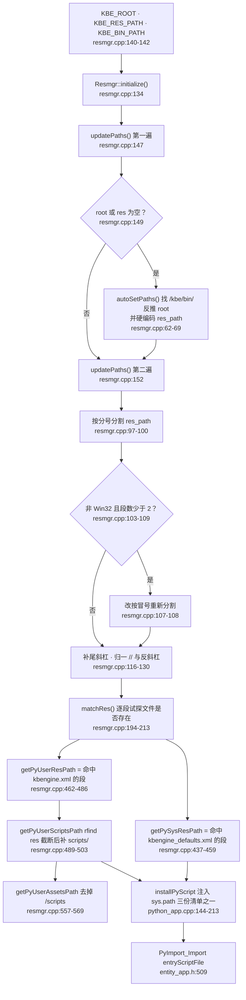

# 固定目录与路径解析链

> KODE-CFG-011 · KB-001 引擎机制。以下每条结论都标注 `kbe/src` 的 `文件:行号`，
> 源码取自只读检出 `/home/cui/workspaces/kbengine`（commit `c2a3b8f`）。
> 同批篇目：[入口脚本 SPI 方法表](entry-script-spi-methods.md)、
> [启动流程与堆栈](startup-flow-and-stack.md)、
> [实体对象生命周期与引用释放](entity-lifecycle-reference.md)。

脚本目录只有三个决定点：`Resmgr` 读的环境变量、这些变量被切出来的
`res_path`、以及写死并注入 `sys.path` 的目录清单。三者都在编译期定死，
项目想多加一个搜索目录只能改引擎。

## 路径从哪来

### 三个环境变量

`Resmgr::initialize()` 读取 `KBE_ROOT`、`KBE_RES_PATH`、`KBE_BIN_PATH`
（`kbe/src/lib/resmgr/resmgr.cpp:134`、`:140-142`），先跑一次 `updatePaths()`
（`:147`）；若 `root_path` 或 `res_path` 仍为空，则回退 `autoSetPaths()`
（`:149-150`）再跑一次 `updatePaths()`（`:152`）。之后校验三个派生路径，
缺失时打印 `not set environment`（`:154-164`），最后置 `isInit_ = true`
（`:166`）。

`autoSetPaths()` 在可执行文件路径里找字面量 `/kbe/bin/`
（`kbe/src/lib/resmgr/resmgr.cpp:62`），从那里截断得到引擎 root
（`:67-68`），然后写死资源路径：

```
<root>kbe/res/;<root>/assets/;<root>/assets/scripts/;<root>/assets/res/
```

（`kbe/src/lib/resmgr/resmgr.cpp:69`）。注意不对称：`kbe/res/` 前面没有斜杠，
三条 `assets` 有——`:67-68` 截断后 root 一定以 `/` 结尾。

`Resmgr::initialize()` 由 `loadConfig()` 在读任何配置文件之前调用
（`kbe/src/lib/server/kbemain.h:68`，配置读取在 `:71`、`:74`），所以路径解析
先于 `kbengine_defaults.xml`。

### `res_path` 的切分规则

`updatePaths()`（`kbe/src/lib/resmgr/resmgr.cpp:73-131`）先归一化
`root_path` / `bin_path`（补尾斜杠、`//`→`/`、`\\`→`/`，`:76-94`），再按 `;`
切分 `res_path`（`:97-100`）。在非 Windows 构建上，如果切出来少于 2 段，就清空
后改按 `:` 重切（`:103-110`）——守卫上方的注释说明了 Windows 为什么不能走这条
分支：会把盘符切开（`:102`）。每段补尾部分隔符（`:116-121`），再用同一个切分符
拼回去（`:123-130`）。

## 系统资源根与用户资源根

`matchRes(const char*)` 按顺序遍历 `respaths_`，返回第一个「段 + 相对路径」
在磁盘上存在的段；全部未命中则原样返回入参（`kbe/src/lib/resmgr/resmgr.cpp:194-213`）。

| 取值函数 | 探测文件 | 未命中时的回退 | 行号 |
| --- | --- | --- | --- |
| `getPySysResPath()` | `server/kbengine_defaults.xml` | `respaths_[0]` | `kbe/src/lib/resmgr/resmgr.cpp:437-459`（`matchRes` 在 `:443`，回退在 `:453-454`） |
| `getPyUserResPath()` | `server/kbengine.xml` | 先 `respaths_[1]`，再 `respaths_[0]` | `kbe/src/lib/resmgr/resmgr.cpp:462-486`（`matchRes` 在 `:468`，回退在 `:478-481`） |

两者的返回值都缓存在函数内 `static` 字符串（`resmgr.cpp:439`、`:464`），一个进程
只解析一次。默认布局下即：系统根 = 含 `kbe/res/` 的段，用户根 = 含 `assets/res/`
的段。

## scripts 路径是推导出来的，不是配置出来的

`getPyUserScriptsPath()` 取 `getPyUserResPath()`，用 `rfind` 找子串 `res` 的
**最后一次**出现（`kbe/src/lib/resmgr/resmgr.cpp:497`），从那里截断到末尾
（`:498`）再补 `scripts/`（`:499`）：

```cpp
path = getPyUserResPath();
std::string::size_type pos = path.rfind("res");
path.erase(pos, path.size() - pos);
path += "scripts/";
```

由此得到三条结论：

- `assets/res/` 与 `assets/scripts/` 是兄弟目录，结尾的 `res` 后缀就是唯一锚点
  ——知道 `assets` 就能推出 `scripts`，这也是没有 `KBE_SCRIPTS_PATH` 变量的原因。
- 锚点是子串匹配而非路径段匹配：用户根里最后一个 `res` 出现在别处时（比如目录名
  就叫 `resource`），会静默算出错误的 `scripts/` 路径。
- 用户根里完全没有 `res` 时，`rfind` 返回 `npos`，`erase(npos, …)` 按 C++
  标准抛 `std::out_of_range`——不含 `res` 的 `KBE_RES_PATH` 不只是错，是致命。

`getPyUserAssetsPath()` 就是把 `/scripts` 与 `\scripts` 去掉后的同一条路径
（`kbe/src/lib/resmgr/resmgr.cpp:557-569`，替换在 `:564-565`）。

## 注入 `sys.path` 的固定目录清单

一共三份写死的清单，按应用基类各用一份，末尾都追加同一个系统侧目录
`getPySysResPath() + "scripts/common"`。

### 1. `PythonApp::installPyScript` —— loginapp、dbmgr、interfaces、logger

`kbe/src/lib/server/python_app.cpp:144-213`，由 `PythonApp::inInitialize()`
调用（`:74`）：

| 阶段 | 目录 | 行号 |
| --- | --- | --- |
| 前置校验 | `respaths`、用户根、系统根、scripts 路径必须非空 | `python_app.cpp:146-151` |
| 所有组件公共 | `common`、`data`、`user_type` | `python_app.cpp:168-170` |
| `BASEAPP_TYPE` | `server_common`、`base`、`base/interfaces`、`base/components` | `python_app.cpp:174-179` |
| `CELLAPP_TYPE` | `server_common`、`cell`、`cell/interfaces`、`cell/components` | `python_app.cpp:180-185` |
| `DBMGR_TYPE` | `server_common`、`db` | `python_app.cpp:186-189` |
| `INTERFACES_TYPE` | `server_common`、`interface` | `python_app.cpp:190-193` |
| `LOGINAPP_TYPE` | `server_common`、`login` | `python_app.cpp:194-197` |
| `LOGGER_TYPE` | `server_common`、`logger` | `python_app.cpp:198-201` |
| default（client） | `client`、`client/interfaces`、`client/components`，**不含** `server_common` | `python_app.cpp:202-207` |
| 系统侧 | `getPySysResPath() + "scripts/common"` | `python_app.cpp:209-210` |
| 安装 | `getScript().install(tbuf, pyPaths, "KBEngine", componentType_)` | `python_app.cpp:213` |

### 2. `getComponentPythonPaths` —— baseapp、cellapp

`EntityApp::installPyScript()`（`kbe/src/lib/server/entity_app.h:370-389`）
**不走**上面的 switch，而是调 `getComponentPythonPaths()`
（`entity_app.h:381`），实现在 `kbe/src/lib/entitydef/common.cpp:72-126`。
清单基本相同（公共段 `common.cpp:88-91`，`BASEAPP`/`CELLAPP`/`DBMGR` 分支
`:95-110`，系统侧 `:118-119`），两处差异：

- 开头多拼一个空段 `L";"`（`common.cpp:88`），即 scripts 根本身也进 `sys.path`；
- 它的 `switch` 只认 `BASEAPP`、`CELLAPP`、`DBMGR` 和 `default`
  （`common.cpp:93-116`）——真拿它去算 login/interface/logger 会落进 `client` 分支。

### 3. `client_lib/kbemain.h` 的 `installPyScript` —— client、bots

`kbe/src/lib/client_lib/kbemain.h:57-110`，调用点 `:262`。公共段在 `:81-83`，
`CLIENT_TYPE` 走 `client`、`client/interfaces`、`client/components`（`:85-90`），
其余（即 bots）走 `bots`、`bots/interfaces`、`bots/components`（`:91-96`）；
系统侧 `:98-99`，`script.install(...)` 在 `:102`。

### 哪个基类用哪份清单

| 组件 | 基类 | 目录清单 |
| --- | --- | --- |
| baseapp、cellapp | `EntityApp<Entity>`（`kbe/src/server/baseapp/baseapp.h:37`、`kbe/src/server/cellapp/cellapp.h:21`） | `entitydef/common.cpp:72-126` |
| loginapp、dbmgr、interfaces、logger | `PythonApp`（`kbe/src/server/loginapp/loginapp.h:22`、`kbe/src/server/dbmgr/dbmgr.h:32`、`kbe/src/server/tools/interfaces/interfaces.h:24`、`kbe/src/server/tools/logger/logger.h:49`） | `python_app.cpp:144-213` |
| bots、client | `ClientApp`（`kbe/src/server/tools/bots/bots.h:40`） | `client_lib/kbemain.h:57-110` |

入口模块的导入同样分开：`EntityApp::installPyModules()` 在
`kbe/src/lib/server/entity_app.h:509` 导入 `entryScriptFile`（base/cell 分支
`:495-504`），`PythonApp::installPyModules()` 在
`kbe/src/lib/server/python_app.cpp:340`（组件分支 `:234-266`），
`Bots::installPyModules()` 在 `kbe/src/server/tools/bots/bots.cpp:218`，
client 在 `kbe/src/lib/client_lib/clientapp.cpp:272`。

## 坑：`getPyUserComponentScriptsPath` 只认四种组件

`Resmgr::getPyUserComponentScriptsPath()`（`kbe/src/lib/resmgr/resmgr.cpp:506-555`）
是组件→目录映射的第二处独立硬编码。两个分支（`componentType ==
UNKNOWN_COMPONENT_TYPE` 走 `:516-525`，否则走 `:538-547`）都只认 `CELLAPP`、
`BASEAPP`、`BOTS`、`CLIENT`，其余类型直接 `KBE_ASSERT(false)`（`:525`、`:547`）。

这与另外两份清单所处的七组件世界不一致（login/dbmgr/interfaces/logger 在这里缺席），
也与 `getComponentPythonPaths`（认 base/cell/db、不认 bots/client）不一致。
它在树内只有一个调用点：`PyEntityDef::loadAllScriptForComponentType()`
（`kbe/src/lib/entitydef/py_entitydef.cpp:1867`），而该函数在调用之前就已经把
base/cell 以外的类型挡掉了（`py_entitydef.cpp:1849-1865`，`else` 分支在
`:1862-1865`）。

实际用法：不要对非实体组件调 `getPyUserComponentScriptsPath`——那个断言是活的
代码路径，不是死分支。

## `entryScriptFile` 默认是 `kbemain`

`kbe/res/server/kbengine_defaults.xml` 每个组件段的入口模块默认值都是 `kbemain`
（是模块名，不是文件路径）：interfaces `:238`、dbmgr `:274`、cellapp `:451`、
baseapp `:592`、loginapp `:746`、bots `:837`、logger `:908`。读入
`entryScriptFileName` 在 `kbe/src/lib/server/entity_app.h:494-504` 与
`kbe/src/lib/server/python_app.cpp:233-266`，导入在 `entity_app.h:509` /
`python_app.cpp:340`。

## 解析链



## 坑位汇总

- `initialize()` 内部跑两遍 `updatePaths()`（`resmgr.cpp:147`、`:152`）：
  依赖 `autoSetPaths()` 之后才成立的 `KBE_RES_PATH` 没问题，但非空却畸形的值会
  原样进 `respaths_`。
- 按冒号重切（`resmgr.cpp:103-110`）在 Windows 上永远不走，这是有意的。
- `getPyUserScriptsPath()` 是子串截断，不是路径截断（`resmgr.cpp:497-499`）。
- 同一套目录布局存在三份写死清单（`python_app.cpp:144-213`、
  `entitydef/common.cpp:72-126`、`client_lib/kbemain.h:57-110`），边缘处互相不一致。
- `getPyUserComponentScriptsPath()` 对七种服务端组件中的四种会断言
  （`resmgr.cpp:525`、`:547`）。

下一篇：[入口脚本 SPI 方法表](entry-script-spi-methods.md) ·
[启动流程与堆栈](startup-flow-and-stack.md)
