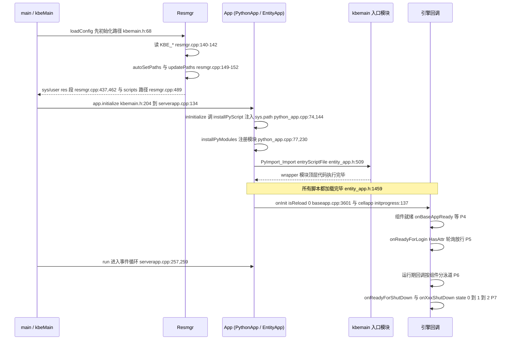

# 启动流程与堆栈

> KODE-CFG-013 · KB-001 引擎机制。阶段顺序与下面每一帧都取自
> `/home/cui/workspaces/kbengine`（commit `c2a3b8f`）的 `kbe/src`。
> 同批篇目：[固定目录与路径解析链](fixed-directories-and-path-resolution.md)、
> [入口脚本 SPI 方法表](entry-script-spi-methods.md)。

## 七个阶段

| 阶段 | 发生了什么 | 证据 |
| --- | --- | --- |
| **P0 环境路径** | `Resmgr::initialize()` 读 `KBE_ROOT` / `KBE_RES_PATH` / `KBE_BIN_PATH`，跑 `updatePaths()`，root 或 res 为空则回退 `autoSetPaths()`，再跑一次 `updatePaths()`，随后解析出系统根、用户根与 scripts 路径 | `kbe/src/lib/resmgr/resmgr.cpp:134`、`:140-142`、`:147`、`:149-150`、`:152`；`autoSetPaths` `:62-69`；`updatePaths` `:73-131`；`getPySysResPath` `:437`；`getPyUserResPath` `:462`；`getPyUserScriptsPath` `:489` |
| **P1 模块导入** | `installPyScript()` 把固定目录清单注入 `sys.path`，`installPyModules()` 注册引擎 Python 模块，最后 `PyImport_Import(entryScriptFile)` 执行 **wrapper 模块顶层代码** | `kbe/src/lib/server/python_app.cpp:144`、`:213`、`:230`、`:340`；`kbe/src/lib/server/entity_app.h:281`、`:284`、`:509` |
| **P2 脚本加载完成** | 引擎自己的标记：注释「所有脚本都加载完毕」紧挨首个回调之前；`entryScript_` 此时已持有模块对象 | `kbe/src/lib/server/entity_app.h:1459` / `python_app.cpp:708`（热重载路径）；冷启动证据：`kbe/src/server/baseapp/initprogress_handler.cpp:184`、`loginapp.cpp:173`、`dbmgr.cpp:308`、`interfaces.cpp:152`、`logger.cpp:128`、`cellapp/initprogress_handler.cpp:136`、`bots.cpp:101`、`clientapp.cpp:130`；模块持有在 `entity_app.h:509` |
| **P3 首个引擎回调** | `onInit(isReload)`——启动路径传 `0`，热重载路径传 `1` | 启动：`kbe/src/server/baseapp/baseapp.cpp:3601`、`kbe/src/server/cellapp/initprogress_handler.cpp:137`、`kbe/src/server/tools/bots/bots.cpp:102`、`kbe/src/lib/client_lib/clientapp.cpp:131`；热重载（`isReload=1`）：`entity_app.h:1460`、`python_app.cpp:709` |
| **P4 组件就绪** | 各组件各自的 Ready 回调 | `onBaseAppReady` `kbe/src/server/baseapp/initprogress_handler.cpp:185`；`onLoginAppReady` `kbe/src/server/loginapp/loginapp.cpp:174`；`onDBMgrReady` `kbe/src/server/dbmgr/dbmgr.cpp:309`；`onInterfaceAppReady` `kbe/src/server/tools/interfaces/interfaces.cpp:153`；`onLoggerAppReady` `kbe/src/server/tools/logger/logger.cpp:131`；cellapp 没有独立就绪回调，用的是 `cellapp/initprogress_handler.cpp:137` 的 `onInit(0)` |
| **P5 开放登录** | `onReadyForLogin` 带 `PyObject_HasAttrString` 守卫；处理器每 tick 轮询，返回值达到 ≥ 0.9999 才上报 `onBaseappInitProgress` 并自毁 | 守卫 `initprogress_handler.cpp:201`、调用 `:206`、阈值 `:244`、上报 `:250-254`、自毁 `:256-260`；cellapp 侧 `cellapp/initprogress_handler.cpp:153`、`:156` |
| **P6 运行期** | 按组件分的数据 / 空间 / 账号 / 计费回调，全部列在 [入口脚本 SPI 方法表](entry-script-spi-methods.md) | `entity_app.h:1308`、`baseapp.cpp:3668`、`cellapp.cpp:864`、`spacememory.cpp:609`、`loginapp.cpp:1013`、`dbmgr.cpp:1242`、`interfaces.cpp:637`、`logger.cpp:290` |
| **P7 关停** | 先可选的 `onReadyForShutDown`，再按 `0 → 1 → 2` 三段式发 `onXxxShutDown(state)` | `baseapp.cpp:275`、`dbmgr.cpp:78`、`logger.cpp:176`；`baseapp.cpp:327`（state 0）、`:342`（state 1）、`:389`（state 2）；`loginapp.cpp:62`、`dbmgr.cpp:156`、`interfaces.cpp:79`、`logger.cpp:218` |

## 时序图

## 栈帧（自上而下）

| # | 帧 | 证据 |
| --- | --- | --- |
| 1 | `KBENGINE_MAIN` 展开的 `main(int, char**)`，先调 `loadConfig()` | `kbe/src/lib/server/kbemain.h:375-387`（Win32）、`:393-399`（POSIX），`loadConfig()` 调用在 `:377` / `:395` |
| 2 | `loadConfig()` → `Resmgr::getSingleton().initialize()`，随后 `g_kbeSrvConfig.loadConfig("server/kbengine_defaults.xml")` 与 `("server/kbengine.xml")` | `kbe/src/lib/server/kbemain.h:66-75`（`initialize` 在 `:68`，配置读取在 `:71`、`:74`） |
| 3 | `Resmgr::initialize()` → `updatePaths()` → `autoSetPaths()` → `updatePaths()` → `getPySysResPath()` / `getPyUserResPath()` / `getPyUserScriptsPath()` | `kbe/src/lib/resmgr/resmgr.cpp:134-166`（调用在 `:147`、`:149`、`:152`，校验 `:154`） |
| 4 | `kbeMain(...)` → `SERVER_APP app(...)` → `app.initialize()` | `kbe/src/lib/server/kbemain.h:200`、`:204` |
| 5 | `ServerApp::initialize()` → `loadConfig()` → `initializeBegin()` → `inInitialize()` → `initializeEnd()` → `Network::initialize()` | `kbe/src/lib/server/serverapp.cpp:134-160`（调用在 `:142`、`:145`、`:148`、`:151`、`:160`） |
| 6 | `EntityApp<E>::inInitialize()` → `installPyScript()` → `installPyModules()` → `installEntityDef()` | `kbe/src/lib/server/entity_app.h:279-288` |
| 7 | `PythonApp::inInitialize()` → `installPyScript()` → `installPyModules()` | `kbe/src/lib/server/python_app.cpp:72-81` |
| 8 | `installPyScript()` 拼 `pyPaths` 并调 `getScript().install(...)`——`sys.path` 注入点 | `python_app.cpp:144-213`（安装在 `:213`）；entity 侧 `entity_app.h:370-388`；client/bots 侧 `kbe/src/lib/client_lib/kbemain.h:57-102` |
| 9 | `installPyModules()` → `PyImport_Import(entryScriptFile)`——wrapper 顶层代码在此执行 | `entity_app.h:509`、`python_app.cpp:340`、`bots.cpp:218`、`clientapp.cpp:272` |
| 10 | `EntityApp<E>::reloadScript()` / `PythonApp::reloadScript()` → `onInit(1)` | `entity_app.h:1452-1463`、`python_app.cpp:702-712`；只能由 Python 暴露的 `KBEngine.reloadScript()` 触发（`cellapp.cpp:1839`、`baseapp.cpp:5104`） |
| 11 | `Baseapp::onDbmgrInitCompleted()` → `onInit(0)` → `InitProgressHandler::start()` | `baseapp.cpp:3581-3614`（`onInit` 在 `:3601`，处理器在 `:3611-3614`） |
| 12 | `InitProgressHandler::process()` → `onBaseAppReady` → `onReadyForLogin` 轮询 → `onBaseappInitProgress` | `kbe/src/server/baseapp/initprogress_handler.cpp:132-260`（`:185`、`:201`、`:206`、`:244`、`:250`） |
| 13 | `ServerApp::run()` → `dispatcher_.processUntilBreak()`——长驻事件循环 | `kbe/src/lib/server/serverapp.cpp:257-261`，入口在 `kbemain.h:227` |
| 14 | 关停：`canShutdown()` → `onShutdownBegin()` → `onShutdown(first)` → `onShutdownEnd()` | `baseapp.cpp:258`、`:321`、`:334`、`:383`，对应回调 `:275`、`:327`、`:342`、`:389` |

## 几条要紧的说明

- **`onInit` 有两条完全不同的调用路径。** 启动路径传 `isReload = 0`
  （`baseapp.cpp:3601-3604`、`cellapp/initprogress_handler.cpp:137-140`）；
  `entity_app.h:1460` 与 `python_app.cpp:709` 的 `isReload = 1` 位于
  `reloadScript()` 内，只有 Python 调 `KBEngine.reloadScript()` 才会走到，
  **不属于冷启动**。
- **loginapp / dbmgr / interfaces / logger 冷启动收不到 `onInit`。** 它们的首个
  回调是自己的 `onXxxReady`（P4）；这几个组件的 `onInit` 只存在于
  `reloadScript()` 路径之后。
- **P5 是轮询不是事件。** `InitProgressHandler::process()` 每 tick 跑一次，属性
  存在就调 `onReadyForLogin`，把返回值转成浮点（`initprogress_handler.cpp:217`），
  直到 `v >= 0.9999`（`:244`）才置 `completed` 并销毁处理器（`:256-260`）。
- **cellapp 没有 `onCellAppReady`**，它的就绪信号就是 `onInit(0)`
  （`cellapp/initprogress_handler.cpp:137`）。
- **三段式关停只属于 baseapp**（`state = 0/1/2`，`baseapp.cpp:327`、`:342`、
  `:389`）；其他组件只在各自 `onShutdownBegin` 里发一次 `onXxxShutDown`
  （`loginapp.cpp:62`、`dbmgr.cpp:156`、`interfaces.cpp:79`、`logger.cpp:218`）。

相关：[入口脚本 SPI 方法表](entry-script-spi-methods.md)（36 个方法，32 必选 /
4 可选）· 生命周期图 `/kbengine-lifecycle.svg` ·
[固定目录与路径解析链](fixed-directories-and-path-resolution.md) ·
[实体对象生命周期与引用释放](entity-lifecycle-reference.md)
